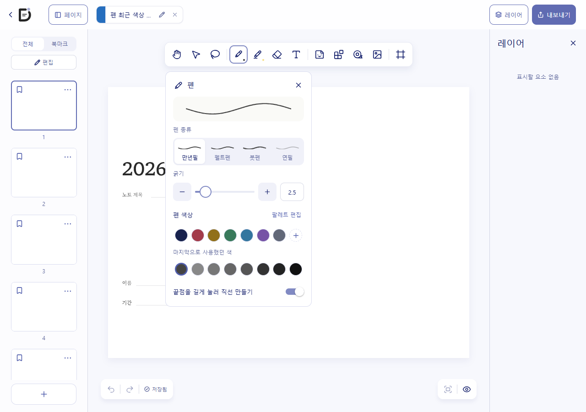

# 공용 색 창과 고정 팔레트

관련 이슈: [S15P31F106-439](https://ssafy.atlassian.net/browse/S15P31F106-439)

## 사용 방법

- 평소 기본색을 누르면 적용한다. ‘팔레트 편집’ → 기존 칸 선택 → 공용 색 창에서 바꾸고 닫으면 그 칸에 저장한다. ‘편집 끝내기’로 일반 선택으로 돌아온다. 칸 추가·삭제는 제공하지 않는다.
- 펜·형광펜의 기본색 7개 옆 원형 +는 현재 도구 색을 직접 지정한다. 팔레트를 덮어쓰거나 사용자 색 컬렉션을 만들지 않는다.
- 실제 필기한 최근 색을 8개까지 기록한다. 선택만 하면 이력을 바꾸지 않는다. 재사용한 색은 맨 앞으로 옮긴다. 기본색과 최근색은 같은 28px 원, 폭 1/8·높이 38px 칸을 사용한다.
- ‘내 색상’ UI는 앱 전체에서 제거했다. 이전 사용자 색 저장 자료는 읽거나 삭제하지 않는다.

## 공용 창과 스포이트

- PresetColorEditor 하나로 통합했다. 제목/X, SV·색상·채도·명도, HEX와 스포이드 아이콘을 제공한다. 정상 닫기(X·바깥·뒤로가기)는 확정, 회전은 창을 닫는다. 기존 실시간 미리보기 호출부는 유지한다.
- Android/iOS는 기존 captureScreenSampler로 앱 전체 화면을 캡처한다. 캔버스 전용 연결은 제거했다. 웹은 브라우저 EyeDropper를 쓴다.
- 앱은 상단 알약, 3배 원형 돋보기, 새 색/원래 색 반원 테두리와 중앙 조준 칸을 사용한다. 색 창과 스포이트 UI는 캡처 전에 숨긴다. 화면 회전·백그라운드·입력 취소 시 종료하며 늦게 도착한 캡처도 해제한다.
- 일반 펜의 마지막 선택색 복원은 유지한다. 기존 문서의 획 색·서버 API는 바꾸지 않는다.

## 저장·복구

- 편집기와 공방은 기존 `dio-editor-palette-v1:<scope>`를 공유한다. pen/highlighter/text/tape 외에 paper/paperLine 범위를 추가했다. 기존 문서 색은 자동 변경하지 않는다.
- 읽기 성공 후 편집한다. 쓰기는 직렬화하고 디스크 저장 성공 후 반영한다. 실패 시 기존 팔레트와 창을 유지하고 재시도를 안내한다.
- 중복 색도 칸을 합치지 않는다. 예전 짧은 팔레트는 저장된 앞부분을 유지하고 나머지 칸은 기본값으로 복원한다.
- 최근색 저장 키는 유지한다. 기존 7개 기록을 그대로 복원하며 이후 실제 사용 시 최대 8개를 보관한다.

## 검증

- 관련 Node 테스트 81개 통과: 공용 창·직접 지정·고정 칸 저장·오류 복구·최근 8색·테이프·도형·다이어리/속지·펜 복원·화면 스포이트 수명 관리.
- `EXPO_QA_PORT=8089 node tests/recent-pen-colors-browser.cjs`: 실제 EditorScreen에서 직접 지정·8색 실제 필기·재사용 정렬·재로드와 기본/최근 칸의 x/폭/높이 일치 검증.
- `EXPO_QA_PORT=8089 node tests/palette-browser.cjs`: 실제 편집기/공방 6범위 저장·오류 후 재시도·재로드·회전 취소·문서 불변·390×844/320×740/844×390 창 경계 검증. 브라우저 스포이트 연결은 OS 창 자동 조작이 불가능해 API 결과를 대체했으며 실제 화면 픽셀 검증이 아니다.
- 앱 스포이트 테스트는 모의 화면 캡처로 놓기 위치·캔버스 밖 좌표·UI 숨김·자원 해제를 검증했다. Android/iPad 실기기 캡처와 좌표 정합은 미검증이다.
- 로컬 index.js 기반 웹·Android·iOS 전체 export 종료 코드 0, 실제 Expo Go Android 소스 번들 HTTP 200과 변경 코드 포함 확인.
- 공유 node_modules junction 환경에서 expo/AppEntry가 외부 App.js를 해석한 문제를 막기 위해 로컬 index.js를 명시했다. 이전 기본 진입 export는 현재 앱 검증 근거로 사용하지 않는다.

## 웹 화면

위 이미지는 Windows Edge의 실제 EditorScreen 테스트 화면이다. 실기기 검증 자료가 아니다.

## MR !316 WARN 반영

테이프 드로어의 공용 팔레트에서 이전 가로 스크롤용 음수 여백과 미사용 보정 스타일을 제거했다. Windows Edge 실제 EditorScreen에서 제목·편집 버튼·색상 칸이 검색란과 같은 본문 여백 안에 드는지 검사했고 공용 팔레트 브라우저 검증 및 관련 Node 테스트 18개가 통과했다. 이번 변경은 레이아웃만 수정하며 INFO 3건은 변경하지 않았다. 실기기 재검증과 전체 번들 생성은 반복하지 않았다.

## MR !316 develop 충돌 해결 (2026-11-03)

- develop `96c11bff`를 병합했다. 팔레트 통합·직접 지정·최근 8색·공용 전체 화면 스포이트를 유지하며, 삭제한 MyColorPresets UI는 복원하지 않았다. 기존 저장 키의 보존 정책은 그대로다.
- 최신 모바일 `renderPanel`·시트 카드·제목 드래그 닫기와 FadeScroll을 펜·텍스트 설정에 유지했다. 시트 너비를 반영하는 테이프 열 계산과 기존 WARN 수정인 본문 여백도 유지한다.
- 속지의 EditablePalette와 최신 PaperFontDropdown을 함께 유지하고, 디오&모아 기본 스티커 및 최근 사진 패널 변경도 병합했다. 가이드와 색인은 양쪽 항목을 보존했다.
- `npm run test:eyedropper` 16건, `npm run test:pen` 137건, tape-drawer/text-settings-ios-font/builtin-stickers/photo-panel/tool-panel-placement 31건 통과(명령 합계 184건). 최초 제한 환경의 localhost EACCES는 정상 권한으로 재실행하여 통과했다.
- `EXPO_QA_PORT=8094 node tests/palette-browser.cjs` 통과: 실제 EditorScreen의 6개 팔레트 범위, 편집·저장 실패 재시도·재실행 복원·최근 8색·테이프 본문 여백·390×844/320×740/844×390 색 창 배치. 브라우저 EyeDropper는 API 대체를 통한 연결 검사다.
- 로컬 index.js 기준 `expo export --platform web --output-dir .expo/mr316-merge-web --max-workers 2` 성공. Android·iPad 실기기와 실제 네이티브 화면 캡처는 이번 충돌 해결에서 재검증하지 않았다.

## MR !316 최신 WARN: 재시도 오류 문구 복구 (2026-11-03)

`7f039614` 기준 최신 리뷰의 WARN 1건을 반영했다. 팔레트 불러오기 재시도를 시작할 때 이전 오류 상태를 초기화하며, 재시도가 다시 실패하면 오류를 표시한다. 성공 시 재시도 안내와 이전 오류 문구가 모두 사라진다.

실제 EditablePalette의 실패 → 성공 재렌더링 회귀 테스트를 추가했다. 수정 전에는 오류가 남아 실패함을 확인했고, 수정 후 `npm run test:eyedropper` 17건이 통과했다. 변경분 공백 검사도 통과했다. 작은 오류 상태 변경이므로 전체 번들·실기기 검사는 반복하지 않았다. 같은 리뷰의 INFO 4건(저장 실패 후 취소, 앵커, 레이스 색상, 추가 단위 테스트 범위)은 이번 수정 대상에 포함하지 않았다.
# MR !316 최신 WARN: 기본 색 복원 오류 안내 (2026-11-03)

- `6deb3e08` 기준 최신 리뷰의 WARN 1건만 수정했다. StudioPresets의 기본 색 복원이 실패한 뒤 재시도할 때와 성공했을 때 이전 오류를 지운다.
- 오류 안내는 디자인 가이드의 안내 글자(12.5/600, 줄 높이 19)와 작은 오류 글자용 `dangerStrong`을 사용한다.
- 실패 후 재시도 중·성공 후 오류가 없어지고 기본 색 복원 버튼이 사라지는 회귀 테스트를 추가했다. 수정 전 오류 잔류로 실패, 수정 후 `npm run test:eyedropper` 18개 통과. `git diff --check` 통과.
- INFO인 레이스 단색 표시는 변경하지 않았다. 이번 수정에 대해 앱 전체 빌드와 Android·iPad 실기기 검증은 반복하지 않았다.
