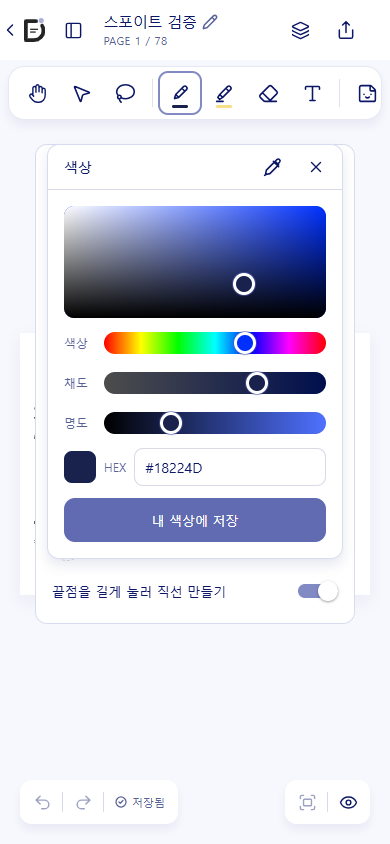

# 펜·형광펜 캔버스 스포이트

관련 이슈: [S15P31F106-439](https://ssafy.atlassian.net/browse/S15P31F106-439)

## 사용 방법

펜·형광펜 설정의 ‘내 색상’ +를 누르면 독립 색 선택 창이 열린다. 설정 옆 공간이 없으면 반대편 또는 화면 안에 배치한다. 팔레트·HEX로 현재 도구의 색을 바꾸고, ‘내 색상에 저장’으로 프리셋을 명시적으로 저장한다. 우상단 스포이트 아이콘을 누르면 같은 편집 화면에서 누르거나 끌어 색을 고른다. 십자선·원형 확대 미리보기·HEX를 보여주며 손을 떼면 색을 적용하고 색 창으로 돌아온다. 선택 중 안내 문구는 표시하지 않고 취소 버튼만 제공한다.

## 구현과 데이터 영향

- 속지·사진·스티커·텍스트·필기 그림 층만 한 번 캡처한다. 격자·선택 테두리·도구 UI는 제외한다.
- 긴 변 최대 2048px의 PNG를 RGBA로 한 번 해석하고 포인터 픽셀을 평균 없이 읽는다. 캡처 실제 크기와 확대·이동 좌표를 반영한다.
- 캡처와 픽셀 버퍼는 기기 안에서만 처리하며 완료·취소·실패 시 해제한다. 뒤늦게 완료된 캡처도 폐기한다.
- 페이지 밖 놓기·입력 취소·뒤로가기·Esc·백그라운드·페이지/내용/화면 크기 변경은 색을 적용하지 않는다. 캡처 실패는 기존 색을 유지하고 재시도를 제공한다.
- 문서 형식·서버 API·기존 획은 변경하지 않는다. 새 네이티브 모듈을 추가하지 않는다.
- 공용 PresetColorEditor와 기존 웹/네이티브 eyedropper 유틸은 보존한다. 캔버스용 유틸은 canvasEyedropper.js로 분리한다.
- iPad 점진 렌더링은 일반 페이지 전환에서 유지하고 캡처 중에는 전체 그림을 표시해 일부 획만 캡처하지 않게 한다.
- 네이티브 측정이나 프리셋 복원이 늦어도 + 클릭은 즉시 창을 연다. RN 0.88에서 제거된 absoluteFillObject 대신 명시적 절대 좌표를 사용한다.

## 검증 기록 (2026-11-03)

- `node --test tests/color-picker-opening.test.js tests/color-picker-placement.test.js tests/eyedropper.test.js tests/capture-pixels.test.js`: 14개 통과.
- 펜 설정·펜 입력·형광펜·페이지 이미지 회귀: 39개 통과. 네이티브 페이지 준비/점진 표시 회귀: 2개 통과.
- `EXPO_QA_PORT=8084 node tests/eyedropper-browser.cjs`: Windows Edge 실제 EditorScreen, 1280×800 / 390×844 / 844×390 통과. 반투명 합성 색상 #8A315C, 사진 #E08020, 펜·형광펜 적용, 프리셋 저장, 취소·회전·실패/재시도·늦은 캡처 해제, 문서 불변을 확인했다.
- `expo export --platform all --output-dir .expo/eyedropper-publish-export`: Android/iOS Hermes 및 웹 산출물 생성 완료. CLI는 산출 완료 뒤 종료 지연 경고를 남겼다. 앱 설치·실기기 실행 검증과는 별개다.
- 이전 혼합 작업 폴더에서는 Android 에뮬레이터의 Expo Go로 + 열기와 펜·형광펜 색 적용을 확인했다. 이 분리 브랜치의 실기기 Android/iPad 재검증은 수행하지 않았다. 에뮬레이터 및 브라우저 검증을 실기기 검증으로 간주하지 않는다.
- Expo Go 시작 시 발생한 ExpoCrypto/Reload 문제는 별도 사안이며 이 변경으로 해결됐다고 판단하지 않는다.

## 화면 자료

