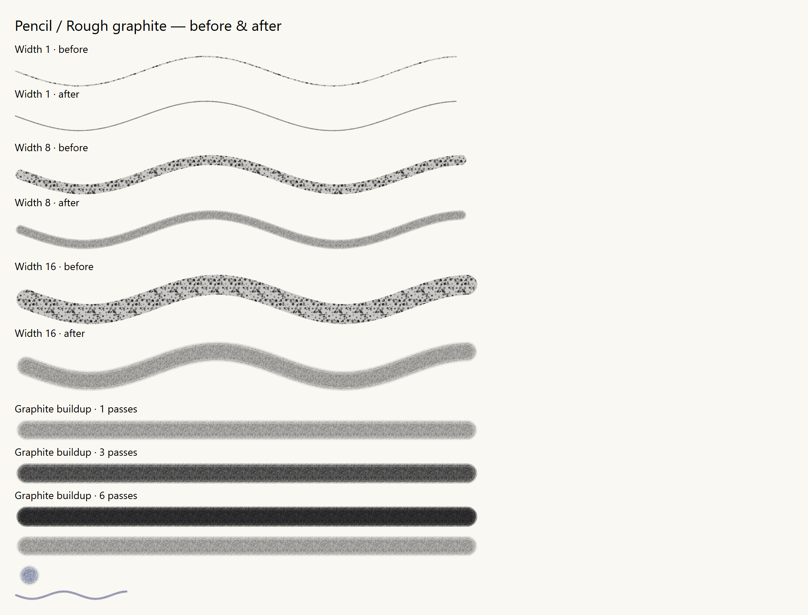

# 연필 흑연 질감 개선

관련 Jira: [S15P31F106-178](https://ssafy.atlassian.net/browse/S15P31F106-178)

## 목표와 비교

2026-10-21 사용자가 이 채팅에서 **거친 스케치 연필: 입자와 결이 뚜렷한 질감**을 선택했다. 아래는 실제 공통 StrokeContent와 변경 전 패턴을 같은 곡선으로 렌더링한 비교 이미지다. 사용자가 추가로 제공한 흑연 면칠·감자 소묘·나무 소묘 이미지의 미세 종이 결을 목표로 재조정했다. 비교 이미지는 브라우저 렌더링이며 iPad 캡처는 아니다. 기기 확인 시 이 이미지를 기준으로 질감의 강도를 조정한다.

## 구현

- 기존 원형 입자 패턴을 불규칙한 흑연 입자·짧은 섬유 결로 교체했다. 화면에서 1px보다 작던 미세 가루층은 바탕 농도에 합쳤다. 색상은 선택한 펜 색을 사용하며 종이 색을 덮는 흰색 입자를 넣지 않는다.
- 굵기와 무관하게 작은 종이 결을 유지하고 굵기 1~2에는 더 진한 연속 바탕을 남겨 가는 글씨의 가독성을 확보한다. 실제 Pencil 압력·기울기는 연동하지 않는다.
- 입자는 모듈 초기화 때 고정 생성하고 두 개의 SVG Path로 묶는다. 좌표는 10배 정수로 적어 획마다 복사되는 경로 문자열을 줄인다. 획의 점 개수에 따라 입자 노드가 늘어나지 않는다. 같은 저장 좌표에서 다시 렌더링하면 같은 패턴이다.
- 공통 StrokeContent에 연필 전용 컴포넌트를 연결해 필기 미리보기·캔버스·설정 미리보기·썸네일·출력 surface에 적용한다. renderVersion 2 연필의 표시가 바뀌며 기존 저장 문서도 다시 열면 새 질감으로 보인다. 데이터 형식은 변경하지 않았다. 이전 버전의 점선 연필 분기는 유지한다.
- 177번은 다른 작업 폴더에서 StrokeContent와 strokes/eraser를 수정 중이다. 이 브랜치는 `feature/fe/pencil-graphite`, 작업 폴더는 `DIO-Pencil`이며 시작 기준은 develop `8919b3d`다. 공통 StrokeContent에서 충돌할 수 있으므로 병합 때 177번의 만년필·붓펜 변경과 연필 전용 분기를 모두 보존해야 한다.

## 검증 결과

- `node --test tests/pen-settings.test.js tests/pen-input.test.js tests/eraser.test.js tests/highlighter.test.js`: 27개 통과.
- `node --test tests/area-eraser.test.js tests/editor-history.test.js`: 9개 통과.
- 전용 Metro 8097 실행 후 `node tests/pencil-texture-browser.cjs`: 굵기 1·8·16 × 배율 0.5·1·2.5 × 흰색·크림색 종이 18개 조합 통과. 테스트는 이 포트의 전용 서버를 사용하며 177번 개발 서버와 구분한다.
- 위 조합에서 가시 픽셀과 중간 빈 열이 없는 것을 확인했고, JSON 복원 전후 SVG가 같고 픽셀 오차가 허용치 이내임을 확인했다. 최종 실행의 복원 픽셀 차이는 모두 0이다. 단일 탭, 두꺼운 직선의 농담 차이, 패턴 ID 중복 없음도 확인했다. 수평 진행 곡선에 대한 픽셀 검사이며 모든 필체를 입증하지 않는다.
- 데스크톱 Edge headless, deviceScaleFactor 2의 500획 fixture 갱신은 최신 실행에서 약 168ms였다. 실제 손글씨 입력 지연·이전 구현 대비 성능·iPad 성능 측정이 아니다. [원시 결과](./qa-pencil-texture-results.json)를 함께 저장했다.
- 초기 구현에서 `expo export --platform ios --output-dir .expo/pencil-ios --max-workers 2` 통과. Hermes 번들에 새 흑연 컴포넌트 문자열이 포함됨을 확인했다. Windows에서 만든 JS/Hermes 번들이며 iOS 네이티브 앱 빌드·기기 실행은 아니다.
- 초기 검증에서는 node_modules 미연결 및 샌드박스의 Edge/서버 접근·Hermes 임시 파일 권한 문제로 실패했다. 기존 설치 의존성을 연결하고 허용된 로컬 실행으로 재검증했다. 브라우저 복원 검사는 동일 SVG를 필수로 확인하고 Edge의 프레임별 알파 양자화 오차만 최대 3/255·평균 0.25/255 미만으로 허용한다.

## 남은 iPad 확인

Jira는 진행 중으로 유지한다. 기기 모델·iPadOS·Expo/앱 버전·Apple Pencil·굵기·배율을 기록하고 다음을 확인해야 한다.

- 비교 이미지 기준 질감 강도 합의, 빠른 글씨·겹쳐 칠하기·단일 탭·여러 방향 곡선에서 끊김이나 주기적인 무늬가 거슬리지 않는지.
- 최소·중간·최대 굵기와 확대/축소, 종이 색 변경, 저장·앱 재실행 복원, 획/영역 지우기·Undo/Redo.
- PNG/PDF의 실제 기기 출력, 기존 연필 문서가 새 질감으로 바뀌는 모습.
- 500개 이상 요소가 쌓인 문서에서 입력 지연과 메모리, 다른 펜 표현 회귀. 데스크톱 측정값을 기기 통과 근거로 사용하지 않는다.

## 참고 이미지 반영 후 재검증

- 큰 점무늬를 1,649개의 미세 입자와 110개의 짧은 결로 교체했다. 이후 아래 '획당 무늬 데이터 축소'에서 미세 가루 1,024개를 바탕 농도로 합쳤다.
- 3개의 반투명 획을 같은 경로에 포개 중심과 가장자리 농도를 다르게 했다. 반복 필기 시 흑연 농도가 누적된다. 실제 압력/기울기와 획 진행 방향을 추종하는 입자 방향은 아직 구현하지 않았다.
- 브라우저 18개 조합·복원·단일 탭·패턴 ID 검사를 재통과했다. 1/3/6회 겹친 면의 평균 어두움(흰색 대비 0~255)은 약 50/97/122로 증가했다. 최신 측정값과 비교 이미지로 자료를 교체했다.
- 이전 iOS 번들 통과는 초기 구현 결과다. 이번 조정은 8098 Expo 서버에 반영했으며 실제 iPad 화면과 지연은 사용자 재확인 대기다.

## 획당 무늬 데이터 축소

연필 획은 각자 `<Pattern>`을 가지므로 무늬 경로가 획 수만큼, 캔버스와 페이지 목록 썸네일에 각각 복사된다. 리뷰에서 획당 경로 문자열이 약 108KB라 연필 획 300개 페이지의 DOM 경로 데이터가 약 67MB(develop 약 0.6MB)로 늘어나는 것을 확인해 다음처럼 줄였다.

- 화면에서 1px보다 작던 미세 가루층(1,024개, 덮는 면적 약 31%, 불투명도 0.58)을 경로에서 빼고 바탕 농도를 0.24→0.38(굵기 2 이하), 0.1→0.26으로 올려 같은 톤을 유지했다.
- 남은 입자 625개·결 110개의 좌표를 무늬 viewBox 240(기존 24의 10배) 기준 정수로 적었다. 반복 간격(페이지 좌표 12)과 입자 배치는 그대로다.
- 획당 무늬 경로: 108,502자 → 16,389자. 연필 획 300개 페이지의 DOM 경로 데이터: 약 66.9MB → 약 11.7MB. 같은 페이지에서 Ctrl+휠 확대 5회 반응: 385~498ms → 312~450ms(데스크톱 Chromium, 2회 측정). develop의 약 0.6MB·약 280ms보다는 여전히 무겁다.
- 같은 문서를 웹 편집 화면(deviceScaleFactor 2)에서 비교한 평균 어두움(0~255)과 질감 표준편차는 굵기 1/3/8/16에서 56.3/70.7/75.5/79.2 → 58.5/71.8/76.0/78.7, 1/3/6회 겹침에서 79.2/149.3/188.3 → 78.8/149.5/188.6이다. 300% 확대 화면도 육안으로 차이가 거의 없다.
- `node tests/pencil-texture-browser.cjs`(Metro 8097, Playwright Chromium)를 재통과했다. 18개 조합, 복원 픽셀 차이 0, 겹침 어두움 50/99/125, 단일 탭, 패턴 ID 중복 없음, 획당 무늬 경로 20,000자 미만 검사를 포함한다. 비교 이미지와 원시 결과를 이 실행 결과로 교체했다.
- iPad 실기기 성능은 아직 확인하지 않았다. 연필 획이 많은 페이지의 필기 지연·확대/이동·메모리를 기기에서 확인해야 한다.
