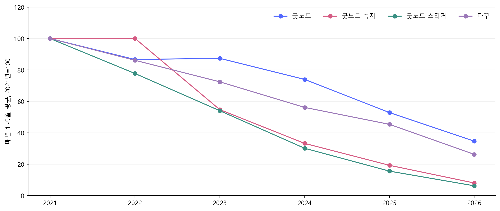
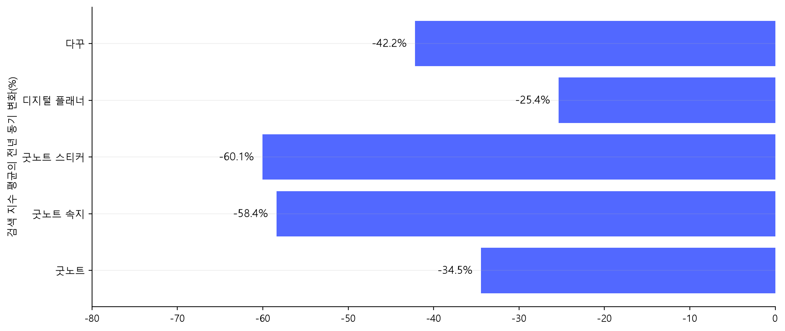
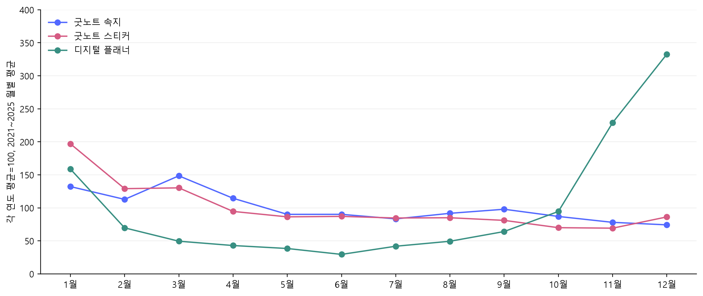
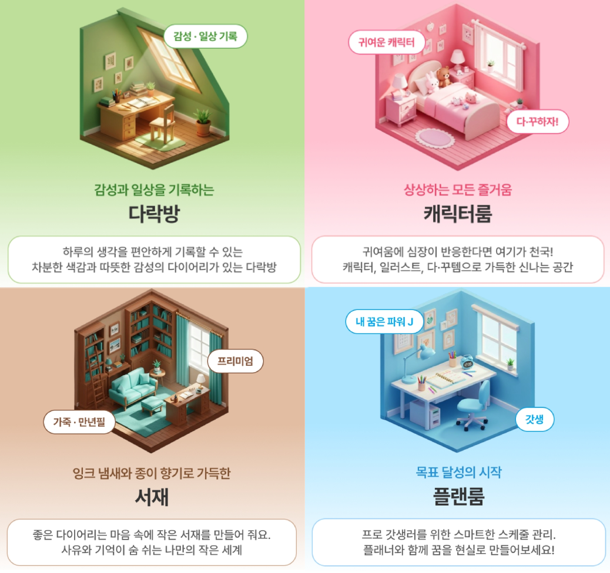
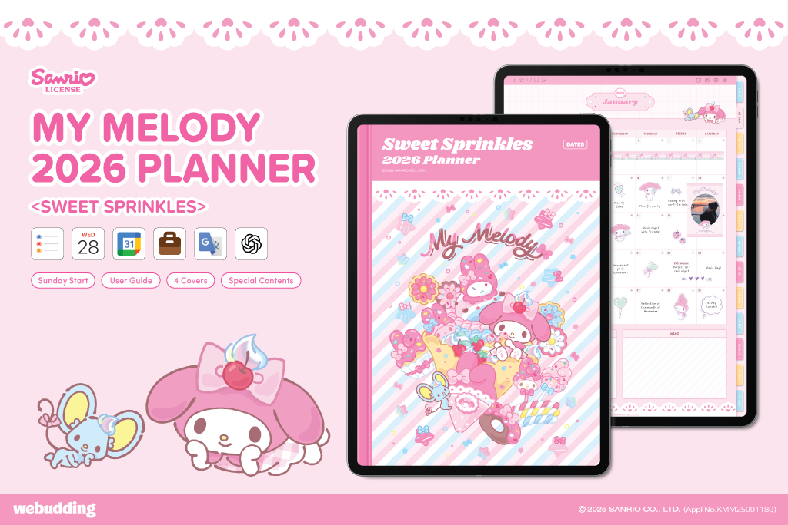
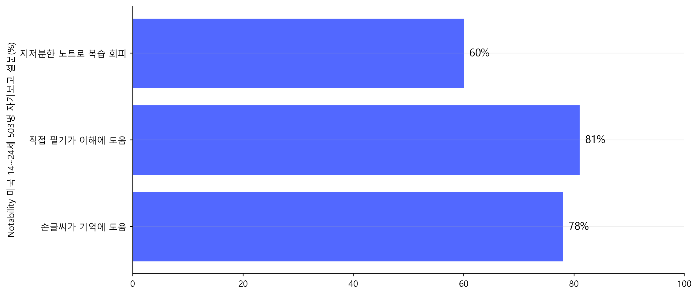

# 디지털 다꾸 시장 심층 조사

조사 기준일: 2026-10-27. 검색 데이터: 2021-01~2026-09, 월간 69개 시점 × 15개 그룹. 이 문서는 제공된 속지·에셋 기획과 1차 멘토링 사업화 자료를 보완하는 시장 조사다. 원본의 다른 장표는 유지하고 시장 분석을 별도 발표자료로 확장한다.

## 1. 조사 결론과 발표에서 쓸 수 있는 주장

**국내 포털에서 굿노트 소재를 찾는 관심은 감소했지만, 디지털 문구의 유료 상품 공급과 필기 앱 안의 유통은 존재한다. DIO는 전체 시장의 고성장을 전제하기보다, 특정 기록 목적과 친구 관계에서 반복 사용·결제를 검증해야 한다.**

| 질문 | 이번에 확인한 사실 | 판단과 한계 |
|---|---|---|
| 검색 관심이 커지는가? | 네이버의 굿노트 속지·스티커 그룹은 2026년 1~9월 지수 평균이 전년 동기보다 각각 58.4%, 60.1% 낮음 | 검색 경로의 약화. 전체 매출 감소율이나 유료 이용자 감소율이 아님 |
| 목적에 따른 차이가 있는가? | 스터디플래너는 같은 계산으로 7.5% 증가 | 종이·디지털 혼합 검색어이므로 디지털 플래너 성장률로 전용할 수 없음 |
| 팔리는 상품 형태가 존재하는가? | 위버딩 공식 안내는 작가 2,000명 이상, 상품 2만 개 이상. 굿노트 공식 추천에는 $9.99~$14.99 플래너가 제시됨 | 공급·표시가격 근거. 판매량·평균 객단가·국내 시장 규모는 미확보 |
| 소비 동기는 무엇인가? | 기능성 기록, 취향 표현, 캐릭터, 추억 보존, 함께 만들기의 사례를 확인 | 목적별 수요 탐색에 활용. 유형별 고객 비중은 추정하지 않음 |
| DIO 기회는 어디인가? | 기존 자료는 동일 페이지의 공동 꾸미기와 질문·차례·완성 상태를 제안 | 공동 경험에 대한 차별화 가설. 경쟁 기능 부재나 지불 의사 입증은 아님 |

이 결론은 검색 감소를 감추지 않는다. 성장 기사만 골라 배열하면 투자·개발 판단을 왜곡할 수 있다. 검색은 탐색 수요의 일부이고, 유통·제품·행동 연구는 서로 다른 층위의 증거다. 각 자료가 무엇을 측정하는지 분리한다.

## 2. 제공 자료를 어떻게 연결했는가

검토 대상은 원본 멘토링 PPT의 7페이지 사업화 항목, 「01 트렌드 조사.md」, 「속지 에셋 아이디어.pdf」와 대응 카탈로그, 기존 「사업화 상세 조사.md」다. 기존 문서에서 정리한 117종은 기획 아이디어 수이며 판매 실적이 아니다. 일반 속지, 정적 에셋, 참여 상태가 있는 온라인 속지·에셋을 같은 수익모델로 묶기 전에 각각 사용 목적을 확인해야 한다.

원본의 속지+스티커+테이프+배경지+글꼴+팔레트 구성은 시장의 테마 묶음과 비교할 수 있다. 다만 기존 자료에 제안된 광고 제거 가격·구독·방 나눔은 확정 정책으로 취급하지 않는다. 이번 분석에서는 소재 수가 아니라 선택, 실제 페이지 적용, 상대방 참여, 재방문, 구매까지의 흐름을 평가 단위로 삼는다.

이전 에이블리·29CM 거래액 비교는 배경 참고로 남기고, 주된 사례는 요청대로 텐바이텐과 위버딩으로 바꿨다. 텐바이텐에도 온라인 쇼핑과 배송이 있으므로 두 사례를 ‘오프라인 판매 대 온라인 판매’로 단정하지 않는다. **실물 문구의 유통·취향 선택 사례와 디지털 문구의 유통·앱 활용 사례**로 비교한다.

## 3. 검색 데이터의 수집 조건과 재현 방법

네이버 데이터랩 공개 화면에서 조회하고 공식 다운로드 XLSX 3개를 보관했다. 각 파일에 결과 URL, 기간, 성별·연령·범위 조건과 숫자가 포함된다. 숫자는 별도 CSV와 JSON으로 정리했다. 다운로드 원본은 수정하지 않았다. [S1~S4]

| 항목 | 조건 |
|---|---|
| 서비스 | 네이버 데이터랩 검색어트렌드, 통합 검색 |
| 기간 | 2021년 1월~2026년 9월, 월간. 진행 중인 2026년 10월 제외 |
| 성별·연령·기기 | 전체, 필터 미지정 |
| 지역 | 네이버 검색 서비스 자료. 국내 관심의 참고 지표이며 대한민국 거주자만의 모집단으로 단정하지 않음 |
| 표본 단위 | 검색어 그룹의 월별 상대 지수. 사람·계정·구매·매출이 아님 |
| 수집일 | 2026-10-27 |
| 비교 원칙 | 동일 요청 안의 동일 그룹·동일 길이 기간을 비교. 요청 사이의 지수 크기는 직접 비교하지 않음 |

네이버는 조회기간 내 최다 검색을 100으로 둔 상대 지수를 제공하며 절대 검색 횟수를 공개하지 않는다. 하위 검색어는 묶어 조회한다. 입력 후 화면과 파일에서 공백이 제거된 형태를 확인해 같은 표현을 중복 입력하지 않았다. 검색어의 포괄 범위는 검색 서비스의 처리 방식에 의존하며 전체 관련 검색을 빠짐없이 수집한 것은 아니다. [S4]

이번 결과를 ‘월 3만 건’ 같은 절대 검색량으로 바꾸지 않는다. 검색광고 키워드 도구의 PC·모바일 절대량은 별도 접근·추출을 하지 못했으므로 넣지 않았다. Google Trends는 직접 조회 시 429 오류로 시계열을 확보하지 못했다. 해외 수요는 Google 검색 곡선을 추정하는 대신 공개된 Etsy 내부 검색 조사와 공식 플랫폼 자료로 보완했다. 두 플랫폼 지수를 연결한 합성 곡선은 만들지 않는다.

### 3.1 실제 조회한 15개 그룹

| 묶음 | 그룹 이름 | 하위 검색어 |
|---|---|---|
| A 핵심 | 굿노트 | 굿노트, goodnotes |
| A 핵심 | 굿노트 속지 | 굿노트속지 |
| A 핵심 | 굿노트 스티커 | 굿노트스티커 |
| A 핵심 | 디지털 플래너 | 디지털플래너 |
| A 핵심 | 다꾸 | 다꾸, 다이어리꾸미기 |
| B 탐색·구매 | 무료 속지 | 굿노트속지무료, 무료굿노트속지, 굿노트무료속지 |
| B 탐색·구매 | 무료 스티커 | 굿노트스티커무료, 무료굿노트스티커, 굿노트무료스티커 |
| B 탐색·구매 | 유료·구매 | 굿노트속지구매, 굿노트스티커구매, 굿노트유료속지, 굿노트유료스티커 |
| B 탐색·구매 | 디지털 다꾸 | 디지털다꾸, 디지털다이어리, 아이패드다꾸 |
| B 탐색·구매 | 위버딩 | 위버딩, webudding |
| C 인접 수요 | 스터디플래너 | 스터디플래너 |
| C 인접 수요 | 아이패드 필기 | 아이패드필기 |
| C 인접 수요 | 삼성노트 속지 | 삼성노트속지, 삼성노트템플릿 |
| C 인접 수요 | 교환일기 | 교환일기, 교환일기앱 |
| C 인접 수요 | 디지털 스티커 | 디지털스티커, 아이패드스티커 |

‘굿노트 에셋’만 보면 소비자가 쓰는 표현을 놓칠 수 있어 속지·스티커·플래너·기기와 사용 목적을 나눴다. ‘다꾸’와 ‘스터디플래너’에는 실물도 포함된다. ‘교환일기’에는 종이·콘텐츠·앱 탐색이 함께 섞인다. 어느 그룹도 DIO의 직접 고객 수로 취급할 수 없다.

### 3.2 계산식

최근 변화율 = (2026년 1~9월 지수의 평균 ÷ 2025년 1~9월 지수의 평균 - 1) × 100. 같은 요청 안의 시계열이므로 정규화 상수는 비율 계산에서 상쇄된다. 9개월 합계로 계산해도 동일하다. 수치가 0인 분모는 계산하지 않는다.

장기 비교 차트는 매년 1~9월 평균을 사용하고 각 그룹의 2021년 값을 다시 100으로 놓았다. 2026년 9개월을 과거 12개월과 섞지 않는다. 서로 다른 그룹의 시작점이 모두 100이므로 이 차트는 변화 방향을 보여 주며 검색량 크기 순위는 보여 주지 않는다.

계절성은 2021~2025년 각 연도의 12개월 평균을 100으로 놓고, 같은 달의 상대값을 5년 평균했다. 연도별 장기 하락의 영향을 일부 줄이지만 연중 하락 추세까지 완전히 제거하지 못한다. 따라서 통계적 계절조정 모형이나 인과 분석으로 부르지 않는다. 최근 연도별 패턴도 원자료에서 함께 확인할 필요가 있다.

## 4. 핵심 검색 수요: 장기 감소와 목적별 차이

아래는 A 묶음 안에서 얻은 지수다. 소수점 네 자리 값은 원자료 분석을 재현하기 위한 것이며 통계적 정확도를 보장하는 신뢰구간이 아니다. [S1]

| 그룹 | 2025년 1~9월 평균 | 2026년 1~9월 평균 | 같은 기간 변화 |
|---|---|---|---|
| 굿노트 | 29.9294 | 19.6135 | -34.5% |
| 굿노트 속지 | 7.3182 | 3.0434 | -58.4% |
| 굿노트 스티커 | 4.9253 | 1.9671 | -60.1% |
| 디지털 플래너 | 0.4272 | 0.3188 | -25.4% |
| 다꾸 | 20.7066 | 11.9756 | -42.2% |

관찰: 소재 검색 감소폭이 앱 이름 검색 감소폭보다 크다. 따라서 단순히 앱 이름을 포함한 무료 자료 검색 유입을 사업의 성장 근거로 삼기는 어렵다. 포털 외부 검색 의존이 줄었을 가능성, 초기 이용자 학습이 끝났을 가능성, 앱 내 구매로 이동했을 가능성, 실제 수요가 줄었을 가능성은 모두 후보 설명이다. 이번 자료는 어느 원인이 맞는지 분리하지 못한다.

2021년은 태블릿 필기·원격학습 관심이 높았을 수 있는 기준 연도다. 이를 이용해 고점 대비 급락만 강조하면 장기 사업 기반을 과소평가할 수도 있다. 그래서 발표에는 장기 곡선과 최근 동일 기간 변화율을 같이 둔다. 코로나가 감소의 원인이라는 인과 주장은 하지 않는다.

시장 판단: ‘검색이 줄었다’와 ‘시장이 사라졌다’는 다르다. 반대로 앱 이용자가 많다는 이유만으로 검색 감소를 무시할 수도 없다. 신규 고객 획득 경로가 무엇인지, 기존 사용자의 재구매가 유지되는지를 따로 측정해야 한다.

## 5. 계절성: 소재와 플래너의 준비 시점은 다르다

| 그룹 | 5년 평균에서 높은 달 | 해당 월의 연평균=100 상대값 | 상품 기획 해석 |
|---|---|---|---|
| 굿노트 속지 | 3월, 1월 | 148.5, 132.2 | 신학기용과 새해용을 별도 준비할 후보 |
| 굿노트 스티커 | 1월 | 197.0 | 새 기록 시작과 꾸미기 소재의 결합 후보 |
| 디지털 플래너 | 12월, 11월, 1월 | 332.8, 228.9, 158.7 | 신년 상품은 연말 전에 발견·미리보기 제공 |
| 스터디플래너 | 1월, 12월 | 174.2, 120.8 | 방학·새해 루틴 테마 실험 후보 |

이 표는 각 연도 평균 대비 상대적인 모양을 정리한 것이다. 예를 들어 플래너의 12월 332.8은 그 달 검색이 전년보다 232.8% 늘었다는 뜻이 아니다. 굿노트 속지가 반드시 연말에 가장 많이 검색된다는 원래의 단순 가정도 지지하지 않는다. 같은 ‘속지’라도 학습 준비와 신년 다이어리는 검색 시점이 다르다. [S1, S3]

DIO에는 연간 날짜형 한 종류에 의존하지 않는 구성을 제안한다. 새해 플래너, 시험·공부 기록, 여행 뒤 추억 정리, 친구와 이어 쓰는 만년형 속지를 각각 검증한다. 검색 계절성만으로 출시 매출을 예측하지 않는다. 연말 성과는 평시 코호트와 구분해 지속 사용을 평가한다.

## 6. 무료 탐색과 결제 의도를 어떻게 해석할까

| B 그룹 | 2025년 1~9월 평균 | 2026년 1~9월 평균 | 변화 |
|---|---|---|---|
| 무료 속지 | 23.6003 | 11.0058 | -53.4% |
| 무료 스티커 | 3.9507 | 1.4319 | -63.8% |
| 유료·구매 표현 | 0 | 0 | 계산 불가 |
| 디지털 다꾸 | 0.6478 | 0.3891 | -39.9% |
| 위버딩 | 5.3587 | 2.7913 | -47.9% |

무료 탐색은 실제로 관측되며 최근에는 감소했다. 다만 키워드 선택 수와 표현이 다르고, 한 사람이 여러 검색을 할 수 있어 ‘무료 이용자 대 유료 이용자 비율’을 이 표로 계산하지 않는다. 무료 검색에도 구매 전 비교 행동이 섞일 수 있다. [S2]

유료·구매 그룹은 최근 두 기간에 0으로 제공됐다. 이것은 **선택한 네 표현으로 구매 수요를 관측하기 어렵다**는 결과다. 판매가 0건이라는 결론이 아니다. 상품명·작가명 검색이나 앱 내 결제로 구매할 수 있고, 낮은 검색량은 제공 과정에서 0으로 보일 수 있다. 0에서 0으로 변한 것을 -100%나 성장률 0%로 제시하지 않는다.

상품 기획 제안: 무료 기본 팩은 첫 경험과 호환성 검증에, 유료 팩은 선택 시간 감소·통일된 테마·편집 가능한 소재·특정 목적의 완성도에 가치를 둔다. 무료 이용자가 유료로 전환할 것이라는 비율은 가정하지 않는다. 미리보기 열람, 실제 적용, 친구의 참여, 결제, 두 번째 팩 구매를 별도 단계로 기록한다.

## 7. 인접 검색: 브랜드보다 목적에서 수요를 찾을 여지

| C 그룹 | 2025년 1~9월 평균 | 2026년 1~9월 평균 | 변화 |
|---|---|---|---|
| 스터디플래너 | 15.4963 | 16.6509 | +7.5% |
| 아이패드 필기 | 1.2015 | 0.4962 | -58.7% |
| 삼성노트 속지 | 1.4170 | 0.8346 | -41.1% |
| 교환일기 | 1.5271 | 0.9761 | -36.1% |
| 디지털 스티커 | 0.7393 | 0.3216 | -56.5% |

디지털 문구 관련 표현 대부분에서 감소를 확인했으므로 굿노트 브랜드 한 개만의 현상이라고 설명하기 어렵다. 한편 스터디플래너의 상대적 견조함은 목적형 탐색을 따로 볼 이유가 된다. 그러나 디지털 상품 비중은 알 수 없으며, 2021년 대비 회복으로 해석할 수도 없다. [S3]

‘교환일기’의 감소도 관계형 서비스가 이미 폭발적으로 성장한다는 주장을 뒷받침하지 않는다. DIO의 공동 기록은 이용자 행동과 실제 초대 전환으로 입증해야 한다. 작은 초기 수요라도 친구 양쪽이 쓰는 이유가 뚜렷하고 유지된다면 탐색 가치가 있다는 것은 제품 가설이지 시장 수치의 결론이 아니다.

추가 키워드 후보는 다음과 같다. 아래 표현은 이번 15개 그룹의 실제 수집 결과에 포함되지 않은 후속 조사 목록이다.

| 목적 | 추가 후보 | 확인하려는 것 |
|---|---|---|
| 학습 | 10분 플래너, 타임테이블, 공부 기록, 오답노트, 시험 계획표 | 일정 관리·기록의 구체 과업 |
| 취향 | 굿노트 다이어리, 마스킹테이프 PNG, 다꾸 스티커, 손글씨 폰트 | 재료 단위와 완성 결과의 표현 차이 |
| 생활 | 독서노트, 가계부 속지, 여행 다이어리, 감정일기 | 연중 지속할 수 있는 기록 목적 |
| 관계 | 커플 일기, 친구 일기, 공유 다이어리, 교환일기 질문 | 단독 기록과 공동 기록의 용어 차이 |
| 호환성 | 노타빌리티 속지, 노트쉘프 템플릿, 갤럭시탭 다꾸, PDF 플래너 | 특정 앱 외부로 확장할 필요 |
| 직접 수요 | 작가명+속지, 캐릭터명+플래너, 상품명+리뷰 | 일반 키워드에서 보이지 않는 상품 탐색 |

## 8. 텐바이텐과 위버딩: 취향 선택을 상품으로 만드는 방식

### 8.1 텐바이텐: 실물 문구의 선택 비용과 사용 장면

공식 사이트에서 디자인 문구, 다이어리·스티커·마스킹테이프 추천 검색, 기획전·브랜드·주문 배송·매장 안내를 확인했다. 온라인 판매도 운영하는 실물 문구 사례다. [S5]

2025-11-04 이투데이 기사는 텐바이텐의 2026년 다이어리 선택 안내를 소개한다. 감성 기록의 다락방, 캐릭터룸, 종이·만년필을 중시하는 서재, 목표 관리의 플랜룸 네 유형이다. 조사일 현재의 판매 성과나 2027년 행사로 바꾸어 쓰지 않았다. [S6]

분석: 선택의 기준이 상품 규격에만 있지 않다. 어떤 사람이며 어떤 기록을 하고 싶은지 먼저 제안한다. DIO도 ‘에셋 100종’보다 공부하기·친구와 여행 회상하기·독서 기록처럼 완성할 장면을 보여 주는 접근을 실험할 수 있다. 실물의 종이 질감·소장·배송은 디지털의 재사용·즉시 적용과 다른 가치다.

### 8.2 위버딩: 작가 공급과 소재를 쓰는 흐름

공식 고객 안내는 작가 2,000명 이상과 상품 2만 개 이상, 플래너·노트·스티커·폰트·브러시·배경·아이콘을 소개한다. 이는 공급 생태계의 존재를 보여 준다. 현재 활동 작가 수, 월 판매량, 구매자 수로 재해석하지 않는다. [S7]

공식 App Store 소개는 쇼핑·보관함과 필기 앱으로 소재를 가져가는 흐름을 설명한다. 스토어 프로모션 이미지는 실제 상품 탐색 맥락을 보여 주는 시각 자료로 사용한다. 개발자 자기소개 수치는 독립 감사 결과가 아니다. [S8]

공식 씨드 안내에 따르면 2024-12-16부터 신규 충전이 중단됐고 충전 없이 작품을 구매할 수 있다. 따라서 과거의 충전형 재화를 현재 필수 구매 구조로 설명하지 않는다. 실제 결제 테스트나 환불 정책 법률 검토는 수행하지 않았다. [S9]

### 8.3 비교와 DIO에 주는 의미

| 비교축 | 텐바이텐 | 위버딩 | DIO의 확인 과제 |
|---|---|---|---|
| 거래 대상 | 종이 다이어리·문구·실물 꾸미기 재료 | 디지털 소재·템플릿 | 공유 페이지에 적용할 소재의 가치 |
| 선택 구조 | 성향·캐릭터·브랜드·사용 장면 | 작가·소재 종류·작품 미리보기 | 상황별 팩이 고르는 시간을 줄이는가 |
| 사용 과정 | 구매·배송·실물 기록 | 구매·다운로드·보관·앱 활용 | 구매 후 친구와 곧바로 쓸 수 있는가 |
| 공급 과제 | 상품 조달·재고·배송 | 작가 확보·권리·파일·호환성 | 초기 직접 제작과 향후 작가 마켓의 구분 |
| 핵심 미확보 정보 | 비교 가능한 문구 부문 매출·구매자 | 비교 가능한 거래액·유료 고객·객단가 | 검증 전 매출·시장 점유율 산정 금지 |

두 회사는 전체 규모를 대표하는 통계 표본이 아니다. 대표 ‘사례’로 사용한다. 시기·범위가 일치하는 매출과 거래액을 확보하지 못했으므로 막대 길이로 두 시장의 크기를 비교하지 않는다.

## 9. 굿노트 생태계: 큰 필기 기반과 유료 소재 시장의 구분

공식 Press Kit는 월간 활성 이용자 2,500만 명 이상을 안내한다. 글로벌 앱 전체 수치이며 국내 이용자, 다꾸 이용자, 소재 구매자를 뜻하지 않는다. About 페이지에는 2,400만 명이라는 별도 표기가 있어 사이트 내 수치 불일치도 확인했다. 이번 문서는 Press Kit의 기준을 명시하고 두 숫자로 성장률을 계산하지 않는다. [S10, S11]

2025-01-24 공식 발표는 위버딩과 함께 산리오 캐릭터의 디지털 플래너·스티커 6개 상품을 출시했다고 설명한다. 팬덤 IP가 디지털 문구로 확장된 사례이며 판매 성공 규모는 공개하지 않는다. [S12]

공식 2026 플래너 추천 글은 2025-12-10 게시됐으며 11개 추천 상품을 $9.99~$14.99로 안내한다. 그중 마이멜로디 $14.99, Smart Daily Tracker $9.99, Smart Professional Planner $11.99를 표본으로 보았다. 추천 상품에 편향된 소규모 관찰로 시장 평균 가격을 추정하지 않는다. 환율·세금·국가·할인에 따른 차이도 있다. [S13]

| 관찰한 상품 예시 | 공식 글 표시가격 | 읽을 수 있는 상품 구성 |
|---|---|---|
| 2026 My Melody Sweet Sprinkles | $14.99 | 캐릭터와 연·월·주·일 기록, 셀프케어 |
| 2026 Smart Daily Tracker | $9.99 | 트래커·생활 기록·스티커와 템플릿 묶음 |
| 2026 Smart Professional Planner | $11.99 | 목표·재무·업무용 기록 구성 |

작가 모집 안내에는 판매별 커미션과 계약 시 요율 안내, 분기 정산을 설명한다. 고정된 공개 수수료를 확인하지 못해 DIO의 요율 근거로 쓰지 않는다. 일반 안내와 달리 별도 신청 화면에는 접수 일시 중단 문구가 있으므로 현재 즉시 입점 가능하다고 말하지 않는다. [S14, S15]

해석: 앱의 설치 기반, 작가 공급, 콘텐츠 상품화가 서로 연결돼 있다. DIO가 기존 대형 필기 앱과 동일한 범용 기능으로 경쟁하면 초기 비용이 커질 수 있다. 대신 특정 공동 기록 과업에서 선택·적용·초대·이어 쓰기 과정을 얼마나 줄이는지 확인할 가치가 있다. 이는 진입 전략 제안이며 시장 점유율 확보의 증거는 아니다.

## 10. 에셋 트렌드: 정적인 PNG를 넘어 편집과 사용성

굿노트 공식 소개는 편집형 스티커의 텍스트·색·레이어 변경을 안내한다. 스티커를 무한 재사용하고 노트 색에 맞출 수 있으며, 해부학·여행·학습처럼 목적이 있는 예시를 보여 준다. 2024년 공개 기능이므로 ‘색을 바꿀 수 있는 에셋 자체’를 DIO만의 최초 기능으로 주장하지 않는다. [S16]

공식 스티커 안내에는 Elements로 소재를 관리하고 외부 JPG·PNG를 가져오는 방법, 색 편집형 마스킹테이프 등도 제시된다. 기능 소개는 실제 이용 빈도·만족도의 통계가 아니다. [S17]

제공 자료와 연결하면 다음 상품 가설이 생긴다. 10분 단위 공부 칸은 펜으로 대략 칠하면 칸 전체가 그 색으로 채워지고, 체크는 체크한 펜 색을 유지한다. 점선 안쪽 그리드는 빈칸의 범위와 완성 상태를 읽기 쉽게 하는 기획 선택이다. 시장 자료가 이런 상호작용의 선호도를 직접 입증하지는 않는다. 실제 필기 방해·오동작·취소 편의까지 비교해야 한다.

| 소비 과업 | 정적 소재의 가치 | 상호작용 가설 | 측정할 행동 |
|---|---|---|---|
| 공부 기록 | 익숙한 10분 시간표 | 칸 자동 채움·총 시간 합계 | 칠하기 시간, 수정 횟수, 합계 신뢰 |
| 취향 꾸미기 | 테마·색·캐릭터 | 색 변경·문구 수정 | 선택 시간, 실제 배치, 다시 쓰기 |
| 공동 일기 | 사진·질문 속지 | 차례·완성·친구 반응 | 양쪽 참여, 응답 지연, 재방문 |
| 추억 보존 | 여행·독서·일상 양식 | 같은 테마에 여러 날 축적 | 검색·다시 보기·완성 기록 수 |

## 11. 해외 소비 동향: 아날로그 회귀도 함께 읽기

Etsy 2026 봄·여름 보고서는 2026-02-10 기준 직전 3개월을 전년 같은 기간과 비교한다. 여행 저널 검색은 두 배, 저널 장식은 +395%, 가죽 저널 커버는 +126%, 메모리 저널은 +189%다. 미국 로그인 이용자 활동과 정규화 검색에 대한 플랫폼 내부 지표이며 국내 디지털 속지 성장률이 아니다. [S18]

이 자료는 촉감과 실물 기록의 회복을 강조한다. 디지털 사업에 유리한 자료로만 읽을 수 없다. 디지털은 실물의 촉각·소장 경험과 경쟁하고, 손글씨 표현·기억 보존의 가치는 참고할 수 있다. 실물 장식 검색을 디지털 유료 수요로 환산하지 않는다.

2026-10-14 게시된 가을·겨울 보고서는 2026-09-14 기준 직전 3개월을 전년과 비교하며, 맞춤 친구 선물 검색 +1,400%, DIY 활동 +8,500%를 제시한다. 이 수치는 넓은 실물·체험 검색어의 변화이고 낮은 기저의 영향도 확인할 수 없다. [S19]

DIO 해석: 함께 만드는 행위와 개인화된 기억 선물을 제품 실험 소재로 삼을 수 있다. 친구 생일 페이지·여행 회상·같은 사진에 덧그리기를 시험할 후보가 된다. 하지만 Etsy 미국 소비자를 한국 DIO의 타깃으로 곧바로 일반화하거나 이 증가율을 매출 전망에 넣지 않는다.

## 12. 소비자 행동 연구: 직접 쓰는 가치와 공동 표현

### 12.1 학습 기록의 수요

Notability는 2026년 7월 미국 14~24세 학생 503명을 조사했다. 손글씨가 타이핑보다 기억에 도움이 된다는 응답 78%, 직접 필기할 때 녹음·전사에만 의존할 때보다 이해가 낫다는 응답 81%, 지저분한 노트 때문에 복습을 피한 경험 60%를 제시한다. AI가 노트를 대신 쓰길 원한 응답은 13%, 이미 쓴 노트를 정리해 주길 원한 응답은 47%다. [S20]

이는 업체가 발표한 자기보고 설문이다. 한국 대표 표본도 아니고 학습 효과를 실험으로 입증한 결과도 아니다. 다꾸·유료 소재 구매율을 측정하지도 않는다. DIO에는 ‘표현을 대신 만드는 자동화’보다 ‘직접 쓴 것을 쉽게 정리하고 읽게 하는 도움’의 수요를 탐색할 참고가 된다. 학생이 정말 자동 채움이나 시간 집계를 원하는지는 별도 확인해야 한다.

### 12.2 함께 쓰고 그리는 행위의 근거

CHI 2026 논문은 CollaNote의 익명 공동 캔버스 600쪽 이상, 이용자 인터뷰 20명, 실시간 상호작용 70분을 분석했다. 예술적 표현, 지지·공유, 관계 형성과 색·공간을 이용한 대화 차례를 관찰했다. 표본과 환경이 제한된 질적 연구이며 시장 크기나 결제율을 제시하지 않는다. [S21]

DIO는 실명 친구 중심의 지속 기록을 제안하므로 익명·휘발성 공개 캔버스와 다르다. 논문 결과를 그대로 전이하지 않는다. 색으로 작성자를 구분하거나 상대방이 이어 쓸 위치를 알리는 설계를 테스트할 근거로 활용한다. 20명을 20% 같은 선호율로 바꾸지 않는다. 공동 표현이 실제 관계 유지에 도움이 되는지, 누군가 쓰지 않을 때 부담이 생기는지도 관찰해야 한다.

## 13. 기기 기반과 시장 규모의 경계

IDC는 2025년 세계 태블릿 출하량 1억 5,190만 대를 안내한다. 별도 2026년 2분기 자료는 3,360만 대, 전년 동기 대비 -12.3%를 제시한다. 전자는 연간 수치이고 후자는 분기 수치이므로 직접 비율을 계산하지 않는다. 출하량은 기존 설치 기반이나 한국 필기 사용자 수가 아니다. [S22, S23]

따라서 ‘태블릿이 늘어나니 디지털 다꾸도 자동으로 성장한다’는 주장은 보류한다. 기존 기기 이용자의 사용 목적과 결제 습관이 더 직접적이다. 신규 기기 구매 부담이 커져도 기존 사용자 대상 소재 소비가 유지될 수 있지만, 이를 확인할 구매 데이터는 확보하지 못했다.

이번 공개 조사에서 **한국 디지털 다꾸만 분리한 총거래액, 유료 고객 수, 객단가, 침투율**을 검증 가능한 동일 기준으로 확보하지 못했다. 일반 문구 시장, 노트 앱 시장, 세계 태블릿 시장, 크리에이터 경제 규모를 디지털 다꾸 TAM으로 합치지 않는다. 조사 방법·정의가 없는 유료 시장조사 판매 페이지의 CAGR도 핵심 근거에서 제외했다.

규모 추정은 조건부 계산으로 남긴다. 연간 소재 거래액 = 확인된 대상 활동 이용자 × 연간 유료 구매 비율 × 유료 구매자의 연간 구매액. DIO 순매출은 플랫폼·환불·작가 정산 등을 추가 반영해야 한다. 이번에는 세 항목의 국내 실측 기반이 없어 가상의 숫자를 채우지 않았다.

## 14. DIO에 적용할 가설과 검증 순서

### 14.1 무엇을 먼저 실험할까

| 후보 | 근거 | 검증 전제 | 초기 관찰 |
|---|---|---|---|
| 공부 기록 팩 | 스터디플래너 관심의 최근 증가, 기록 정리 수요 | 검색의 실물 비중과 디지털 선호 미확인 | 기존 시간표로 기록하는 사람의 실제 과업 |
| 취향 테마 팩 | 텐바이텐 유형 선택, 위버딩·굿노트 상품 사례 | 테마가 구매 이유인지 미확인 | 낱개보다 묶음의 선택·적용 시간 |
| 친구 추억·교환 팩 | 공동 필기 질적 연구, 개인화·친구 소비 사례 | 한국 친구 2인의 반복 사용 미확인 | 초대 수락, 양쪽 편집, 다음 기록 |
| 편집형 소재 | 굿노트의 색·문구 수정 상품 | 기능 존재만으로 경쟁 우위 없음 | 원하는 색으로 바꾸고 다시 쓰는지 |

기능을 많이 넣기보다 한 과업을 완성하는 시간을 비교한다. 사용자는 종이, 기존 노트 앱, 사진·메신저를 계속 쓸 수 있다. 바꾸는 수고보다 개선 폭이 커야 한다. 선호 응답보다 실제 적용·완성·재방문을 관찰한다.

### 14.2 실험 설계 제안

1차는 기존 디지털 기록 사용자와 친구를 쌍으로 모집한다. 무료 자료만 쓰는 그룹과 최근 실제 소재를 산 그룹을 구분한다. 최근 한 달에 사용한 페이지·소재·검색·지출·중단 이유를 확인한 뒤 같은 사진에 기록을 남기게 한다. 특정 연령·성별을 전체 시장의 대표로 선언하지 않는다.

2차는 무료 기본 팩과 목적형 유료 후보의 미리보기를 비교한다. 결제 없는 가격 설문과 실제 구매 행동은 구분한다. 유료 실험을 진행하면 총노출·사용자·친구 쌍·구매자 중 어느 분모인지 기록한다. DIO의 방 공유 권리는 별도 정책이므로 친구가 이미 무료로 쓸 수 있는 상황에서 중복 결제를 기대하지 않는다.

3차는 14일 사용을 관찰하되 D7·D14가 이미 나온 성과처럼 발표하지 않는다. 초대 수락률 = 수락한 초대 ÷ 유효하게 보낸 초대. 양쪽 활성률 = 두 명 모두 실제 편집한 방 ÷ 초대 수락 방. 재방문·반복 공동 기록·실제 구매·환불을 따로 집계한다. 작은 탐색 실험은 통계적 유의성을 자동 보장하지 않는다.

### 14.3 콘텐츠 운영과 수익성

연말 플래너 성수기와 학습용 속지의 준비 시점을 구분하고, 평시에는 만년형·여행·독서·친구 추억 팩을 실험한다. 검색 하락 상황에서는 일반 키워드만으로 유입을 기대하기보다 사용 예시, 작가별 취향, 친구 초대가 실제 유입을 만드는지 비교한다. 이것은 유입 전략 가설이다.

낱개 팩은 개별 구매 검증에 적합하고, 구독은 재구매·반복 사용을 확인한 후 비교한다. 작가 마켓을 열면 공급량뿐 아니라 권리 확인·검수·정산·파일 품질·고객 지원이 필요하다. 총결제액과 DIO가 실제로 보유하는 매출을 구분하고, 공동 사용 범위에 따른 정산 기준도 확정해야 한다.

## 15. 발표 문구와 피해야 할 과장

| 피할 표현 | 근거에 맞는 표현 |
|---|---|
| 디지털 다꾸 시장은 계속 폭발적으로 성장한다 | 소재 검색은 최근 감소했고 유료 상품 공급·유통은 확인했다 |
| 굿노트 이용자 2,500만 명이 우리 고객이다 | 글로벌 필기 기반이 크지만 다꾸·국내·유료 고객은 구분해야 한다 |
| 위버딩의 2만 상품이 유료 수요를 입증한다 | 다양한 작가·소재의 공급 기반을 보여 준다 |
| 무료 검색 비중이 유료 전환율이다 | 무료 탐색의 존재와 실제 구매는 별도 측정한다 |
| 구매 검색이 0이므로 구매자가 없다 | 선택한 표현의 구매 탐색이 자료에 잘 나타나지 않았다 |
| 스터디플래너 +7.5%는 디지털 시장 성장이다 | 실물·디지털 혼합 목적어의 관심이 최근 증가했다 |
| Etsy 친구 선물 증가는 한국 공동 다꾸 매출 근거다 | 관계·개인화 소비의 해외 참고 사례다 |
| 경쟁사에는 공동 편집·색 편집이 없다 | 기존 기능과 구분되는 사용 흐름의 가치를 검증한다 |

발표 예시: “검색으로 보면 국내 굿노트 소재 탐색은 과거보다 줄었습니다. 하지만 작가가 디지털 문구를 공급하고 필기 앱 안에서 유료 소재를 판매하는 구조는 확인했습니다. 저희는 전체 시장의 고성장을 전제로 삼기보다 공부·취향·친구와 기록이라는 목적별로 수요를 나누고, 같은 페이지를 함께 완성하는 경험에서 반복 사용과 구매를 검증하겠습니다.”

## 16. 출처와 근거 수준

수집일은 모두 2026-10-27. 공식 설명도 자기보고·홍보 자료일 수 있다. ‘관찰’은 공개 문서의 확인, ‘계산’은 보관 원자료의 재집계, ‘제안’은 DIO의 미검증 가설이다. 외부 자료의 원문 전체는 복제하지 않고 필요한 수치·짧은 요약·링크를 남긴다.

- [S1] 네이버 데이터랩 A 결과. 2021-01~2026-09 월간, 전체. https://datalab.naver.com/keyword/trendResult.naver?hashKey=N_7c3f6e2107dd03da8f59606472d6f50c . 원자료: 네이버_핵심5그룹_202101-202609.xlsx. 계산 근거.
- [S2] 네이버 데이터랩 B 결과. 동일 조건. https://datalab.naver.com/keyword/trendResult.naver?hashKey=N_6bb74d096579ebfb83f7a07d95468929 . 원자료: 네이버_탐색구매5그룹_202101-202609.xlsx.
- [S3] 네이버 데이터랩 C 결과. 동일 조건. https://datalab.naver.com/keyword/trendResult.naver?hashKey=N_03ad7418d4c00958f84ab22226d935ca . 원자료: 네이버_인접수요5그룹_202101-202609.xlsx.
- [S4] 네이버 개발자 데이터랩 공식 설명. 지수·그룹·연령·기기 정의. https://developers.naver.com/products/service-api/datalab/datalab.md
- [S5] 텐바이텐 공식 홈페이지. 상품군·추천 검색·배송·매장 메뉴 확인. https://www.10x10.co.kr/
- [S6] 이투데이, 2025-11-04, 돌아온 다이어리의 계절. 텐바이텐의 2026 다이어리 유형 및 이미지. https://www.etoday.co.kr/news/view/2522115
- [S7] 위버딩 공식 고객 안내. 2,000명 이상 작가·20,000개 이상 상품 및 상품군. https://guide.webudding.com/en/customer
- [S8] 위버딩 공식 App Store 소개·스크린샷. 개발자 설명 기준. https://apps.apple.com/kr/app/id6449518288
- [S9] 위버딩 공식 씨드 이용 안내. 신규 충전 중단일·직접 구매 확인. https://guide.webudding.com/159ffecb-29a2-8026-92c0-f2cb5ee47b83
- [S10] Goodnotes 공식 Press Kit. 25M+ 월간 활성 이용자 자기보고. https://www.goodnotes.com/press
- [S11] Goodnotes About. 24M MAU 표기가 Press Kit와 다름. 성장 비교에서 제외. https://www.goodnotes.com/about-us
- [S12] Goodnotes, 2025-01-24, Hello Kitty and Friends 디지털 문구 출시. https://www.goodnotes.com/press/hello-kitty-and-friends-digital-stationery-collection
- [S13] Goodnotes, 2025-12-10, The 11 Best Digital Planners for 2026. 추천 표본·표시가격·상품 구성. https://www.goodnotes.com/blog/digital-planners
- [S14] Goodnotes 작가 모집 안내. 계약별 요율·분기 정산 설명. https://www.goodnotes.com/marketplace/apply-to-be-a-creator
- [S15] Goodnotes 작가 신청 페이지. 신청 일시 중단 문구 확인. https://www.goodnotes.com/marketplace/signup-to-be-a-creator
- [S16] Goodnotes, 2024-08-02, 편집형 스티커 공식 소개. https://www.goodnotes.com/blog/editable-stickers-goodnotes-marketplace
- [S17] Goodnotes 공식 스티커 안내. Elements·파일 가져오기·소재 예시. https://www.goodnotes.com/shop/stickers
- [S18] Etsy, 2026-03-17, Spring and Summer 2026. 2026-02-10 기준 직전 3개월 전년 비교, 미국 로그인 활동·정규화 검색. https://www.etsy.com/seller-handbook/article/1473931456647
- [S19] Etsy, 2026-10-14, Fall and Winter 2026. 2026-09-14 기준 직전 3개월 전년 비교. 일반 검색 지표와 별도 주석을 구분. https://www.etsy.com/seller-handbook/article/1521255894814
- [S20] Notability, 2026-07-27, 미국 14~24세 학생 503명 설문. 자기보고·업체 발표. https://blog.notability.com/post/why-students-are-pairing-handwritten-notes-with-ai-in-2026
- [S21] Purohit 외, CHI 2026, When Handwriting Goes Social. 관찰·인터뷰 질적 연구, arXiv v2 2026-02-11, DOI 10.1145/3772318.3790828. https://arxiv.org/html/2602.00371v2
- [S22] IDC, 2025년 세계 태블릿 출하량 설명. 글로벌 연간 기기 지표. https://www.idc.com/resource-center/blog/global-tablet-shipments-rise-1-9-in-4q25-as-seasonal-demand-offsets-cooling-replacement-cycle/
- [S23] IDC, 2026-08-13, The Tablet Market Hits a Wall. 2026년 2분기 세계 출하량·전년 비교. https://www.idc.com/resource-center/blog/the-tablet-market-hits-a-wall/
- [S24] Etsy 공식 Marketplace Insights 안내. 30일 검색·리스팅 수 확인 도구이나 이번 조사에서는 판매자 로그인 자료를 수집하지 않음. https://help.etsy.com/hc/en-us/articles/35122361353239-How-Do-I-Use-Etsy-s-Marketplace-Insights-Tool

## 17. 원자료와 후속 조사 공백

원자료 폴더에는 네이버 공식 XLSX 3개, 1,035행의 월별 정리 CSV, 계산 JSON, 출처가 있는 상품 이미지가 있다. 서로 다른 요청의 수치는 직접 합산하지 않는다. 총 15개 그룹은 각각 69개월이며 동일 이용자의 중복을 제거한 사람 수가 아니다.

남은 공백은 국내 실제 유료 구매율·재구매·객단가, 앱 내부 검색량, 작가별 매출 분포, 한국 이용자의 플랫폼 구성, 개인화·공동 기록의 지불 의사다. 이 값들은 공개 공급·검색 자료로 대체할 수 없다. 검색광고 절대량, Etsy 판매자 내부 도구, 유료 앱 분석 데이터는 확보하지 않았다고 명시한다.

추가 조사를 진행한다면 월간 키워드 절대량을 동일 시점에 별도로 추출하고, 네이버 지수와 단위를 분리한다. 플랫폼·작가 인터뷰로 최근 12개월 실판매·무료 배포·유료 전환의 정의를 맞춘다. 이후 DIO의 실제 친구 쌍 실험을 결합해 규모 추정식을 채우는 순서가 적절하다. 이번 결과물은 공개 자료 기반의 다면적 시장 분석이며 고객 검증 완료 보고서가 아니다.

