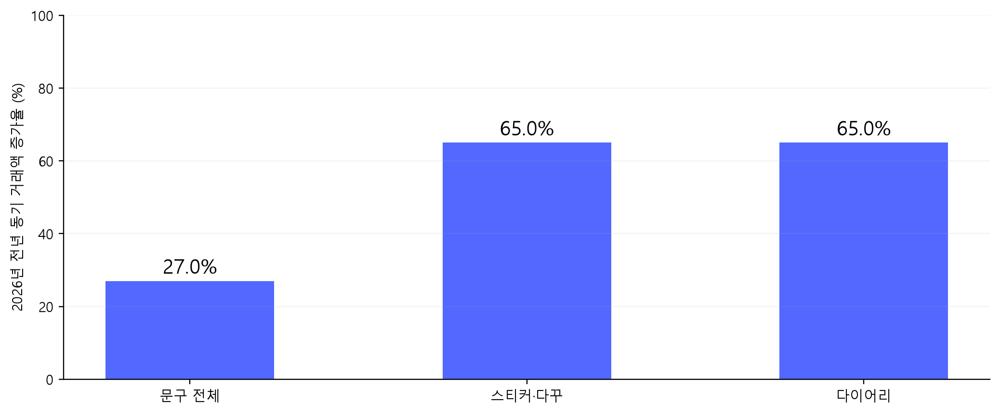
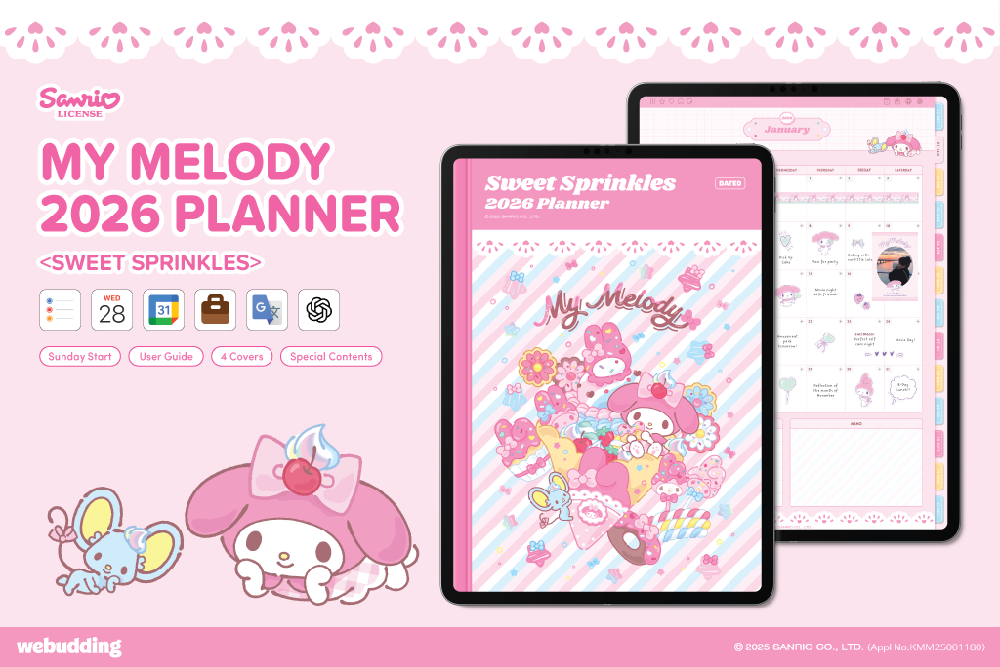
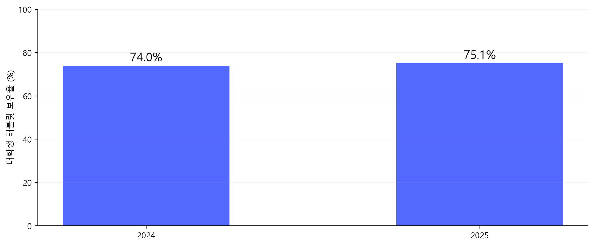

# DIO 피칭용 시장 조사 · 최신자료 개정

조사 기준일: 2026-10-27. 이번 개정은 발행일과 수치·사건의 기준 시점을 함께 확인했다. 채택 근거는 모두 2024년 이후이며, 실제 본편의 외부 출처는 2025~2026년 자료로 구성했다. 제목에 적힌 상품 연도, 기사 발행 연도, 수치 측정 연도는 구분한다.

## 1. 피칭의 중심 논리

**최근 기록·꾸미기 소비가 거래로 나타나고, 디지털 문구는 IP 상품과 필기 앱 유통으로 운영되고 있다. DIO는 이 취향 소재를 친구와 같은 사진·페이지에 함께 사용하는 경험으로 연결한다.**

이 문장은 최근의 소비 행동, 디지털 상품의 존재, DIO의 제품 제안을 연결한다. 실물 문구 증가율을 디지털 전체 시장 증가율로 옮기거나, 해외 유통을 DIO의 매출 가능성과 동일시하지 않는다. 최신성이 부족한 과거 판매·매출·투자 수치는 이번 개정본의 근거와 차트에서 제외했다.

| 피칭에서 답할 질문 | 채택 근거 | 날짜와 의미 |
|---|---|---|
| 지금도 꾸미기에 돈을 쓰는가? | 에이블리 스티커·다꾸 및 다이어리 거래액 각각 +65% | 2026-10-13 발표, 2026-09-15~10-01 전년 동기 비교. 실물 상품 |
| 일시적 기사 한 건뿐인가? | 29CM 다이어리·플래너 거래액 +63% 이상 | 2026-09 보도, 2026년 1~8월 전년 동기. 다른 플랫폼·다른 기간 |
| 디지털 문구도 실제 사업인가? | 위버딩의 캐릭터 문구와 미국·중국·유럽·일본·태국 유통 소개 | 2026-03-02 운영 보도. 판매액·점유율은 미공개 |
| 어떤 상품이 팔리는 구조인가? | 산리오 디지털 플래너·스티커 출시, 2026 플래너 유료 추천 | 2025년 공식 발표·상품 소개. 가격은 표시가격 |
| 초기 고객의 환경은 어떤가? | 대학생 태블릿 보유율 2025년 75.1% | 2025-02-27 공식 조사. 보유와 구매는 구분 |

본편은 6장, 질문 대응 별첨은 1장이다. 최신 수치를 먼저 제시하되 텐바이텐·위버딩은 요청대로 대표 서비스 사례로 유지한다. 에이블리·29CM는 이 두 회사의 실적을 대신하는 이름이 아니라 최근 소비를 확인할 보조 지표다.

## 2. 최신성 선별 기준과 교체 내역

자료의 우선순위는 2026년 측정·사건과 2026년 발행, 2025년 측정·사건과 2025년 발행, 필요한 경우 2024년 자료 순이다. 단순한 페이지 갱신일·검색 수집일은 실적의 시점으로 보지 않는다. 과거 실적을 최근 기사에서 재인용한 경우도 최신 숫자로 쓰지 않는다.

| 이전 자료의 요소 | 이번 조치 | 대체 자료 |
|---|---|---|
| 오래된 누적 콘텐츠 판매 건수 | 본편·근거집에서 제거 | 2026년 디지털 문구 운영·해외 유통 보도 |
| 과거 여러 해의 회사 매출 차트 | 제거 | 2026년 실제 문구 거래액 변화와 최근 디지털 상품화 사례 |
| 과거 전략 투자 | 제거 | 2025년 IP 상품 출시와 2026년 유통 운영 |
| 대학생 보유율의 긴 과거 비교 | 최근 두 해만 표시 | 2024년 74.0%, 2025년 75.1% |
| 검색 장기 하락 차트 | 최신 본편에서 제외 | 별첨에 지표의 해석 원칙만 설명 |

‘오래된 것보다 큰 숫자가 좋다’는 방식으로 대체하지 않는다. 최근 회사 매출·유료 고객·거래액을 찾지 못한 디지털 부문은 사업 운영과 상품 출시로 설명하고, 그 범위가 다름을 명시한다.

## 3. 2026년 소비 실적: 기록과 꾸미기의 지출

### 3.1 에이블리, 2026년 10월 발표

뉴시스 2026-10-13 보도는 에이블리의 2026-09-15~10-01 거래액이 전년 같은 기간보다 문구 전체 +27%, 스티커·다꾸 +65%, 다이어리 +65%, 필통 +22%라고 설명한다. 본편 차트는 문구·스티커·다꾸·다이어리의 구분과 해당 기간을 유지한다. [R1]

해석: 다꾸가 단순한 검색 주제에 그치지 않고 실제 쇼핑으로 나타난다는 최근 근거다. 단, 한 플랫폼의 짧은 기간이며 입점·기획전·상품 구성 변화의 영향이 섞일 수 있다. 전체 문구 시장, 템플릿 시장, DIO 잠재 고객의 증가율로 확대하지 않는다. 상위 문구 카테고리와 하위 항목을 더해 총성장률을 만들지도 않는다.

피칭 문구: “올해 10월 발표된 거래 자료에서도 다이어리와 스티커·다꾸 상품 소비가 확인됩니다. 저희는 이런 취향 소비를 함께 기록하는 디지털 경험에 연결하려 합니다.”

### 3.2 29CM, 2026년 9~10월 자료

뉴시스 2026-09-04 보도는 29CM의 2026년 1~8월 거래액을 전년 동기와 비교해 문구·사무용품 +48% 이상, 다이어리·플래너 +63% 이상, 스티커 +45%, 테이프 +10% 이상으로 제시한다. 에이블리와 기간·상품군·기반이 다르므로 두 증가율의 우열이나 합계를 계산하지 않는다. [R2]

더 최근인 매일경제 2026-10-20 보도는 이구홈 성수 2호점의 9월 18일~10월 11일 문구 거래액이 전월 동기보다 10배 이상이라고 설명한다. 매장 상품의 60% 이상을 문구로 구성하고 체험·팝업을 강화한 상황이다. **단일 매장의 상품 구성 변경 효과**가 커질 수 있어, 이 수치는 본편의 대표 성장률보다 상세 참고로 둔다. 전월 비교를 전년 비교라고 쓰지 않는다. [R3]

최신성만 보면 10배가 눈에 띄지만, 피칭에서 질문에 견디려면 분모와 집계 범위가 중요하다. 그래서 본편의 주된 거래 차트는 기간·카테고리가 명료한 에이블리 수치, 보조 설명은 29CM의 1~8월 자료를 채택했다.

## 4. 2026년 디지털 문구 사업의 운영

2026-03-02 뉴시스 기사(파이낸셜뉴스 전재)는 위버딩이 태블릿용 노트 속지·플래너·스티커를 제작하고, 캐릭터 IP 상품을 굿노트에 유통하며 미국·중국·유럽·일본·태국 이용자를 확보하고 있다고 소개한다. [R4]

이 자료는 과거 투자만으로 생존을 설명하는 대신 최근 디지털 문구 상품과 유통이 운영된다는 근거로 쓴다. 같은 기사에서 태국의 최근 2년 월평균 유입 성장 수치도 회사 설명으로 제시하지만, 분모·시작점·유입 정의가 공개되지 않아 본편의 성장 차트에는 넣지 않는다. 단순 복리로 누적 성장이나 고객 수를 추정하지 않는다.

기사의 굿노트 전체 이용자 규모와 대학생 태블릿 보유율은 다른 공식 자료와 표기·기준 차이가 있다. 따라서 이 기사에서는 **현재 상품군·국가별 유통·IP 운영**만 채택한다. 이용자 규모를 비교해 회사 성장률을 만들지 않는다. 같은 뉴시스 기사의 여러 신문 전재본도 독립된 여러 조사로 세지 않는다.

피칭 문구: “2026년 보도에서도 위버딩은 캐릭터 속지·플래너·스티커를 해외 필기 앱 이용자에게 유통하고 있습니다. 디지털 문구는 실제로 운영되는 취향 콘텐츠 사업입니다.”

최신 회사 매출액·플랫폼 거래액·국내 유료 고객 수는 공개 자료로 충분히 확인하지 못했다. ‘운영 중이다’를 ‘매출이 몇 배 성장했다’로 바꾸지 않는다. 이 차이가 디지털 문구의 사업 존재와 전체 시장 성장률을 구분하는 기준이다.

## 5. 2025년 상품화: IP와 목적별 플래너

### 5.1 출시된 산리오 상품

Goodnotes의 2025-01-24 공식 발표는 위버딩과 함께 산리오 캐릭터의 디지털 플래너·스티커 총 6상품을 출시했다고 설명한다. 이미 공개된 출시 사실이며, 캐릭터 취향이 디지털 문구에 상품으로 적용된 사례다. 판매량·매출·재구매는 공개하지 않는다. [R5]

### 5.2 잔망루피 라이선스·출시 계획

한국경제TV 2025-06-30 보도는 위버딩과 아이코닉스의 라이선스 계약, 잔망루피 디지털 플래너·스티커·노트 제작 및 굿노트 독점 유통 계획을 소개한다. 해당 기사 기준으로는 ‘출시 예정’이므로 곧바로 판매 완료나 흥행 성공으로 바꾸지 않는다. [R6]

이후 2026년 운영 기사에는 잔망루피를 포함한 IP 상품이 소개된다. 두 자료를 연결할 때도 ‘계획 발표와 이후 운영 소개를 확인했다’고 말하며, 상품별 판매 실적은 알 수 없다고 남긴다. [R4, R6]

### 5.3 2026 플래너의 표시가격과 상품 구성

Goodnotes의 2025-12-10 공식 글은 2026년 플래너 11개를 추천하며 $9.99~$14.99 가격대를 제시한다. 캐릭터·자기관리·업무·생활 트래커 등 목적별 구성을 확인할 수 있다. 상품 연도는 2026년이지만 글 발행일은 2025년으로 표시한다. [R7]

가격은 추천 표본의 표시가격이다. 실제 평균 구매액이나 DIO가 받을 수 있는 가격은 아니다. 국가·세금·할인에 따른 차이도 가능하다. 피칭에는 ‘유료 소재의 상품 구성이 존재한다’를 보여 주는 용도로 사용한다.

## 6. 고객의 디지털 기록 환경

비누랩스의 2025-02-27 공식 발표는 에브리타임 대학생 1,000명 조사의 태블릿 보유율을 2024년 74.0%, 2025년 75.1%로 제시한다. 이번 개정은 이 두 해만 비교하며 변화는 **+1.1%포인트**다. [R8]

기존 자료보다 증가폭은 작지만, 피칭의 중요한 점은 이미 보유율이 높다는 것이다. 새로운 기기 구입을 전제로 하기보다 기존 디지털 기록 사용자에게 접근하는 고객 전략을 설명할 수 있다. 이 표본이 모든 대학생의 확률표본인지, 연도별 동일 응답자를 추적했는지는 공개 보도자료만으로 확정하지 않는다. 보유율을 소재 구매율로 바꾸지 않는다.

더 최신인 비누랩스 2026년 IT 보고서 공식 보도자료도 검토했다. 2026-02-09 발표는 대학생 500명의 브랜드·AI 이용을 주로 다루며, 공개 본문에서 이번에 쓸 태블릿 보유율을 추가 확인하지 못했다. 따라서 최신 기사라는 이유만으로 2025년 보유 수치를 2026년 값으로 바꾸지 않았다. AI 이용·지불 의향을 다꾸 결제율로 대체하지도 않는다. [R9]

## 7. 최신 사용자 행동: 직접 쓰는 가치

Notability의 2026-07-27 발표는 2026년 7월 미국 14~24세 학생 503명을 조사했다고 명시한다. 직접 손으로 기록하는 것의 기억·이해 가치를 묻는 항목과 정리의 어려움을 다룬다. 대표적으로 손글씨가 기억에 더 도움이 된다는 응답은 78%, 지저분한 노트 때문에 복습을 피한 경험은 60%다. [R10]

이 자료는 한국 다꾸 고객 조사나 학습 효과 실험이 아니다. 업체가 발표한 자기보고이며, 기록을 직접 만들면서 활용을 쉽게 하고 싶은 과업을 탐색하는 참고 자료다. DIO에는 사람의 표현을 보존하면서 선택·배치·수정·이어 쓰기의 번거로움을 줄이는 방향을 생각할 근거가 된다. 자동 채움이나 공동 기록의 유료 선호를 입증하지 않는다.

## 8. 텐바이텐·위버딩 사례의 최신성

텐바이텐 대표 시각 자료는 2025-11-04 이투데이가 소개한 2026 다이어리 유형 안내다. 감성 기록·캐릭터·종이·목표 관리라는 선택 맥락을 보여 준다. 발행일과 상품 시즌이 명시된 최근 자료로 유지하되, 현재 매출 성장의 근거로 쓰지 않는다. [R11]

텐바이텐의 현재 상품 페이지와 구매 후기는 연도가 바뀌며 제목·옵션·이전 후기들이 섞일 수 있다. ‘2027’ 제목 아래 과거 후기가 있다고 해서 그 후기를 2027년 상품 구매로 세지 않는다. 페이지 갱신일만으로 2026년 구매 성과를 만들지 않았다.

위버딩의 대표 사례는 2026년 운영 보도와 2025년 공식 상품 출시다. 발행일이 없는 공급 수치 페이지는 최신 작가 증가·상품 증가의 근거에서 뺐다. 두 플랫폼 모두 같은 기간의 비교 가능한 매출 자료를 확보하지 못했으므로 텐바이텐 대 위버딩 규모 비교 차트는 만들지 않는다.

| 대표 사례 | 자료 시점 | 피칭에서 맡는 역할 |
|---|---|---|
| 텐바이텐 | 2025-11, 2026 다이어리 안내 | 취향과 목적을 먼저 제안하는 실물 문구 선택 |
| 위버딩 | 2026-03 운영 보도, 2025 상품화 | 디지털 소재의 IP·목적별 상품과 유통 |
| DIO | 현재 팀 기획 | 같은 사진·페이지를 친구와 함께 완성하는 제안 |

## 9. 최근 해외 소비의 보조 조사

Etsy 2026-10-14 가을·겨울 보고서는 2026-09-14 기준 직전 3개월의 전년 비교에서 맞춤 친구 선물 검색 +1,400%를 제시한다. 2026-03-17 봄·여름 보고서는 2026-02-10 기준 직전 3개월의 전년 비교로 메모리 저널 +189%, 저널 장식 +395% 등을 제시한다. [R12, R13]

이는 미국 중심 플랫폼의 검색 활동이며 실물·디지털을 분리한 다꾸 거래액이 아니다. 초기 기저도 공개되지 않았다. 본편에서 거대한 퍼센트를 시장 규모로 보여 주기보다 관계·기억·개인화 테마를 고르는 참고 자료로만 둔다. 국내 고객의 같은 선호는 인터뷰·실제 과업으로 확인해야 한다.

## 10. 발표용 문구와 질문 대응

### 10.1 60초 설명

“최근 자료에서도 기록과 꾸미기 소비가 확인됩니다. 올해 10월 발표된 에이블리 자료에서는 다이어리와 스티커·다꾸 상품 거래가 늘었습니다. 디지털 쪽에서는 2026년 위버딩의 IP 문구와 해외 유통 운영이 소개되고, 공식 필기 앱 안에서 유료 플래너와 스티커 상품도 확인됩니다. 저희 DIO는 이 취향 소재를 하루 사진과 친구 관계에 연결합니다. 같은 페이지를 함께 꾸미고 이어 쓰면서 기록을 완성하고 다시 찾을 이유를 만들고자 합니다.”

실물 거래 증가와 디지털 운영 사례를 말로도 구분한다. 본편의 날짜 각주를 작게 숨기는 대신 주요 수치·사건 옆에 연도를 보인다. DIO의 실제 구매·유지 성과가 아직 없으므로 제안과 검증 계획으로 끝낸다.

### 10.2 질문 대응

| 질문 | 근거에 맞는 답변 |
|---|---|
| 실물 거래를 왜 제시하나? | 최근 꾸미기 지출의 맥락이다. 디지털 성장률로 전용하지 않는다 |
| 디지털의 최신 매출은? | 이번 공개 조사에서는 충분히 확인하지 못했다. 최신 운영·IP 상품화를 확인했다 |
| 왜 새 자료인데 보유율은 2025인가? | 2026 공개 보고서에는 같은 문항의 수치를 확인하지 못해 측정 시점이 명확한 공식 조사를 썼다 |
| 해외 성장률을 왜 크게 쓰지 않나? | 회사 설명은 있으나 유입 분모·계산 기준을 확인하지 못해 국가별 유통만 채택했다 |
| 검색 감소는 무시하나? | 탐색 경로의 위험은 남는다. 앱 내 이동이 원인이라는 인과를 확정하지 않는다 |
| DIO에서 실제로 구매할까? | 친구 양쪽의 참여·반복 기록·팩의 실제 결제로 검증할 과제다 |

## 11. 출처 대장 · 발행일과 측정일

아래 채택 출처는 모두 2025~2026년 발행이다. 2024년 수치는 대학생 보유율 비교의 시작점으로만 쓴다. 과거 사건을 최신 날짜로 재포장한 자료, 발행일 불명의 공급 수치, 정의가 불명확한 성장 요약은 본편에서 제외했다.

- [R1] 뉴시스, 2026-10-13. 에이블리 거래액, 측정 2026-09-15~10-01 대 전년 동기. https://mobile.newsis.com/view_amp.html?ar_id=NISX20261013_0003823398 . 본편 핵심, 실물 상품.
- [R2] 뉴시스, 2026-09-04. 29CM 거래액, 측정 2026년 1~8월 대 전년 동기. https://www.newsis.com/view/NISX20260904_0003776235 . 본편 보조, 실물 상품.
- [R3] 매일경제, 2026-10-20. 이구홈 성수 2호점 문구 거래액, 측정 2026-09-18~10-11 대 전월 동기. https://m.mk.co.kr/amp/12180323 . 단일 매장·팝업·구색 변경 맥락, 근거집 참고.
- [R4] 뉴시스 기사 파이낸셜뉴스 전재, 2026-03-02. 위버딩 IP 상품·굿노트 유통·해외 사용자 운영 소개. https://www.fnnews.com/news/202603020802316644 . 기사 속 모호한 성장 수치·다른 기준의 이용자 수는 본편 미사용.
- [R5] Goodnotes 공식 발표, 2025-01-24. 산리오 디지털 문구 6상품 출시. https://www.goodnotes.com/press/hello-kitty-and-friends-digital-stationery-collection . 출시 사실만 채택, 기업 소개 문단의 과거 연혁·실적 제외.
- [R6] 한국경제TV, 2025-06-30. 잔망루피 라이선스와 디지털 문구 제작·굿노트 유통 예정. https://www.wowtv.co.kr/NewsCenter/News/Read?articleId=A202506300423 . 계획과 이후 운영 보도를 구분.
- [R7] Goodnotes 공식 블로그, 2025-12-10. 2026 플래너 추천·표시가격·상품 이미지. https://www.goodnotes.com/blog/digital-planners . 상품 연도와 게시일 구분.
- [R8] 비누랩스 공식 보도자료, 2025-02-27. 대학생 1,000명 조사, 2024년 74%, 2025년 75.1% 보유율만 채택. https://www.vinuteam.com/newsroom/33 . 더 과거 비교값은 제외.
- [R9] 비누랩스 공식 보도자료, 2026-02-09. 대학생 500명, 2026년 IT 리포트. https://www.vinuteam.com/newsroom/49 . 공개 본문에 같은 태블릿 보유 수치 미확인, 조사 검토용.
- [R10] Notability 공식 블로그, 2026-07-27. 측정 2026년 7월 미국 14~24세 학생 503명. https://blog.notability.com/post/why-students-are-pairing-handwritten-notes-with-ai-in-2026 . 자기보고, 한국 구매 의향 아님.
- [R11] 이투데이, 2025-11-04. 텐바이텐 2026 다이어리 유형 소개 및 홈페이지 캡처. https://www.etoday.co.kr/news/view/2522115 . 선택 방식의 사례, 매출 지표 아님.
- [R12] Etsy, 2026-10-14. 측정 2026-09-14 기준 직전 3개월 대 전년 동기, 친구 맞춤 선물 검색. https://www.etsy.com/seller-handbook/article/1521255894814 . 미국 플랫폼 검색 참고.
- [R13] Etsy, 2026-03-17. 측정 2026-02-10 기준 직전 3개월 대 전년 동기, 저널·추억 기록 검색. https://www.etsy.com/seller-handbook/article/1473931456647 . 실물·디지털 분리 자료 아님.

## 12. 이번 자료로 말할 수 있는 결론

최근 기록·꾸미기 소비는 실제 실물 거래 자료로, 디지털 문구의 사업 운영은 IP 상품·필기 앱·해외 유통 자료로 확인했다. 고객의 디지털 기기 기반과 직접 쓰는 가치도 최근 조사로 보완했다. DIO가 제안하는 공동 기록 경험은 이 근거에 연결하되, 시장 전체의 최신 고성장이나 DIO 결제 성공으로 단정하지 않는다.

추가로 확보하면 가장 유용한 자료는 디지털 문구 플랫폼·작가의 최근 12개월 매출과 재구매, 국내 공동 기록 사용자의 실제 행동이다. 현재 본편은 최신성이 부족한 과거 큰 숫자 없이도 고객 환경·소비·유통·제품 제안을 설명하도록 구성했다.
