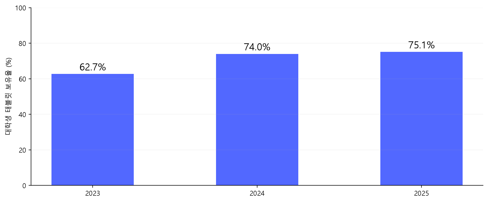
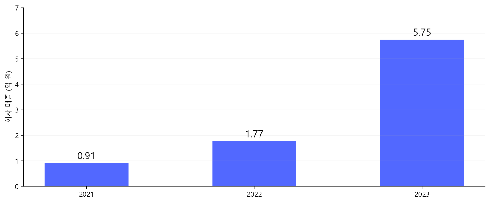
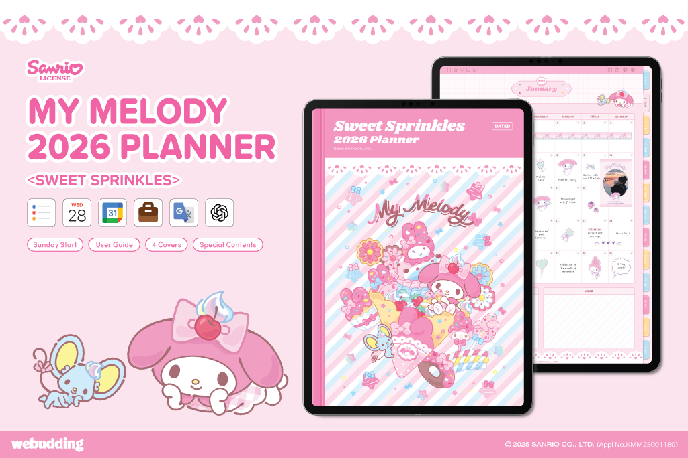

# DIO 피칭용 시장 조사

조사일: 2026-10-27. 목적은 디지털 다꾸의 사업 기회를 설명할 수 있는 거래·매출·고객 기반·유통 확장의 근거를 찾아 발표에 연결하는 것이다. 발표는 본문 6장과 질문 대응용 별첨 1장으로 구성했다. 기존 심층 조사와 검색 원자료는 보존한다.

## 1. 이전 분석을 어떻게 보완했나

이전 자료는 포털 검색 감소를 여러 장에 걸쳐 보여 주면서 디지털 문구의 실제 판매와 매출을 충분히 조사하지 못했다. 검색 지수는 탐색 경로 하나의 변화이고, 디지털 소재 소비 전체의 실적은 아니다. 이번 추가 조사에서는 위버딩 운영사의 과거 매출, 콘텐츠 판매 건수, 공식 전략 제휴, 국내 대학생의 기기 보유 조사를 확보했다.

**피칭의 중심 주장은 ‘이미 보급된 디지털 기록 환경 위에서 소재를 구매하는 행동과 유통 사업이 나타났고, DIO는 그 소재를 친구와 함께 사용하는 경험을 제안한다’로 잡는다.** 세계 시장이 2026년에 몇 % 성장했다거나 DIO 고객이 이미 확보됐다는 주장은 하지 않는다.

본편의 순서는 고객 기반, 실제 소비, 유통·IP 확장, 텐바이텐·위버딩 사례, DIO의 제안이다. 검색 감소는 질문 대응 자료에 남긴다. 이는 불리한 자료를 지우는 것이 아니라 ‘검색이 시장 규모를 대표하는가’라는 적절한 위치에서 다루는 편집이다. 모든 핵심 숫자에는 측정 연도·대상·출처를 함께 적는다.

## 2. 피칭에 가장 유용한 근거 5개

| 우선순위 | 확인한 근거 | 발표에서 말할 수 있는 것 | 범위 |
|---|---|---|---|
| 1 | 국내 대학생 조사 태블릿 보유율 2023년 62.7%, 2024년 74.0%, 2025년 75.1% [P1] | 초기 고객이 디지털 기록을 시작할 기기 기반이 형성돼 있다 | 대학생 1,000명 조사. 전체 국민·다꾸 고객 비율 아님 |
| 2 | 위버딩 운영사 매출 2021년 9,137만 원, 2022년 1억 7,697만 원, 2023년 5억 7,539만 원 [P2] | 디지털 문구 관련 사업에서 실제 매출 성장 사례가 존재한다 | 회사 매출. 플랫폼 거래액·작가 수익·전체 시장 아님 |
| 3 | 위버딩 운영사 2024년 1분기 매출 전년 동기 대비 +250% [P3] | 소재 판매가 제휴·공급 사업으로 확장된 사례다 | 회사 발표 인용 보도. B2B 확대 포함, 현재 성장률 아님 |
| 4 | 2023년 11월 인터뷰의 누적 디지털 문구 판매 약 21만 건, 월 6,000~1만 건 [P4] | 무료 배포 외에 콘텐츠 거래가 실제로 일어난다 | 과거 대표 인터뷰 자기보고. 결제자·재구매율과 다름 |
| 5 | Goodnotes의 2023년 25억 원 전략 투자와 2025년 산리오 디지털 문구 출시 [P5, P6] | 필기 앱·작가·IP를 잇는 유통과 상품화가 성립한다 | 투자금은 매출이 아님. 출시가 흥행 규모를 입증하지 않음 |

이 다섯 근거는 서로 다른 질문에 답한다. 보유율은 접근 가능한 환경, 매출은 수익화 사례, 판매 건수는 거래 행동, 제휴는 유통 방식이다. 수치들을 합쳐 TAM이나 DIO 매출을 계산하지 않는다. 과거 성장 사례를 2026년 현황처럼 소개하지 않는다.

## 3. 고객 기반: 신규 출하량보다 실제 보유를 본다

### 3.1 국내 대학생의 태블릿 보유

비누랩스는 2025-02-27 공식 보도자료에서 에브리타임을 통한 대학생 1,000명 조사 결과를 발표했다. 태블릿 보유율은 2023년 62.7%, 2024년 74%, 2025년 75.1%로 제시했다. 2023~2025 변화는 **12.4%포인트**다. 이를 12.4% 증가라고 쓰지 않는다. [P1]

피칭 문구: “대학생 조사에서 태블릿 보유율은 75.1%입니다. 저희는 새로운 기기를 사야만 가능한 취미를 제안하기보다 이미 가진 기기에서 함께 기록하는 경험을 만듭니다.”

조사 주체와 대상이 명확하다는 장점이 있다. 다만 이 수치를 전국 모든 대학생의 엄밀한 확률표본 추정으로 단정하지 않는다. 보도자료에는 연도별 동일 응답자 추적 여부·자세한 표집·가중치가 충분히 공개되지 않았다. 태블릿을 가졌다는 것이 필기를 하거나 소재를 구매한다는 뜻도 아니다. 따라서 시장 규모의 곱셈 계수로 쓰지 않고 고객 환경의 근거로 쓴다.

### 3.2 넓은 국내 기기 기반의 보조 자료

한국갤럽의 마켓70 2025는 전국 제주 제외 만 13세 이상 5,251명에게 가구 내 제품 보유를 물었다. 태블릿 PC 보유 응답은 41%다. 층화 집락 확률 비례 추출, 조사원 면접, 표본오차 ±1.4%포인트가 명시됐다. [P7]

41%는 ‘내가 개인 태블릿을 갖고 있다’가 아니라 응답자의 **집에 태블릿이 있다**는 값이다. 대학생 75.1%와 나란히 비교해 연령 효과를 계산하면 조사 문항·표본 차이를 섞게 된다. 본편은 고객과 가까운 대학생 자료를 쓰고, 갤럽은 근거집에 보관한다.

해석: 2026년 신규 기기 출하량의 부진만으로 디지털 기록 서비스의 이용 기반이 사라졌다고 볼 수 없다. 출하량은 흐름, 보유는 축적된 기반이다. 그렇다고 출하 감소가 사업에 영향이 없다는 뜻도 아니다. 신규 기기 구매층과 기존 기기 활용층을 구분하는 편이 DIO 타깃 설명에 더 적합하다.

## 4. 실제 거래와 매출: 공급 수보다 강한 사업 근거

### 4.1 회사 매출의 과거 성장

이투데이 2024-12-08 보도는 누트컴퍼니의 매출을 다음과 같이 제시한다. 2021년 9,137만 원, 2022년 1억 7,697만 원, 2023년 5억 7,539만 원이다. 2023년은 2021년의 약 6.3배다. 기사는 디지털 문구·IP 사업 확장을 함께 다룬다. [P2]

| 연도 | 기사 원수치 | 차트용 억 원 환산 |
|---|---|---|
| 2021 | 9,137만 원 | 0.9137 |
| 2022 | 1억 7,697만 원 | 1.7697 |
| 2023 | 5억 7,539만 원 | 5.7539 |

피칭 문구: “디지털 문구는 무료 자료만 있는 분야가 아닙니다. 위버딩 운영사의 매출은 2021년 약 0.91억 원에서 2023년 약 5.75억 원으로 커졌습니다.”

이는 비상장 회사의 언론 보도 수치다. 이번에 감사보고서나 사업별 매출 주석을 확보하지 못했다. 개인 소비자의 스티커 구매만으로 발생한 매출이라고 말하지 않는다. 판매 수수료·B2B·IP 관련 수익이 포함될 수 있고, 매출과 거래액의 회계 기준도 다르다. 영업이익·현금흐름·2026년 성장 지속을 입증하지 않는다.

### 4.2 2024년 1분기 +250%와 유통 확장

매일경제 2024-05-31 보도는 회사 발표를 인용해 2024년 1분기 매출이 전년 같은 기간보다 250% 증가했다고 전한다. 굿노트와의 콘텐츠 제휴를 통한 B2B 사업 본격화를 매출 확대의 배경으로 설명한다. [P3]

+250%는 기준 대비 3.5배다. ‘2.5배가 됐다’고 적지 않는다. 이 수치를 2023년 전체 매출에 곱해 2024년 연간 매출을 만들거나, 2026년 성장률로 연장하지 않는다. 연간 6.3배와 분기 +250%는 기간·기준이 달라 하나의 동일 시계열 그래프로 연결하지 않는다.

여기서 피칭에 중요한 부분은 높은 퍼센트 자체보다 **소재가 유통 채널과 만나 수익 사업으로 확장되는 구조**다. DIO는 이 사실을 디지털 소재의 경제적 가치가 실현된 사례로 쓸 수 있다. DIO에 같은 제휴·수익이 보장된다는 뜻은 아니다.

### 4.3 콘텐츠 판매 건수

블로터의 2023-11-03 대표 인터뷰는 누적 디지털 문구 콘텐츠 판매 약 21만 건, 월 6,000~1만 건을 제시한다. 시즌에 따라 월 판매가 다르다는 설명도 있다. 이번 발표는 이 거래 행동을 무료 배포와 구분되는 근거로 사용한다. [P4]

판매 건수의 단위는 콘텐츠 거래이며 사람 수가 아니다. 반복 구매·프로모션·취소의 상세 집계 기준은 공개되지 않았다. 월 1만 건을 매월 고정값으로 삼아 연간 12만 건으로 계산하지 않는다. 주문당 가격을 확인하지 못했으므로 판매 건수와 매출을 나눠 평균 가격도 추정하지 않는다.

2021년 거래액 9배 성장 기사와 2024년 누적 35만 건 보도도 발견했지만 본편 숫자는 추가로 늘리지 않았다. 전자는 초기 작은 기저와 팬데믹 시기의 과거 사례이고, 후자는 원문 접근과 기준 확인이 상대적으로 제한돼 보수적인 2023년 인터뷰를 채택했다. 더 큰 수치를 고르는 것보다 날짜·단위·발언자를 명확히 설명할 수 있는 자료를 우선했다. [P8, P9]

## 5. 유통과 IP: 디지털 문구를 살 수 있는 경로가 만들어졌다

### 5.1 공식 필기 앱의 전략 참여

Goodnotes의 2023-09-25 공식 발표는 위버딩에 190만 달러, 25억 원을 전략 투자했다고 밝힌다. 같은 발표는 위버딩의 2023년 1~8월 매출이 전년 동기보다 220% 증가했다고 설명한다. 거래의 당사자인 공식 발표로 확인할 수 있다는 장점이 있다. 다만 투자자이자 제휴사의 홍보 자료라는 점도 함께 본다. [P5]

투자금은 고객 결제액이 아니므로 매출 차트에 합치지 않는다. 2023년 1~8월 +220%와 2024년 1분기 +250%는 서로 다른 기간이다. 이를 성장 가속이라고 단정하지 않는다. 다만 필기 앱이 소재 공급과 작가 생태계에 직접 참여한 사건은 유통 사업의 전략적 중요성을 보여 준다.

### 5.2 실제 IP 상품 출시

2025-01-24 Goodnotes 공식 발표는 위버딩과 협업한 산리오 디지털 문구를 소개한다. 첫 출시에는 헬로키티·시나모롤·마이멜로디의 플래너와 스티커 팩 총 6개가 포함된다. 이는 캐릭터 취향이 디지털 소재 상품으로 확장된 구체 사례다. [P6]

공식 2026 플래너 추천 글은 2025-12-10 게시됐으며 추천 11상품을 $9.99~$14.99로 안내한다. 이 자료는 유료 상품 구성의 예시로 쓴다. 판매량·평균 객단가·이익률을 입증하지 않는다. [P10]

피칭 문구: “종이 문구에서 익숙한 캐릭터와 취향 소비가 디지털 플래너와 스티커 상품으로 확장됐습니다. 필기 앱 안에서 발견하고 쓰는 유통 경로도 이미 존재합니다.”

현재 Goodnotes Press Kit는 글로벌 월간 활성 이용자 2,500만 명 이상을 안내한다. 플랫폼 전체 이용 기반이며 국내 다꾸 유료 고객 수가 아니다. About의 별도 2,400만 명 표기와 차이가 있어 엄밀한 이용자 성장 차트를 만들지 않는다. 본편에서는 필요할 때 ‘글로벌 필기 플랫폼의 유통 기반’ 정도로 설명한다. [P11]

## 6. 텐바이텐과 위버딩을 피칭에서 쓰는 역할

두 회사를 동일 기준의 시장 규모로 비교하지 않는다. 텐바이텐은 실물 문구를 취향과 사용 장면으로 고르게 하는 사례, 위버딩은 디지털 소재를 거래·보관·활용하는 사례다. 텐바이텐도 온라인 판매를 운영하므로 ‘오프라인 회사 대 온라인 회사’라는 표현은 피한다.

| 사례 | 확인한 행동·구조 | DIO와 연결하는 해석 |
|---|---|---|
| 텐바이텐 | 성향별 다이어리 추천, 캐릭터·기록·계획에 따른 상품 선택 | 무엇으로 꾸밀지보다 무엇을 완성할지 먼저 제안 |
| 위버딩 | 디지털 소재 판매, 보관함, 필기 앱 활용, 콘텐츠 공급 제휴 | 소재의 거래와 실제 사용을 이어 주는 경험에 가치 |
| DIO 제안 | 하루 사진을 바탕으로 친구가 같은 페이지를 함께 꾸밈 | 취향 팩이 관계와 반복 기록으로 이어지는지 검증 |

텐바이텐의 네 유형은 2025-11-04 기사에서 확인한 2026년 다이어리 안내다. 이 사례를 2026년 현재 매출 성장이나 2027 행사로 바꾸지 않는다. [P12]

위버딩 공식 안내의 작가 2,000명 이상·상품 2만 개 이상은 공급 생태계다. 이번 본편은 이미 확보한 판매·매출 근거를 우선하고, 상품 수를 구매 수처럼 보이지 않게 보조로 둔다. [P13]

보관함 출시 보도는 여러 경로에서 받은 디지털 콘텐츠를 관리·활용하는 불편을 설명한다. 이는 사용 흐름의 문제가 업계에서 이미 다뤄졌다는 근거다. DIO가 이 문제를 해결했다고 입증하거나 모든 이용자가 같은 불편을 겪는다는 통계로 사용하지 않는다. [P14]

## 7. 최근 실물 취향 소비의 보조 근거

디지털의 최근 실적 자료가 부족할 때 실물 문구의 성장률을 그대로 대체해서는 안 된다. 다만 꾸미기·기록 소비 자체가 지불 행동과 연결되는지 설명할 보조 자료는 유용하다.

뉴시스 2026-09-04 보도는 29CM의 2026년 1~8월 거래액이 전년 동기보다 문구·사무용품 48% 이상, 다이어리·플래너 63% 이상, 스티커 45%, 테이프 10% 이상 증가했다고 설명한다. 이구홈 성수 1호점 문구 판매량은 같은 기간 10만 개 이상이다. [P15]

이 근거는 텐바이텐의 실적이 아니고 디지털 소재 실적도 아니다. 본편의 두 대표 사례는 그대로 유지하고, 실물 취향 소비를 설명할 때 질문 대응용으로만 쓴다. 플랫폼의 상품군 확대·입점·행사 효과가 성장에 섞일 수 있어 전체 문구 시장 증가율로 일반화하지 않는다.

피칭 문구: “기록과 꾸미기를 위해 돈을 쓰는 행동은 실물 문구에서도 확인됩니다. 저희는 이 소비 습관이 디지털 공동 기록에서 어떤 형태로 이어지는지 검증합니다.”

## 8. DIO의 시장 기회를 말하는 방식

### 8.1 근거에서 제품 제안까지

첫째, 국내 대학생의 기기 기반은 디지털 기록을 시도할 수 있는 환경을 보여 준다. 둘째, 디지털 문구의 판매와 회사 매출은 소재가 거래되는 사업임을 보여 준다. 셋째, 공식 플랫폼 제휴와 IP 상품은 소재 유통과 취향 소비의 확장을 보여 준다. 여기까지가 외부에서 확인한 근거다.

DIO는 하루 사진 한 장을 친구들과 함께 꾸미고 이어 쓰는 경험을 제안한다. 같은 테마의 속지·스티커·테이프를 선택하는 방식과 질문·차례·완성 상태는 이 사용 목적을 돕는 가설이다. 외부 시장이 확인됐다는 것과 DIO의 제품 적합성이 입증됐다는 것은 구분한다.

### 8.2 발표용 60초 설명

“기록과 꾸미기는 이미 디지털 기기 위에서 거래되는 콘텐츠가 됐습니다. 국내 대학생 조사에서 태블릿 보유율은 2025년 75.1%이고, 위버딩의 대표 인터뷰에는 디지털 문구 누적 판매 약 21만 건이 제시됩니다. 운영사의 매출 성장과 굿노트의 전략 투자, 산리오 디지털 플래너 출시도 확인할 수 있습니다. 저희 DIO는 이 소재를 하루 사진과 친구 관계에 연결합니다. 같은 페이지를 함께 꾸미고 이어 쓰는 경험으로, 소재를 고른 뒤 실제 기록을 완성하고 다시 방문할 이유를 만들고자 합니다.”

발표 시 21만 건의 기준은 2023년 인터뷰임을 장표에서 보이게 둔다. 숫자를 말할 시간이 없으면 판매 건수 대신 ‘실제 판매와 매출이 발생한 디지털 문구 시장’으로 표현해도 된다. 인터뷰의 오래된 수치를 최신 현황처럼 말하지 않는다.

### 8.3 짧은 핵심 문구

“디지털 문구의 거래와 유통은 이미 존재합니다. DIO는 친구와 같은 페이지를 함께 완성하는 이유를 더합니다.”

‘DIO가 최초’, ‘경쟁사는 함께 못 쓴다’, ‘개인 기록은 끝났다’ 같은 표현은 쓰지 않는다. 공동 편집과 편집형 소재가 기존 앱에도 있으므로, 선택·초대·이어 쓰기·완성의 구체 흐름과 검증할 행동으로 차이를 설명한다.

## 9. 예상 질문과 답변 근거

| 질문 | 답변 방향 | 추가로 필요한 데이터 |
|---|---|---|
| 검색은 줄었는데 왜 기회인가? | 포털 탐색과 전체 소비는 측정 대상이 다르다. 과거 실제 판매·매출·제휴와 고객 기기 기반을 함께 본다 | 최신 플랫폼 거래·재구매·발견 경로 |
| 과거 성장으로 현재를 설명하나? | 역사적 상업화 근거라고 명시한다. 최근 IP 상품 운영은 확인했지만 2026 성장률은 미확보다 | 2025~2026 회사·플랫폼 실적 |
| 매출은 B2B 아닌가? | B2B 확장이 포함된다. 개인 다꾸 수요만의 성장으로 말하지 않는다 | 사업별 매출·순수 B2C 거래액 |
| 전체 시장 크기는 얼마인가? | 공개 자료만으로 국내 디지털 다꾸 TAM을 확정하지 않았다. 현재는 고객·거래·유통의 존재를 보여 준다 | 대상 활동 고객·유료율·구매액 |
| 왜 DIO에서 돈을 쓰나? | 친구와 같은 페이지를 완성하는 가치와 테마 팩의 편리함을 제안한다. 지불 의사는 아직 검증 전이다 | 양쪽 활성·반복 공동 기록·실제 구매 |
| 왜 굿노트가 아닌가? | 범용 필기 기능 수보다 특정 관계·기록 과업의 완성 경험으로 비교한다 | 기존 앱 대비 완성 시간·재방문 |

검색 감소를 앱 내 구매 이동으로 설명할 수 있다는 가설은 남지만, 이번에 실제 이동을 추적한 자료는 없다. 따라서 ‘검색이 줄어든 이유는 모두 앱으로 이동했기 때문’이라는 답변은 하지 않는다.

## 10. 본편과 근거집의 역할

| 장표 | 제목 | 발표 목적 |
|---|---|---|
| 1 본편 | 디지털 기록 위의 취향 소비 | 고객 환경·실제 거래·유통의 논리를 한눈에 제시 |
| 2 본편 | 고객이 이미 가진 기록 도구 | 국내 대학생 기기 기반을 시각화 |
| 3 본편 | 디지털 문구의 판매와 매출 | 회사 매출 차트와 실제 거래 근거 |
| 4 본편 | 필기 앱과 IP로 확장된 유통 | 제휴·투자·상품 출시의 구조 |
| 5 본편 | 취향을 고르는 경험과 쓰는 경험 | 텐바이텐·위버딩 사례 비교 |
| 6 본편 | DIO가 제안하는 공동 기록 | 확인한 시장과 제품 가설을 연결 |
| 7 별첨 | 시장 근거의 범위와 질문 대응 | 검색·연도·시장 규모 질문을 정직하게 설명 |

본편에는 작은 숫자를 과장한 예상 시장 차트 대신 측정 대상이 명확한 차트를 넣는다. 모든 차트는 편집 가능하고 기간·단위를 함께 보이게 한다. 신규 유료 고객·매출·재구매가 아직 없는 DIO의 실적 그래프는 만들지 않는다.

## 11. 출처와 채택 판단

이번 조사에서 새로 확보하거나 재확인한 자료다. 같은 회사 발표를 여러 언론이 옮긴 경우 독립적인 여러 조사로 세지 않는다. 모든 자료는 2026-10-27 확인했다.

- [P1] 비누랩스 공식 보도자료, 2025-02-27. 에브리타임 대학생 1,000명 조사, 태블릿 62.7%·74%·75.1%. https://www.vinuteam.com/newsroom/33 . 본편 핵심. AI 지불 의향 수치는 다꾸 결제율로 사용하지 않음.
- [P2] 이투데이, 2024-12-08. 누트컴퍼니 연도별 매출 9,137만·1억7,697만·5억7,539만 원. https://www.etoday.co.kr/news/view/2426976 . 본편 핵심. 회사 전체 매출 보도이며 감사·사업별 내역 미확보.
- [P3] 매일경제, 2024-05-31. 회사 발표 인용, 2024Q1 매출 +250%, 굿노트 B2B 확대 배경. https://www.mk.co.kr/news/it/11029770 . 머니투데이의 다음 날 보도는 같은 발표이므로 독립 표본으로 중복 계산하지 않음.
- [P4] 블로터, 2023-11-03, 대표·투자자 인터뷰. 누적 판매 약 21만, 월 6천~1만 건. 원문 https://www.bloter.net/news/articleView.html?idxno=607883 는 접근 제한으로, 동일 기사 전재 본문 https://news.nate.com/view/20231103n07815 에서 확인. 본편에 인터뷰 연도·자기보고 명시.
- [P5] Goodnotes 공식 발표, 2023-09-25. 위버딩 190만 달러/25억 원 투자, 2023년 1~8월 매출 +220%. https://www.goodnotes.com/press/goodnotes-invests-webudding . 본편 핵심. 투자·매출 구분.
- [P6] Goodnotes 공식 발표, 2025-01-24. 위버딩과 산리오 플래너·스티커 6상품 출시. https://www.goodnotes.com/press/hello-kitty-and-friends-digital-stationery-collection . 본편 핵심, 판매량 미공개.
- [P7] 한국갤럽 마켓70 2025, 2025-11-20 공개. 만 13세 이상 5,251명, 가구 내 태블릿 보유 41%. https://www.gallup.co.kr/gallupdb/reportContent.asp?seqNo=1597 . 근거집 보조, 개인 보유와 구분.
- [P8] 벤처스퀘어, 2021-12-28. 회사 발표의 연초 대비 월 거래액 9배, 누적 5만 거래. https://www.venturesquare.net/845743 . 초기·과거 자료라 본편에서 제외.
- [P9] 한국경제 계열 기사 검색 결과, 2024년 디지털 다꾸 관련 보도의 누적 35만 판매. https://v.daum.net/v/5BJRTRiB9Y?f=p . 본문 직접 재확인 접근이 제한돼 주된 수치로 채택하지 않음. 혁신의숲의 소개 문구를 최신 실적으로 대체 인용하지 않음.
- [P10] Goodnotes 공식 블로그, 2025-12-10. 2026 추천 플래너의 상품 구성·가격. https://www.goodnotes.com/blog/digital-planners . 추천 표본의 표시가격, 평균 객단가 아님.
- [P11] Goodnotes 공식 Press Kit. https://www.goodnotes.com/press . 25M+ MAU, 글로벌 전체 필기 앱. About https://www.goodnotes.com/about-us 의 24M과 차이, 이용자 성장 차트 미작성.
- [P12] 이투데이, 2025-11-04. 텐바이텐의 2026 다이어리 유형 안내 및 사진. https://www.etoday.co.kr/news/view/2522115 . 텐바이텐 공식 사이트 https://www.10x10.co.kr/ 의 온라인 주문·매장 접점도 재확인.
- [P13] 위버딩 공식 고객 안내. https://guide.webudding.com/en/customer . 작가·상품은 공급 지표. 앱 화면 https://apps.apple.com/kr/app/id6449518288 의 개발자 프로모션 이미지.
- [P14] beSUCCESS, 2023년 보관함 기능 출시 보도, 보도자료 제공 누트컴퍼니. https://besuccess.com/디지털-문구-플랫폼-위버딩-여러-플랫폼에서-구매한/ . 외부 소재 보관·활용의 문제 제기, 이용자 대표 설문 아님.
- [P15] 뉴시스, 2026-09-04. 29CM 실물 문구 거래·이구홈 판매. https://www.newsis.com/view/NISX20260904_0003776235 . 최근 실물 소비의 보조 자료, 텐바이텐·디지털 실적 아님.

## 12. 판단과 남은 조사

이전 자료의 ‘시장 약세’ 인상은 검색 데이터의 비중이 컸기 때문이다. 더 적합한 결론은 **디지털 문구의 상업화 사례와 고객 기반은 확인되며, 최신 전체 시장 성장률과 DIO의 유료 전환은 별도로 확인해야 한다**는 것이다. 과거 성장 수치를 빼먹은 문제를 보완했지만, 그 수치만으로 2026년 호황을 선언하지도 않는다.

후속 조사의 우선순위는 플랫폼·작가의 최근 12개월 판매와 재구매, 디지털 기록 사용자와 친구 쌍의 실제 행동, 검색 대신 사용하는 발견 경로, 팩 구매와 방 공유의 권리·정산이다. 시장 기회를 설명한 다음 이 검증 계획으로 연결하면 피칭의 논리가 분명해진다.
