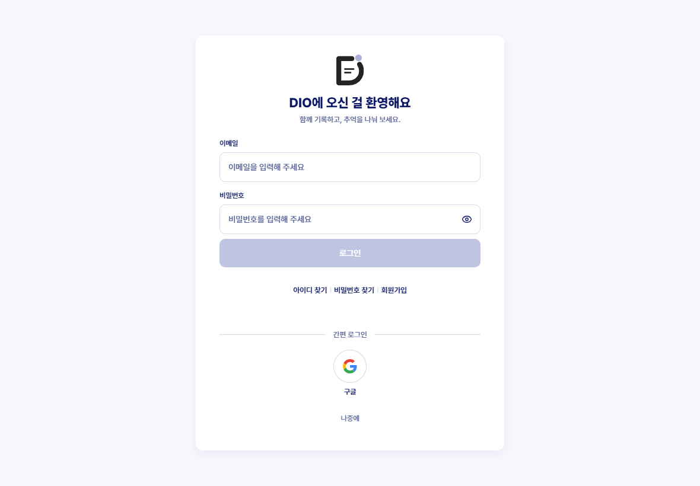
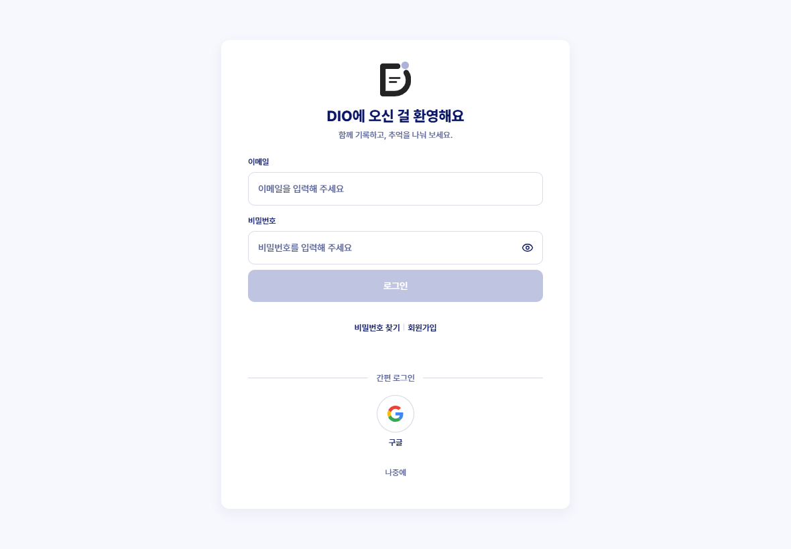
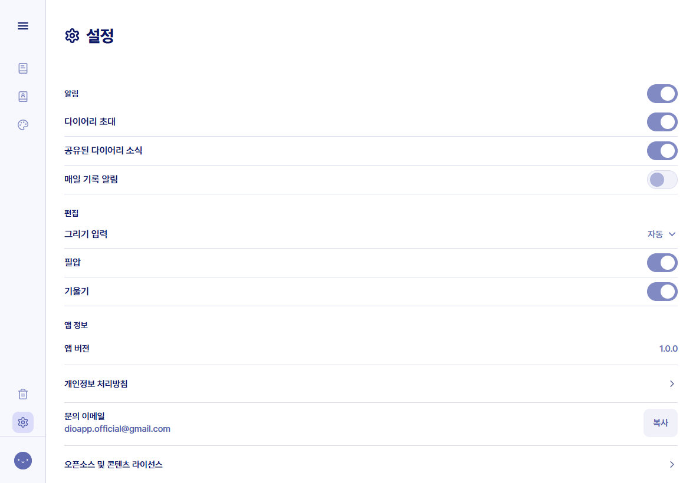
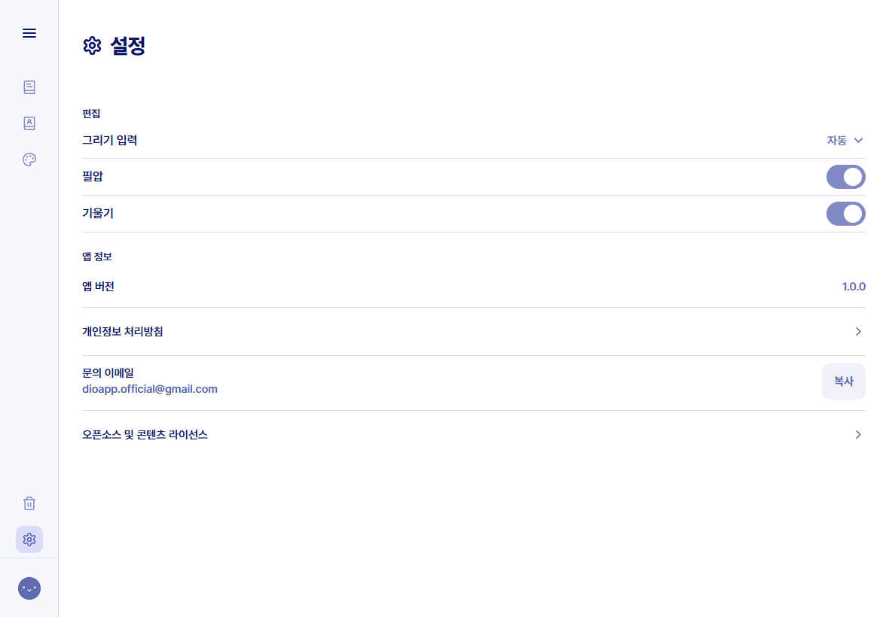
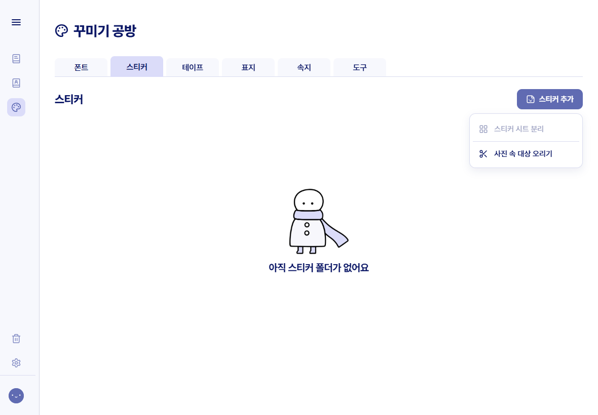
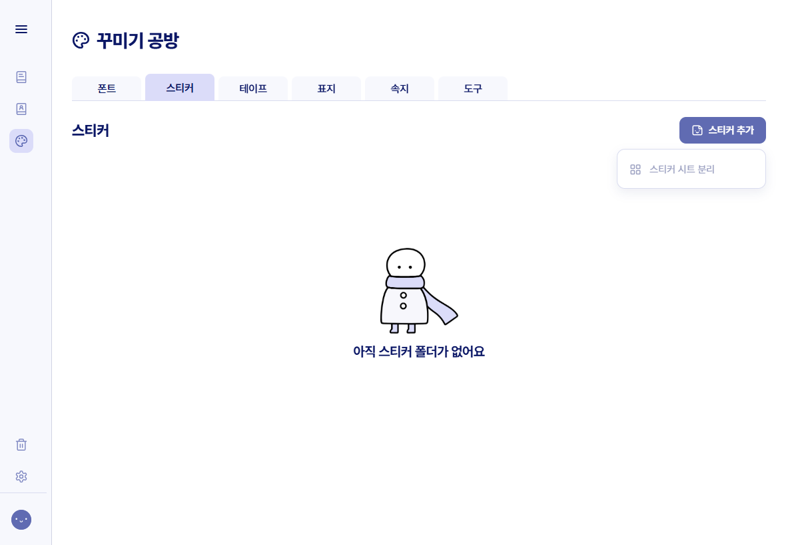

# 미지원 기능 가리기 점검 2026-11-05

> 가린 항목 **5건**(입구 7곳: 1~4번 각 1곳, 5번 3곳) · 사용자가 정할 항목 **7건** · 적용 브랜치 `fix/fe/hide-unsupported-features`, MR 태스크 S15P31F106-512.

사용자 결정(2026-11-05)으로 아래 5건을 적용했다. 입구만 막았고 내부 로직은 그대로라, 아래 "되살리는 법"대로 한 줄을 바꾸면 돌아온다. 2절의 7건은 이번에 건드리지 않았고 그대로 결정 대기다.

## 1. 가릴 항목 (패치에 담김)

> **그림의 기준:** 아래 그림은 패치를 처음 만든 `674b4ae4` 기준이다. 2번 "전" 그림의 스위치는 지금 develop에서 "준비 중" 글자로 바뀌었다. 적용 후 폰 에뮬레이터에서 5번을 다시 확인했다(5절).

5번은 백엔드에 `sticker-cutouts` API가 이미 있고 앱만 연결하지 않은 상태라, 가릴지 연결할지 정할 여지가 있다.


| # | 화면 | 항목 | 미지원 근거 | 가리는 방법 | 되살리는 법(스위치 셋은 `shared/featureFlags.js`에 모여 있고, 켠 경로도 테스트가 있다) |
|---|---|---|---|---|---|
| 1 | 로그인 | 아이디 찾기 링크 | `auth/AuthScreen.js:613-620` 누르면 "계정 서비스 연결 후 이용할 수 있어요" 창만 뜬다. 이메일이 곧 아이디이고 백엔드 `auth/controller`에 아이디 찾기 엔드포인트가 없다 | 링크와 앞 구분선 제거 (비밀번호 찾기 · 회원가입은 그대로) | 패치의 해당 덩어리를 되돌린다 |
| 2 | 설정 > 알림 | 다이어리 초대 · 공유된 다이어리 소식 · 매일 기록 알림 ("준비 중" 표시 3줄) | 팀원 커밋 `0c4eb3b6`이 스위치를 "준비 중" 글자로 바꿨다(`diary/components/NotificationSetting.js:9-11`). 실제 발송에는 여전히 연결되지 않았다. | `DEVICE_TOGGLES_ENABLED=false`. 회원은 "알림 설정" 진입 행만 남고, 게스트는 구역이 통째로 사라진다 | `shared/featureFlags.js`의 `DEVICE_TOGGLES_ENABLED`를 true |
| 3 | 설정 > 알림 설정(회원) | "서비스 알림" 구역("준비 중" 표시) | `diary/screens/NotificationSettingsScreen.js:40-47` 같은 커밋이 "서비스 알림 설정을 준비하고 있어요"와 "준비 중"으로 바꿨다. 서버 설정과 연결되지 않았다. | `SERVICE_SECTION_ENABLED=false`. 제목 · 줄 · 구분선을 숨기고 아래 마케팅 정보 수신(서버 동의 저장)은 그대로 | `shared/featureFlags.js`의 `SERVICE_SECTION_ENABLED`를 true |
| 4 | 공유 허브 | 추가 인원 안내 버튼과 "유료 이용은 준비 중이에요" 문구 | `sharing/SharingHub.js:658-664` 정원 4명이 차면 나오는 버튼. 결제 · 구독 코드가 앱에 없고 백엔드에도 없다 | 버튼과 문구 제거. "소유자 포함 4명이 함께하고 있어요."는 남긴다 | 패치의 해당 덩어리를 되돌린다  |
| 5 | 꾸미기 공방 · 편집기 스티커 보관함 | 사진 속 대상 오리기 (입구 3곳: 공방 `+ 스티커 추가` 메뉴, 편집기 `+` 메뉴, 공방 버튼 설명 글) | `editor/components/panels/StickerCutoutModal.js:243` 저장 확인창이 "미리보기 단계라 실제로는 저장되지 않아요"라고 말한다. 앱은 `sticker-cutouts` API를 호출하지 않는다(백엔드 `StickerCutoutController`는 있음). 입구: `DecorationStudioScreen.js:418-419, 212`, `DecorDrawer.js:873` | `CUTOUT_ENTRANCE=false`. 메뉴 항목을 빼고 설명을 "스티커 시트 분리"만 남긴다 | `shared/featureFlags.js`의 `CUTOUT_ENTRANCE`를 true |

바꾼 테스트(이유): `diary-sharing-state`(추가 인원 안내가 없음을 확인), `notification-setting-section`(기기 토글이 없고 진입 행만 남음, 게스트는 null), `decoration-studio`(오리기 항목이 없음). 기존 테스트가 옛 입구를 확인하고 있었기 때문이다.

### 화면 확인 (웹 8130, 게스트, 수정 전 · 후)




- **1번** — 전: "아이디 찾기 | 비밀번호 찾기 | 회원가입" 세 개. 후: 두 개이고 빈 구분선이 남지 않는다.




- **2번** — 게스트는 알림 구역(토글 4개)이 통째로 사라지고 편집 구역이 맨 위로 올라온다. 회원 화면(진입 행만 남는 모습)은 로그인이 필요해 찍지 못했고 단위 테스트로 확인했다.




- **5번** — 전: 스티커 시트 분리, 사진 속 대상 오리기 두 줄. 후: 스티커 시트 분리 한 줄. (웹에서는 시트 분리가 흐리게 비활성이다. 아래 결정 항목 C.)
- **3번, 4번** — 회원 로그인이나 4명이 찬 공유 다이어리가 필요해 화면은 찍지 못했다. 단위 테스트로만 확인했다.

## 2. 사용자 결정 필요

| # | 항목 | 근거 | 가렸을 때 위험 | 추천안 |
|---|---|---|---|---|
| A | 신고 · 차단 (마이페이지 "차단한 사용자", 참여자 메뉴의 신고 · 차단) | 앱은 `POST /reports`, `GET·PUT·DELETE /me/blocks`를 호출한다(`safety/safetyApi.js:66-120`). 백엔드 컨트롤러 전체(`backend/src/main`)에 이 경로가 없다. 문서 `docs/신고 차단 프론트.md`도 "현재 develop에는 이 서버 구현이 없다"고 적었다 | 신고 · 차단은 스토어 심사 요건이라 숨기면 탈락 위험 | 숨기지 말고 서버 구현을 출시 전에 끝낸다. 서버 쪽 요청은 3절 |
| B | 손글씨 폰트 만들기 (iOS · 웹) | `handwriting/generator.js:9` 생성 모듈은 Android에서만 불러온다(`modules/dio-handwriting`에 ios 폴더 없음). iOS에서는 입력 화면까지 열리고 마지막에 "Android 개발 빌드가 필요해요"로 막힌다. `docs/font-creation-flow.md:37`은 iOS는 완성 폰트 가져오기만 지원한다고 적음 | 위치 · 구성이 바뀌고 다른 담당자의 기능이다. 이미 만든 폰트 목록까지 가리면 안 된다 | iOS 출시 범위가 정해지면 iOS에서만 "폰트 추가" 입구를 숨긴다(플랫폼 조건 한 줄). 정해 주세요 |
| C | 스티커 시트 분리 (웹) | `editor/services/stickerSplit.js` 웹 대체 구현은 `available:false`. 공방 메뉴에 흐린 항목으로 남는다(위 5번 그림) | 웹을 배포하는지에 달림 | 웹 배포 계획이 없으면 그대로 두고, 있으면 웹에서 항목을 숨긴다 |
| D | 개인정보 처리방침 링크 | `diary/components/AppInformation.js:15` 배포용 주소가 없으면 개인 구글 문서 링크로 열린다. `eas.json` production 환경에 `EXPO_PUBLIC_PRIVACY_POLICY_URL` 등 약관 주소가 없다 | 숨기면 안 됨(정책) | 정식 주소를 만들어 `eas.json`에 넣는다. 코드 변경이 아니라 설정 |
| E | 푸시 알림 | production은 `EXPO_PUBLIC_PUSH_ENABLED=true`라 로그인 후 권한을 요청하고 기기를 등록한다. 백엔드엔 기기 등록 API만 있고 실제 발송 코드는 확인하지 못했다 | 가리면 초대 알림 흐름이 막힐 수 있다 | 서버 발송이 되는지 서버 담당자에게 확인한 뒤 결정 |
| F | 알림 패널 "초대 상세 연결을 기다리고 있어요" | `notifications/serverNotificationApi.js:100` 초대 조회 연결이 없을 때의 대체 동작. 정상 로그인 경로에서는 연결돼 있어 보이지 않는 것으로 추정(확인하지 못함) | 낮음 | 실기기에서 한 번 확인 |
| G | 이메일을 잊은 사용자의 계정 복구 | 아이디 찾기는 안내 창만 띄우고 서버에 API가 없다(위 1번). 1번을 가려도 복구 경로가 새로 없어지는 것은 아니지만, 이메일을 잊으면 앱 안에서 되찾을 길이 없는 상태는 그대로다 | 가리는 것과 무관하게 남는 문제. 문의 경로가 있는지는 확인하지 못했다 | 출시 전에 문의 경로 또는 복구 방법을 정한다 |

정상이라 건드리지 않은 것: 카카오 로그인(이미 숨김, `AuthScreen.js:48`), 애플 로그인(iOS 앱에서만 표시), 비밀번호 찾기(서버 `password-reset-*` 경로 있음), 회원 탈퇴(앱 `DELETE /me`와 서버 `MyProfileController` 있음), 회원가입(서버 `signup` · `email-verifications` 있음), 계획 속지(production에서 이미 꺼짐), 개발용 목업 화면(모두 `__DEV__` 안), "회원가입 준비 중" 창(출시 빌드에서는 인증 서비스가 있어 나오지 않음), 앱 잠금(지원하지 않는 환경에서는 행이 없음).

## 3. 서버 쪽 요청 초안

```md
# 신고·차단 API 구현 요청 (프론트 연동 완료, 서버 없음)
프론트는 docs/신고 차단 프론트.md 의 확정 계약대로 호출한다. 현재 develop 의 backend 에 아래 경로가 없다.
- POST   /api/v1/reports            multipart(report JSON + evidenceFiles) 201 최초 / 200 동일 clientRequestId 재시도
- PUT    /api/v1/me/blocks/{userId} JSON { diaryId } 204 (멱등)
- GET    /api/v1/me/blocks?page&size items/page/size/hasNext
- DELETE /api/v1/me/blocks/{userId} 204
- GET /api/v1/diaries/{diaryId}/members 응답에 blockedByMe, activeAccount 추가
- 초대 조회·수락에 requiresBlockedMemberConfirmation / acknowledgeBlockedMembers, 409 BLOCKED_MEMBER_CONFIRMATION_REQUIRED
출시 전 필요. 없으면 앱의 신고·차단 화면이 모두 실패한다.
```

```md
# 푸시 발송 여부 확인 요청
POST/PUT /api/v1/push/installations 는 있으나 초대·소식 알림을 실제로 푸시로 보내는 코드가 있는지 확인 부탁.
앱은 production 에서 EXPO_PUBLIC_PUSH_ENABLED=true 로 기기를 등록한다.
```

## 4. 예시 세 건 확인 결과

| 전달받은 설명 | 코드 확인 | 설명과 같은가 |
|---|---|---|
| 아이디 찾기가 막다른 길 | `AuthScreen.js:613-620` 링크가 안내 창만 띄운다. 서버에 해당 API 없음. 웹에서 화면 확인 | 같다. 가림 1번 |
| 매일 기록 알림 토글이 서버에 연결되지 않음 | 코드 기준 설명과 같다. 다만 이 점검 도중 팀원 커밋 `0c4eb3b6`이 스위치를 "준비 중" 글자로 바꿔, 지금은 토글이 아니라 "준비 중"이 보인다. 범위도 한 개가 아니라 설정 구역 3줄과 회원용 "서비스 알림" 구역이다. 가림 2번 · 3번. |
| "유료 이용은 준비 중" 문구 | `SharingHub.js:663`. 정원 4명이 찬 공유 다이어리에서 "추가 인원 안내"를 눌러야 보인다. 약관 본문(`legalContent.json:606-625`)의 "향후 유료 기능" 조항은 법률 문서라 건드리지 않았다 | 같다. 가림 4번 |

## 5. 테스트 결과

- 적용 후(develop `ff0e2d15` 병합, 리뷰 반영 뒤 2026-11-05): `node --test tests/*.test.js` 2599건 중 실패 13건. 같은 커밋의 develop은 2595건 중 실패 24건이고 새 실패는 없다. develop에서 `isAiHandwritingFont is not a function`으로 실패하던 `decoration-studio.test.js` 11건은 테스트 하네스에 `aiDisclosure` 목을 넣어 통과하며, 오리기 입구 테스트(스위치 켬 · 끔)도 이 스위트로 확인된다. 남은 13건은 develop에서도 실패하는 서버 계약 · 미디어 테스트다.
- 폰 에뮬레이터(Android, 게스트): 공방 스티커 추가 메뉴에 `스티커 시트 분리`만 남는 것을 확인했다.

아래는 패치를 만들 때의 결과다.

- 전체 `node --test tests/*.test.js`(기준 커밋 `1dd678ca`, 별도 워크트리): 기준선 2575건 중 실패 24건, 패치 적용 후 2575건 중 실패 23건. 새 실패는 없다. 패치가 이름을 바꾼 `decoration-studio` 테스트 1건은 원래 실패하던 것이고, 그 밖에 시간 제한 테스트 1건은 기준선에서만 실패했다(패치와 무관한 흔들림으로 추정).
- 주의(패치 당시): `decoration-studio.test.js`는 기준선에서 `isAiHandwritingFont is not a function`으로 실패해 오리기 테스트를 스위트로 증명하지 못하고 웹 화면(위 5번 그림)으로 확인했다. 위 "적용 후" 항목대로 지금은 통과한다.
- 통과 확인: `notification-setting-section`, `notification-settings-screen`, `diary-sharing-state`.

## 6. 확인하지 못한 범위

- 네이티브: Android 폰 에뮬레이터에서 5번만 확인했다. 실기기와 iOS는 확인하지 않았다.
- 회원 로그인 후 화면: 설정 · 알림 설정 · 공유 허브의 회원용 모습은 찍지 못했다(단위 테스트만).
- 푸시 서버 발송, 서버 쪽 신고 · 차단: 코드에서 없음을 확인했고 운영 서버의 실제 배포 상태는 확인하지 못했다.
- 이번 조사는 `frontend/src` 전체를 문구 · 호출 경로 · 환경 분기로 훑은 것이다. 눌러서 이동하는 모든 화면을 실기로 눌러 본 것은 아니다.
