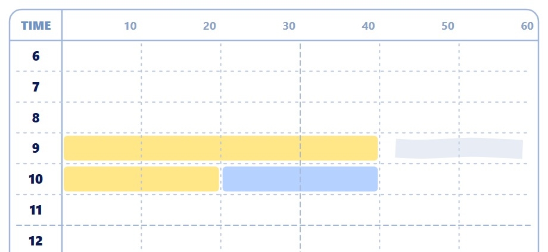

# 02 인터랙션 기능

새 도구를 만들지 않는다. **기존 펜 · 형광펜 · 지우개 · 손 도구를 그대로 쓰고, 속지 영역이 그 획을 알아듣는다.** 같은 형광펜이라도 시간표 안에서 시작하면 칸 채움, 바깥에서 시작하면 보통 형광펜 획이다.

## 기능 목록

| 우선 | 기능 | 도구 · 동작 | 결과 |
|---|---|---|---|
| 필수 | 10분 칸 채움 | 형광펜으로 시간표를 쓸기 | 펜촉 중심이 지나간 칸이 그 형광펜 색으로 통째 칠해짐 |
| 필수 | 총 공부 시간 자동 | — | 칠한 칸 수 × 10분, 총 공부 시간 칸에 `8시간 50분` |
| 필수 | 펜 색 체크 | 펜으로 체크칸을 톡 또는 ✓ 모양으로 긋기 | 반듯한 ✓가 지금 펜 색으로 그려짐 |
| 필수 | 시간 분포 자동 | — | 색 칩 · 막대 · 시간 · 비율(%), 처음 칠한 순 |
| 필수 | 지우기 · 되돌리기 | 지우개로 칸 · 체크 · 색 칸을 지나가기 / 실행 취소 | 획 지우개는 닿은 막대 통째로, 영역 지우개는 칸 하나씩. 한 번 쓸기 = 한 번 취소 |
| 권장 | 할 일 색 칸 | 형광펜으로 할 일 줄을 쓸기 | 그 줄 오른쪽 색 칸이 형광펜 색으로 참 |
| 권장 | 색 바꾸기 | 다른 색 형광펜으로 이미 칠한 칸을 다시 쓸기 | 그 칸만 새 색으로 바뀜(진해지지 않음, 시간 그대로) |
| 권장 | 시작 · 끝 시각 | — | 총 공부 시간 칸 오른쪽 위에 첫 칸 ~ 마지막 칸 시각 |
| 권장 | 요일 표시 | 펜으로 요일을 톡 / 형광펜으로 톡 | 펜은 동그라미, 형광펜은 동그란 칠. 하나만 선택 |
| 권장 | 만족도 | 펜 · 형광펜으로 하트를 톡 또는 여러 개 긋기 | 누른 · 그은 하트만 그 색으로 칠해짐(누적, 하트마다 색 따로) |
| 자유 | 손글씨 · 꾸미기 | 펜 · 형광펜 · 스티커 · 테이프 | 칸 맞춤 없이 그대로. 날짜 · D-day · 목표 · 할 일 글자 · 메모 · 회고 |

## 1. 10분 칸 채움

<figure><figcaption>① 쓰는 중 — 지나간 칸에 점선 미리보기</figcaption></figure>
<figure><figcaption>② 펜을 떼면 — 칸 전체가 칠해짐</figcaption></figure>

- **① 쓰는 중** — 형광펜 획은 원래대로 반투명하게 보이고, 그 밑에 "칠해질 칸"이 같은 색 점선 테두리로 미리 보인다. 줄 끝에서 펜을 들지 않고 다음 줄로 내려가도 한 동작으로 이어진다.
- **② 펜을 떼면** — 손으로 그은 획은 사라지고, 미리보기 칸이 반듯하게 칠해진다. 같은 줄의 같은 색 칸은 하나의 둥근 막대로 이어 그려 종이에 형광펜으로 칠한 느낌을 낸다. 총 공부 시간 · 시간 분포이 바로 바뀐다.

규칙

1. 시간표 **안에서 시작한** 형광펜 획만 칸 채움이 된다. 바깥에서 시작해 들어온 획은 보통 형광펜 획으로 남는다(꾸미기용 밑줄을 망치지 않게).
2. 칸 판정은 **펜촉 중심선**으로 한다. 굵은 형광펜 가장자리만 스친 옆 줄 · 옆 칸은 칠하지 않는다. 빠르게 그어도 칸이 빠지지 않게 점 사이를 3pt 간격으로 채워 판정한다.
3. 한 번 쓸기(펜 대고 ~ 뗄 때까지)가 실행 취소 한 단위다.
4. 같은 색으로 다시 쓸면 변화 없음. 다른 색이면 그 칸만 색이 바뀌고 시간은 늘지 않는다.
5. 시간표 바깥으로 나가면 채움만 멈추고 다시 들어오면 이어진다. 두 번째 손가락 · 손바닥이 닿거나 취소 이벤트가 오면 미리보기를 버린다.
6. 칸 채움은 그림이 아니라 **기록**으로 저장한다(`{줄, 칸, 색}` 목록). 그래서 레이어 패널에 획으로 쌓이지 않고, 합계 계산 · 색 바꾸기 · 지우기가 칸 단위로 된다.
7. 펜으로 시간표에 쓰는 건 자유 필기다(예: 칸 위에 "인강"이라고 적기). 칸 채움으로 바꾸지 않는다.

<figure><figcaption>색 바꾸기 — 분홍으로 다시 쓸기</figcaption></figure>
<figure><figcaption>색 바꾸기 — 그 두 칸만 바뀜</figcaption></figure>
<figure><figcaption>지우개 — 칸 기록을 비움</figcaption></figure>

- **색 바꾸기** — 다른 색으로 쓸면 지나간 칸만 새 색이 된다. 막대는 색이 바뀌는 지점에서 자동으로 나뉜다.
- **지우개** — 지우개 설정을 따른다. **획 지우개**는 닿은 칸이 속한 막대(같은 줄에 이어 칠한 같은 색 칸) 전체를 지우고, **영역 지우개**는 지우개 중심이 지나간 칸 하나하나만 지운다. 지우개 크기와는 관계없다. 지우는 동안 칸이 바로 비고, 손을 떼면 한 번의 되돌리기로 확정된다.
- **끝 모양** — 형광펜 끝 모양이 둥글면 막대 양 끝이 반원, 네모면 네모로 칠한다(칸마다 기억). 영역 지우개로 가운데를 지워 막대가 나뉘어도 조각마다 원래 끝 모양을 유지한다. 끝 모양이 다른 칸은 같은 색이어도 다른 막대다.

### 시간의 뜻

칠한 칸 1개 = 10분 **손으로 남긴 기록**이다. 타이머로 잰 시간이 아니다. 합계는 칠한 칸 수 × 10분이고, **속지 옵션에서 고른 쉬는 시간 색은 합계에서 뺀다.** 쉬는 시간은 총 공부 시간 칸 오른쪽 아래에 `쉬는 시간 1시간 10분`처럼 따로 보이고, 시간표 막대와 색별 기록에서 흐리게 그린다.

## 2. 체크 · 할 일 줄

<figure><figcaption>펜으로 대충 ✓</figcaption></figure>
<figure><figcaption>그 펜 색의 반듯한 ✓</figcaption></figure>

- **펜 색 체크** — 체크칸 **안에서 시작한** 펜 획이면 모양과 관계없이(톡, ✓, ✕, 낙서) 체크로 본다. 펜을 떼면 손 획 대신 반듯한 ✓를 지금 펜 색 · 굵기 2.8로 그린다. 다시 톡 하면 그 색으로 바뀐다. 지우개로 지우면 빈칸.
- 체크칸에 형광펜으로 톡 하면 칸이 형광펜 색으로 칠해진다(진행 중 표시 등으로 자유롭게).

<figure><figcaption>할 일 줄을 형광펜으로 쓸기</figcaption></figure>
<figure><figcaption>그 줄만 칠함 (시안 · 앱에서는 오른쪽 색 칸)</figcaption></figure>

- **할 일 색 칸** — 할 일 줄 오른쪽 끝에 `색` 칸이 있다. 형광펜으로 그 줄을 쓸면(글자 위든 색 칸이든) 그 줄의 색 칸이 형광펜 색으로 찬다. 시간표에 칠한 색과 같은 색을 골라 할 일과 공부 시간을 짝짓는다. 글자 위를 덮지 않아 손글씨가 그대로 읽힌다. 지우개는 색 칸 위를 지나갈 때만 지운다.
- 색 칸과 시간표 색은 **연결하지 않는다.** 같은 색이면 사람이 보기에 묶일 뿐, 앱이 과목을 추론하지 않는다.

## 3. 자동으로 채워지는 칸

| 칸 | 계산 | 빈 상태 |
|---|---|---|
| 총 공부 시간 | 쉬는 시간 색을 뺀 칸 수 × 10분 → `n시간 mm분`, 쉬는 시간은 `쉬는 시간 1시간 10분` | 비움 |
| 시작–끝 | 가장 이른 칸의 시작 ~ 가장 늦은 칸의 끝 (`09:00 ~ 22:20`) | 숨김 |
| 시간 분포 | 색별 칸 수 × 10분(`1시간 40분` · `50분`)과 공부 시간 중 비율(`43%`), 처음 칠한 순 최대 7색(쉬는 시간 색은 맨 아래, 비율 대신 `쉼`). 막대 길이는 가장 많은 색 기준 | 빈 칩 · 빈 막대 7줄 |

- 칩 옆 손글씨 이름 칸은 없앴다(칩 바로 옆에 막대). 그래도 줄이 흔들리지 않게 **그 페이지에서 처음 칠한 순서로 줄을 고정**하고, 새 색만 아래에 붙인다. 쉬는 시간 색은 맨 아래.
- **비율** — 쉬는 시간을 뺀 공부 시간 안에서의 비율이다. 소수점 아래는 표기하지 않고, 버린 소수점이 큰 색부터 1씩 더해 **보이는 숫자의 합이 늘 100**이 되게 한다(예: 10 · 10 · 10분 → 34 · 33 · 33%).
- 자동 칸은 사용자가 손으로 덮어 쓸 수 없고, 그 위에 자유 필기는 할 수 있다.

## 4. 도구별 반응 정리

| 영역 | 손 | 펜 | 형광펜 | 지우개 |
|---|---|---|---|---|
| 시간표 칸 | 화면 이동 | 자유 필기 | **칸 채움** | 획 지우개: 막대 통째 · 영역 지우개: 칸 하나 |
| 체크칸 | 화면 이동 | **펜 색 ✓** | 칸 칠 | 체크 지움 |
| 할 일 줄 | 화면 이동 | 자유 필기 | **색 칸 채움** | 색 칸(그 위를 지날 때) · 획 지움 |
| 요일 | 화면 이동 | 동그라미 | 동그란 칠 | 표시 지움 |
| 만족도 하트 | 화면 이동 | 톡 → 누른 하트만 칠함, 여러 개를 그으면 지나간 하트가 참 | 펜과 같음(형광펜 색) | 닿은 하트 하나씩 비움 (획 · 영역 같음) |
| 그 밖 (날짜 · D-day · 목표 · 메모 · 회고) | 화면 이동 | 자유 필기 | 자유 형광펜 | 획 지움 |

- **텍스트 도구 칸 맞춤** — 날짜 · D-day · 오늘의 목표 · 할 일 · 메모 · 오늘 돌아보기를 텍스트 도구로 탭하면, 그 칸(밑줄 폭 · 할 일 줄 · 메모 줄)에 맞춘 글상자가 생긴다. 글자 16 · 줄 높이 28이라 여러 줄도 다음 칸 · 다음 밑줄에 그대로 맞는다. 정렬 · 색은 사용자가 바꾼다. 끌어서 만든 상자는 칸 맞춤 없이 그대로.
- **만족도 하트는 누적이다** — 펜 · 형광펜 모두 이미 칠한 하트는 그대로 두고 누른 하트 하나 · 그은 하트들만 칠한다. 하트마다 칠한 색을 따로 기억한다. 줄이려면 지우개로 하트를 하나씩 지운다.
- 손바닥 · 펜 입력 분리는 편집기의 기존 규칙(펜이 있으면 손가락은 이동)을 따른다.
- 선택 · 올가미 도구는 속지 기록(칸 · 체크 · 색 칸)을 고르지 않는다. 기록은 속지의 일부라 옮기거나 돌릴 수 없다.

## 5. 속지 옵션

선택 도구에서 빈 곳을 길게 눌러 여는 **속지 옵션**(스터디 플래너가 아니면 기존 '속지 색')에 세 가지를 붙였다. 이 페이지에만 쓴다.

| 옵션 | 값 | 동작 |
|---|---|---|
| 쉬는 시간 색 | 없음 · 형광펜 7색 | 고른 색 칸은 합계에서 빼고 흐리게 그린다 |
| 시간표 시작 | 5 · 6 · 7시 (기본 6) | 시간 숫자가 바뀐다. 칠한 칸은 같은 시각으로 옮겨 그대로 남는다 |
| 형광펜 칸 맞춤 | 켬 · 끔 (기본 켬) | 끄면 형광펜 · 펜 모두 보통 획으로 남는다 |

## 6. 저장 · 출력

- 페이지 속지 ID는 `study-planner-landscape` · `study-planner-portrait`, 기록은 `page.planner`에 저장한다: `cells: {"줄,칸": 색}`, `checks: {줄: 색}`, `bands: {줄: 색}`, `day`, `mood`, `colorOrder`, `options: {restColor, startHour, snap}`. 획 · 스티커 같은 요소는 기존 형식 그대로.
- 합계는 저장하지 않고 열 때마다 계산한다(기록과 숫자가 어긋나지 않게).
- 속지 그림은 파일이 아니라 코드로 만든 SVG이고, 기록을 같은 SVG에 그린다. 그래서 편집 화면 · 썸네일 · PNG/PDF 내보내기가 같은 결과를 쓴다(속지 → 기록 → 사용자 요소 순).
- 가로 · 세로 속지는 좌표가 다르므로 서로 바꿔도 기록을 옮기지 않는다. 바꾸기 전에 "기록이 이 방향 속지에만 남아요" 안내.

- 페이지 복제는 속지 ID·방향·배색·플래너 기록과 옵션을 함께 복사한다. 페이지·요소·그룹 ID는 새로 만들고, 복제 후 기록 수정과 Undo/Redo는 원본에 영향을 주지 않는다.
- 속지 배경색·레이아웃색을 바꿔도 사용자가 칠한 칸·체크·요일·만족도와 집계 색상표의 색은 유지한다. 자동 집계 글자·기본 선만 속지 배색을 따른다. 편집 화면과 PNG/PDF 모두 같은 규칙이다. 기존 저장 형식은 바꾸지 않는다.
