# DIO 전수 QA 보고서 — 2026-11-04

> 폰과 태블릿에서 게스트·회원·공유 흐름을 실제로 돌며 찾은 문제를 **치명 → 규격 → 경험 → 미감 → 통일성 → PM 관점** 순서로 모았다. 지난 [QA 사전 점검](../QA%20점검%202026-11-04/QA%20점검%202026-11-04.md)에 없던 **미감과 사용자 경험**을 이번에 특히 많이 봤다. 수정은 하나도 하지 않았다.

## 0. 범위 · 환경 · 읽는 법

| 항목 | 내용 |
|---|---|
| 코드 기준 | `origin/develop` a1407675 (워크트리 `C:/dqa`) |
| 폰 | 갤럭시 S20 (Android 13, 1080×2400, 411×914dp), 개발 앱 `com.f106.DIO.handwritingdev` + Metro 8120. Play 앱은 건드리지 않음 |
| 태블릿 | 갤럭시 탭 S9 FE (Android 16), 글꼴 지연 로딩 세션의 `com.f106.DIO.fonttest` 앱(같은 커밋 + **글꼴 작업 미커밋 변경 포함**), 재설치 없이 사용 |
| 백엔드 | 로컬 `C:/dio-local` 8080 (develop과 `backend/` 차이 없음) |
| 계정 | 게스트, 그리고 로컬 시드로 만든 `qa1~qa5@dio-local.test`(로컬 DB 전용) |
| 근거 표시 | **[실기]** 실기기에서 재현, **[코드]** 코드만 확인, **[미확인]** 재현 못 함 |

**심각도**: `P0` 출시 차단(심사 거절 · 데이터 대량 손실 · 핵심 사용 불가) / `P1` 핵심 흐름이 끊기거나 작업 소실 / `P2` 불편 · 규격 미달 / `P3` 사소.

**집계**: P0 3 · P1 14 · P2 · P3 약 40(묶어 적은 항목 포함). 화면별 진행표는 [01 화면 목록](01%20화면%20목록.md).

**아직 보지 못한 것** (1 · 2차 합산, 2차 결과는 §12)

- **실제 오프라인(비행기 모드):** 무선 디버깅으로 제어해 끌 수 없었다. 대신 서버를 꺼서 재현했다. 비행기 모드는 QA 때 손으로 돈다.
- **푸시 실제 수신:** 로컬 HTTP 서버에서는 앱이 `PUSH_HTTPS_REQUIRED`로 등록을 멈춘다. HTTPS 서버에서 확인해야 한다.
- **동시 편집 충돌(409):** 두 계정으로 연달아 수정했는데 앱이 합쳐서 충돌 화면이 나오지 않았다. 재현 실패이지 문제 없음이 아니다.
- **초대 · 링크 만료, 저장 공간 부족, TalkBack 실사용, 분할 화면.**
- **폰트 생성 끝까지:** 이 빌드에 모델 파일이 없다. **사진 속 대상 오리기:** 자동 입력으로 칠해지지 않아 손 확인이 필요하다. **스티커 시트 저장 완료.**
- **태블릿의 나머지**(선택 바 · 레이어 · 페이지 메뉴 · 읽기 모드 · 글자 확대): 다른 세션이 태블릿을 쓰고 있어 중단했다.
- **iOS:** 실기기 없음. §7은 코드와 공식 문서 기준.

---

## 1. 먼저 볼 것

| # | 심각도 | 한 줄 | 근거 |
|---|---|---|---|
| F-01 | P0 | 공유 다이어리인데 **신고 · 차단 기능이 없음** (App Store 1.2, Play UGC 정책) | 코드 |
| F-02 | P0 | **앱을 다시 켜면 로그아웃**, 안내 없이 게스트 보관함으로 (회원 다이어리가 안 보임) | 실기 |
| F-03 | P0 | **오픈소스 고지 목록이 현재 의존성과 어긋나** Android 빌드 검사가 실패 | 실기 |
| F-04 | P1 | **초대를 수락해도 다이어리가 열리지 않고** 빈 내 다이어리로 돌아옴 | 실기 |
| F-05 | P1 | **편집 중 참여자에서 제외돼도 안내 없음**, 계속 그려지고 개발자 코드만 노출 | 실기 |
| F-06 | P1 | **스티커 시트 분리 결과가 뒤로가기 한 번에 사라짐** (확인 없음) | 실기 |
| F-07 | P1 | **같은 다이어리의 표지가 사람마다 다름**, 꾸민 표지는 서버에 저장되지 않음 | 실기 |
| F-08 | P1 | **가입하면 기능이 줄어듦**: 회원 새 다이어리에 `속지` 탭 없음 | 실기 |
| F-09 | P1 | **글 입력 뒤 화면이 밀린 채 남아** 페이지가 잘리고, 새 요소가 잘린 위치에 놓임 | 실기 |
| F-10 | P1 | **로그인 뒤 하던 일로 돌아오지 않음**, 게이트 시점도 기능마다 다름 | 실기 |
| F-11 | P1 | **기기 저장값이 계정을 넘나듦**: 다른 계정의 스티커 폴더가 보임 | 실기 |
| F-12 | P1 | **"사진 속 대상 오리기" 저장이 실제로 저장되지 않음** | 코드 |
| F-13 | P1 | **분석 · 크래시 수집이 없음**: 출시 후 전환과 오류를 볼 수 없음 | 코드 |
| F-14 | P1 | **fresh 설치로는 Android 개발 빌드가 안 됨** (Firebase 패키지 · pnpm 설정 · 경로 길이) | 실기 |
| F-15 | P1 | **태블릿 편집기에 패널 둘이 기본으로 열려** 세로에서 페이지가 폭의 절반 | 실기 |
| F-36 | P1 | **세션이 만료되면 벗어날 길이 안 보임**: 프로필은 로그인 상태인데 목록은 `다시 로그인해 주세요`, 로그인 버튼 없음 | 실기 |
| F-37 | P1 | **서버가 끊겨도 `다시 로그인해 주세요`**: 네트워크 문제를 로그인 문제로 안내 | 실기 |

**지난 점검 이후 고쳐진 것 (이번에 확인)** — 페이지 단건 삭제 확인창 [실기], 시스템 글자 확대 대응 대부분 [실기], 로그인 오버레이 뒤로가기 [코드], 오류 복구 화면 [코드], 태블릿 세로 방향 대응 [실기], 알림함 디자인 [실기], 손가락 그리기(지난번 "확인 필요") [실기].

**아직 남은 것** — 재실행 시 게스트(F-02로 격상), 아이디 찾기 막다른 길, 새 다이어리 `속지 색` 칩 잘림, 폰 도구 줄 잘림, 레이어 이름 `텍스트/텍스트`, 안내 멘트 일부.

---

## 2. 치명 · 데이터

### F-01 [P0] 신고 · 차단 기능이 없다 [코드]

- **어디:** 앱 전체. 공유 허브 · 참여자 관리에 `내보내기`만 있고 `신고` · `차단` 문구가 없다.
- **왜 문제:** 공유 다이어리는 다른 사람이 만든 글 · 그림 · 사진을 보여 주는 UGC다. App Store 1.2는 필터링 · 신고 · 악성 사용자 차단 · 공개 연락처를, Play UGC 정책은 약관 동의 · 인앱 신고 · 차단을 요구한다. 1020 대상이라 더 민감하다. 초대제 비공개 공유까지 어디까지 해당하는지는 **심사 정책 해석이 필요**하므로, 담당자가 먼저 판단한다.
- **해법:** 참여자 행에 `신고` · `차단`, 페이지 · 요소에 `신고`를 두고 처리 연락처와 운영 절차를 정한다. 백엔드 API가 필요하니 함께 설계한다.

### F-02 [P0] 앱을 다시 켜면 로그아웃된다 [실기]

- **현상:** 회원으로 쓰다 앱을 강제 종료하고 켜면 안내 없이 게스트 보관함이 뜬다. 방금까지 쓴 회원 다이어리가 하나도 안 보여 **"다 날아갔다"로 읽힌다.** 저장은 서버에 되어 있다.
- **위치:** `src/auth/authApi.js:11-12`(토큰 메모리 보관), `App.js:102-110`(`startGuest`). 지난 보고서에서는 P1이었는데, 회원 기능이 늘어 영향이 커져 올렸다.
- **해법:** 리프레시 토큰을 `expo-secure-store`에 두고 시작 때 조용히 갱신한다. 실패하면 게스트로 떨어뜨리지 말고 "다시 로그인해 주세요"를 한 번 알린다. 토큰은 1회용 교체(RFC 9700) + 갱신 요청 직렬화. Android 자동 백업에서 제외한다.

### F-03 [P0] 오픈소스 고지 목록이 현재 의존성과 어긋난다 [실기]

- **현상:** `src/licenses/generated/android.json`이 11-02 이후 갱신되지 않아 `pnpm-lock.yaml` 해시와 다르다. `scripts/verify-prepared-licenses.cjs android`가 `License catalog is stale`로 실패하고, 이 검사는 `preBuild`에 걸려 있다. 11-03 · 11-04에 lock이 바뀌었다(펜, 구글 · 애플 로그인).
- **왜 문제:** 빌드가 막히고, 새 패키지 고지가 앱에서 빠져 라이선스 의무를 어길 수 있다. 이번 점검은 검사를 건너뛰어 빌드했다.
- **해법:** 고지 목록을 다시 만들고, lock을 바꾸는 MR에 이 검사를 CI로 건다.

### F-05 [P1] 편집 중 제외돼도 안내가 없다 [실기]

- **현상:** 편집 중인 참여자를 소유자가 내보내면 20초가 지나도 화면이 그대로다. 계속 그려지고 `저장 안 됨`만 뜬다. 눌러야 `이 페이지를 편집할 권한을 확인하지 못했어요. (403 / DIARY_ACCESS_DENIED) 기기 작업은 유지돼요.`가 나온다. 상단 참여자 수도 그대로다.
- **왜 문제:** 저장되지 않을 그림을 계속 그리게 된다. 개발자 코드가 사용자에게 보인다.
- **위치:** `src/editor/hooks/useMemberCanvasCollaboration.js:33-35`, `App.js:373-380`(공유 목록 소실 이동은 서버 런타임에서 동작하지 않음).
- **해법:** 403이면 바로 도구를 잠그고 전면 안내 `이 다이어리에 더 이상 참여하지 않아요` + `내 다이어리로`, 가능하면 `내 사본으로 저장`. 오류 문구는 "무슨 일 · 원인 · 다음 행동" 구조로 쓰고 코드는 로그로만 남긴다(NN/g, Adobe Spectrum). 권한 박탈 전용 공식 지침은 찾지 못해 일반 원칙에서 끌어낸 권고다.

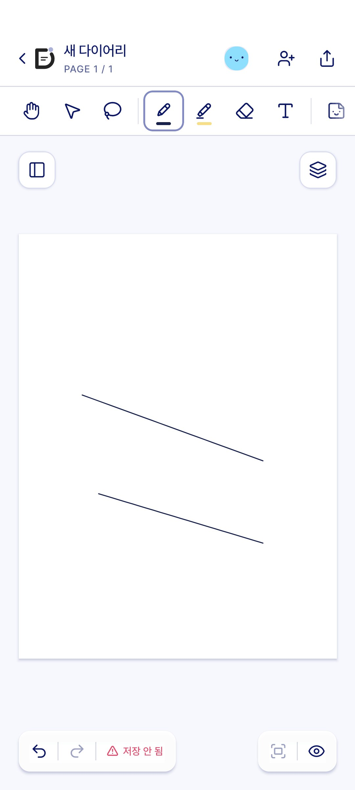
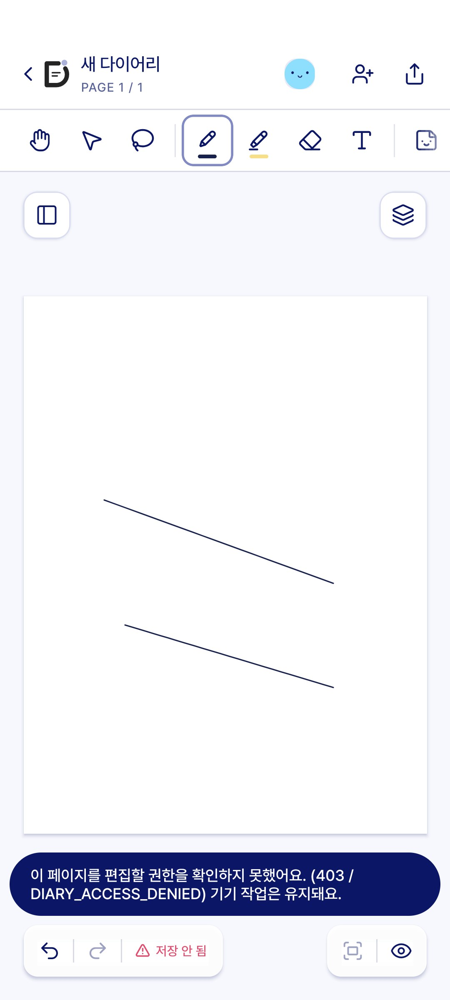

### F-06 [P1] 스티커 시트 분리 결과가 사라진다 [실기]

- **현상:** 7개까지 분리한 뒤 뒤로가기를 누르면 확인 없이 공방으로 나가고 결과가 없어진다. 재분리에만 시스템 확인창이 있다.
- **위치:** `panels/StickerSplitModal.js:289` `onRequestClose`.
- **해법:** 작업이 있으면 `저장하지 않고 나갈까요?`. 앱의 다른 작업 화면(새 다이어리 · 프로필)과 같은 `ConfirmDialog`로 맞춘다.

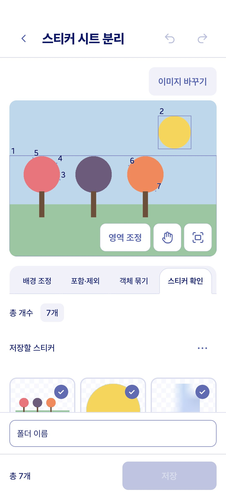
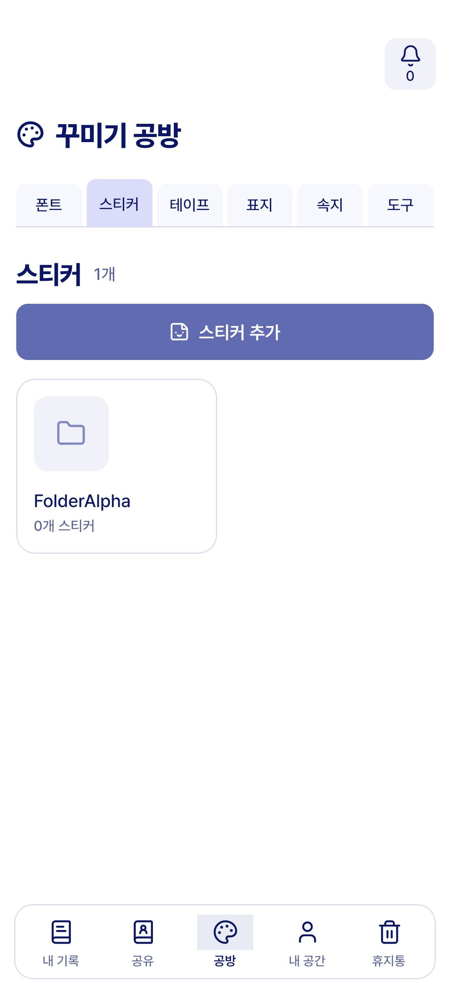

### F-07 [P1] 같은 다이어리의 표지가 사람마다 다르다 [실기]

- **현상:** 세로 표지 + 종이 라벨로 만들면 만든 기기에는 그대로 보이지만, 초대받은 사람과 알림 카드에는 **가로 비율 + 띠 라벨**의 기본 표지로 보인다. 게스트 가져오기도 `옮기지 못한 항목 · 표지 꾸밈 2개`로 표지가 바뀐다.
- **근거:** 서버 응답은 `coverColor`, `coverStyle: "PLAIN"`뿐이다.
- **왜 문제:** 표지는 DIO에서 가장 "내 것" 같은 물건이다. 다른 기기로 로그인하면 꾸민 표지가 사라지는지도 확인이 필요하다 [미확인].
- **해법:** 표지 설정을 서버 필드로 저장하고 사진 표지는 미디어로 올린다(백엔드 요청 필요). 그 전까지는 초대 · 공유 화면이 쓰는 기본 표지가 실제와 다를 수 있음을 팀이 알고 있어야 한다.

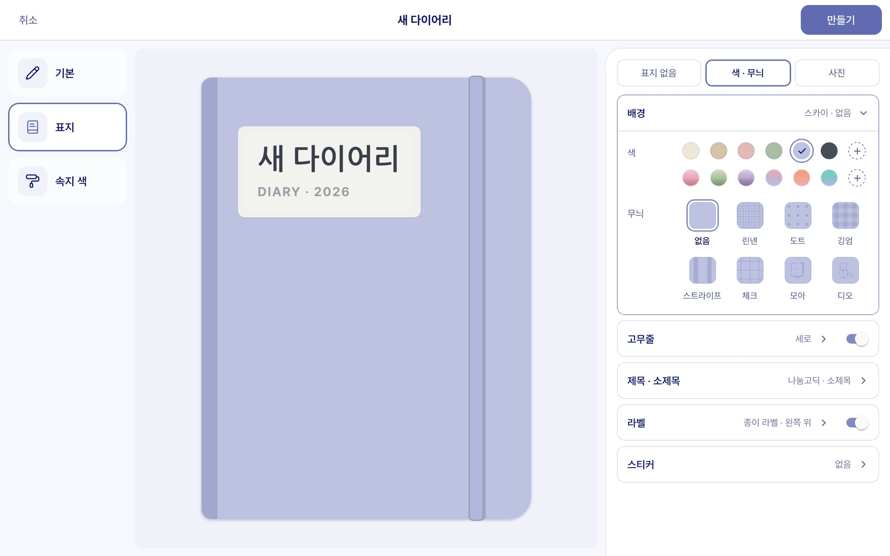
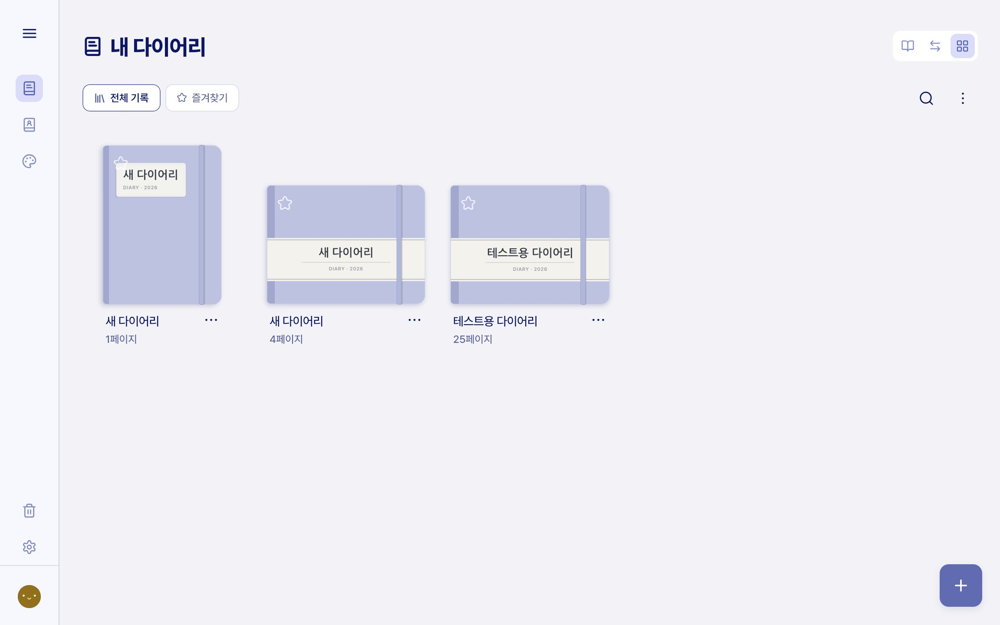
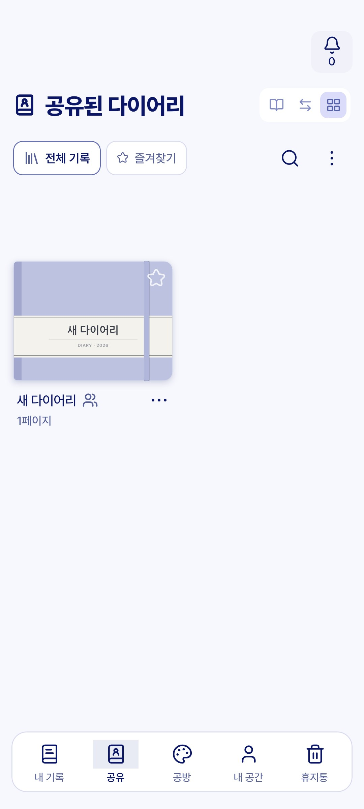

### F-09 [P1] 글 입력 뒤 화면이 밀린 채 남는다 [실기, 폰]

- **현상:** 페이지 아래쪽을 눌러 글을 쓰면 키보드를 피하려 페이지가 위로 밀린다. 입력이 끝나 키보드가 닫혀도 **그대로** 남아 윗부분이 도구 줄 아래로 잘리고 아래는 비어 있다. 이 상태에서 위젯을 붙이면 잘린 위치에 놓이고, 되돌리기 막대가 선택 바를 덮는다. `화면에 맞춤`을 눌러야 돌아온다.
- **해법:** 키보드 때문에 옮긴 값을 사용자가 직접 옮긴 값과 분리해 저장하고 닫힐 때 복원한다. 위치: `EditorScreen.js:181`의 `keyboardDidHide`가 `keyboardTop`만 지운다.

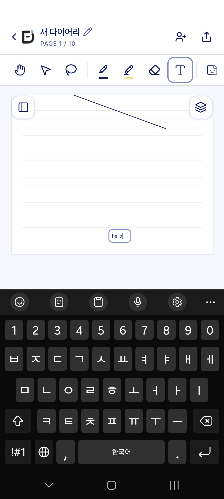
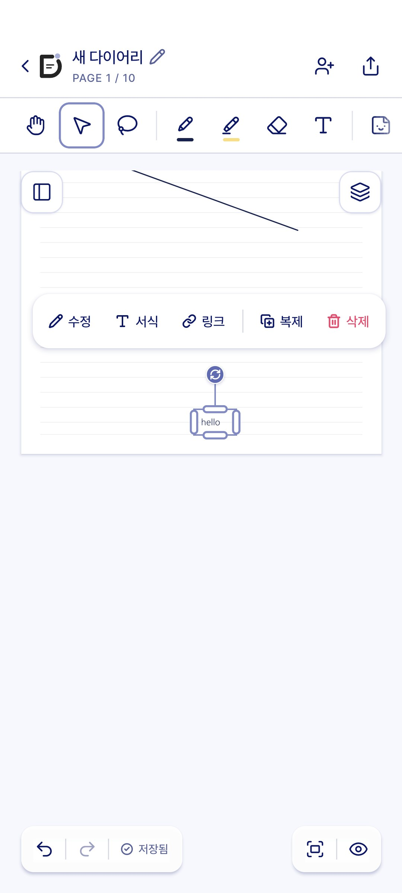
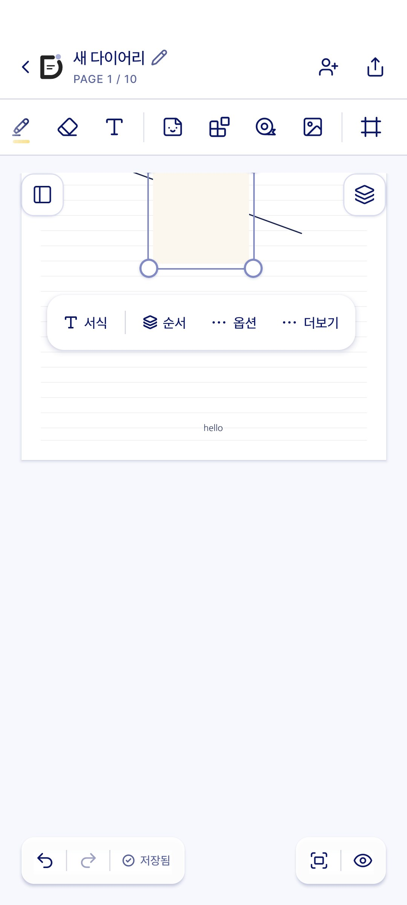
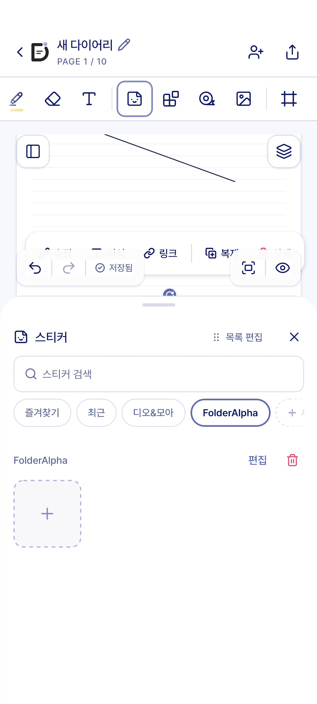

### F-11 [P1] 기기 저장값이 계정을 넘나든다 [실기]

- **현상:** 게스트 때 만든 스티커 폴더 `FolderAlpha`가 다른 회원으로 로그인해도 보인다(공방 · 편집기). 팔레트 · 최근 색 · 테이프 폴더도 같은 구조로 보인다 [코드 추정].
- **왜 문제:** 공용 기기나 계정 전환에서 다른 사람의 사진 스티커가 보일 수 있다. 탈퇴 뒤에도 남는다.
- **위치:** `editor/hooks/useCustomDecor.js:21,73` 등 `STORAGE_KEYS`가 계정 구분 없음(앱 잠금 · 최근 검색어는 계정별).
- **해법:** 저장 키에 계정 범위를 넣고, 게스트 자산은 가져오기 때 함께 옮긴다.

### F-12 [P1] "사진 속 대상 오리기"의 저장이 저장이 아니다 [코드]

- `StickerCutoutModal.js:243,247`: 확인창이 `미리보기 단계라 실제로는 저장되지 않아요.`라고 말한다. 공방 메뉴에는 정식 기능처럼 있다. **출시 전 숨기거나 완성한다.**

### F-14 [P1] 새로 받으면 Android 개발 빌드가 안 된다 [실기]

| 원인 | 현상 | 해법 |
|---|---|---|
| `google-services.json`에 `.handwritingdev` 없음 | `No matching client found` | Firebase에 개발 패키지 등록 |
| pnpm 11이 `.npmrc`의 `node-linker=hoisted`를 무시 (`Unknown project config`) | 깊은 경로 + 260자 초과 → `ninja: manifest still dirty after 100 tries` | `pnpm-workspace.yaml`의 `nodeLinker: hoisted`로 이동 |
| 플러그인 임시 폴더 `~/.dio-cxx/<해시>`가 김 | `ninja: mkdir ... No such file` | 더 짧은 경로(팀원 빌드는 `C:/x`로 직접 수정 중)를 플러그인 기본값으로 |

---

## 3. 규격 · 표준

| # | 심각도 | 근거 | 내용 | 해법 |
|---|---|---|---|---|
| F-16 | P2 | 실기 | 시스템 글자 크기를 바꾸면 **앱이 재시작되어 편집기에서 보관함으로 튕김** (`configChanges`에 `fontScale` 없음) | `fontScale` 추가 + 재계산, 또는 상태 복원 |
| F-17 | P2 | 실기 | 글자 1.5배에서 **표지에 인쇄된 제목까지 커져** `새 / 다이어리`로 줄바꿈 | 표지 · 속지 · 캔버스 글자는 `allowFontScaling={false}`, UI만 확대 |
| F-18 | P2 | 실기 | 라이트 앱에 **검은 키보드와 시스템 바** (키보드 뜰 때 하단 바 재등장) | 몰입 정책 정리, iOS는 `keyboardAppearance="light"` |
| F-19 | P2 | 실기 | 편집기 떠 있는 막대 · 폰 하단 탭 · 가로 도구 레일의 접근성 영역이 **0×0**으로 잡힘, 로그인 오버레이 뒤 보관함도 접근성 트리에 남음 | TalkBack으로 확인 후 `accessibilityViewIsModal` · `importantForAccessibility` 적용. 도구로 본 값이라 실제 영향은 [미확인] |
| F-20 | P2 | 코드 | 알림 권한을 로그인 직후 자동 요청 (지난 보고서와 동일) | 초대 수락 · 종 버튼 맥락에서 요청 |
| F-21 | P2 | 실기 | 폰(S펜 없음)에도 `그리기 입력: 펜만`과 필압 · 기울기 토글이 보임. 고르면 손가락으로 못 그릴 수 있음 [선택 후 동작은 미확인] | 펜 입력을 본 기기에서만 노출 또는 확인 문구 |
| F-22 | P3 | 실기 | 폰 사진 선택이 여러 장 모드라 1장이어도 `완료`를 한 번 더 눌러야 함(스티커 분리 등) | 1장 기능은 단일 선택 |
| F-23 | P2 | 조사 | Play 계정 삭제 정책은 **인앱 + 웹 삭제 요청 링크** 둘 다 요구. 인앱은 있음, 웹 링크는 앱에서 못 찾음 | 웹 경로 준비, Data safety에 기재 |
| F-24 | 참고 | 조사 | targetSdk 36 마감은 지난 보고서와 같음. 지난 보고서의 "API 37 2027-08"은 현행 Play 문서에서 확인 안 됨 → 추정으로 낮춘다. Apple은 2026-04-28부터 26 SDK 빌드 필수 | 일정표 수정 |

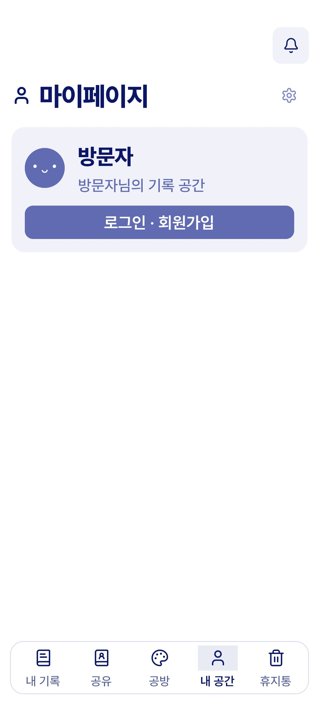
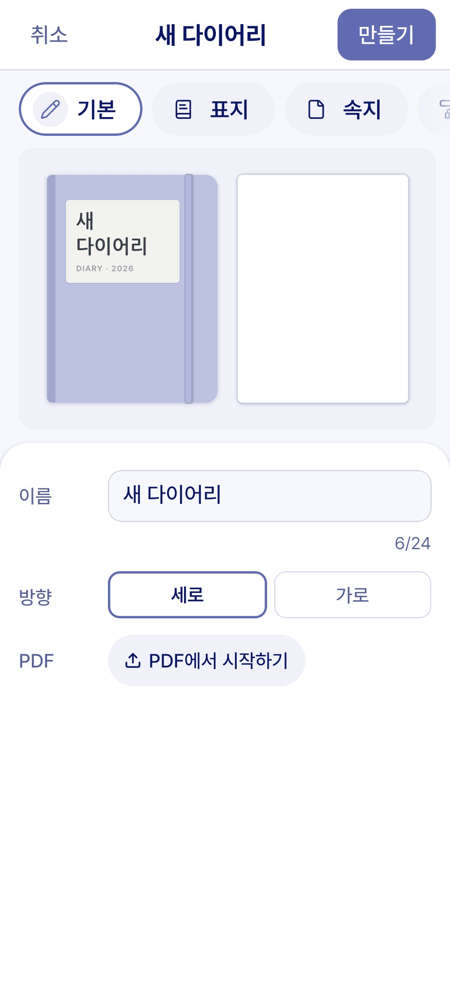
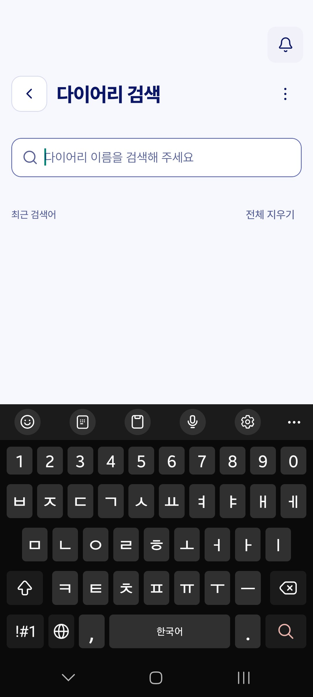
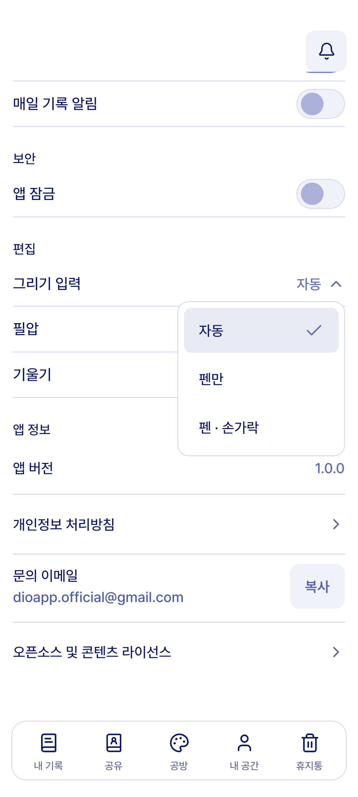

---

## 4. 사용자 경험

### 4.1 게스트 → 회원 → 공유로 넘어가는 길 (가장 큰 구멍)

DIO의 핵심 가치는 **함께 꾸미는 것**인데, 혼자 쓰다가 함께 쓰기로 넘어가는 길목마다 흐름이 끊긴다.

#### F-04 [P1] 수락해도 다이어리가 안 열린다 [실기]

- **흐름:** 종 → 초대 확인 → 수락 → 프로필 설정 → `수락하고 참여하기` → **공유 창** → `완료` → **빈 내 다이어리**. 초대받은 다이어리는 `공유` 탭에서 직접 찾아야 한다. 가이드는 "그 다이어리를 바로 연다"고 적었다.
- **위치:** `SharingHub.js:730`(`canOpenDiary`), `sharingApi.js:188`(서버 런타임이 항상 `false`).
- **해법:** 수락의 목적지는 항상 그 다이어리다(Figma의 "Open in Figma"가 수락과 열기를 함께 한다). 도착하면 `○○에 참여했어요` 토스트만 띄운다. **도안 6**.

#### 그 밖에 초대 흐름 [실기]

- **P2** 대기 중 초대에 `삭제`만 있다(가이드는 거절 · 수락, `OO님이 초대했어요` 문장도 없앤다고 함).
- **P2** 프로필 설정에서 본 아바타 색과 참여 후 색이 다르다(페리윙클 → 갈색). 전역 프로필 · 다이어리 프로필 색도 다르다.
- **P2** 공유 창에 `알림 · 새 초대 없음` 줄이 늘 있다(가이드는 "두지 않는다").
- **P3** 내 행과 다른 사람 행의 이름 시작점이 어긋난다.

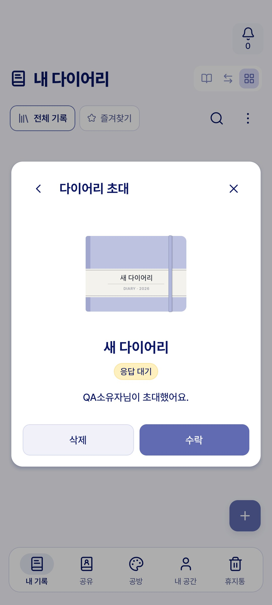
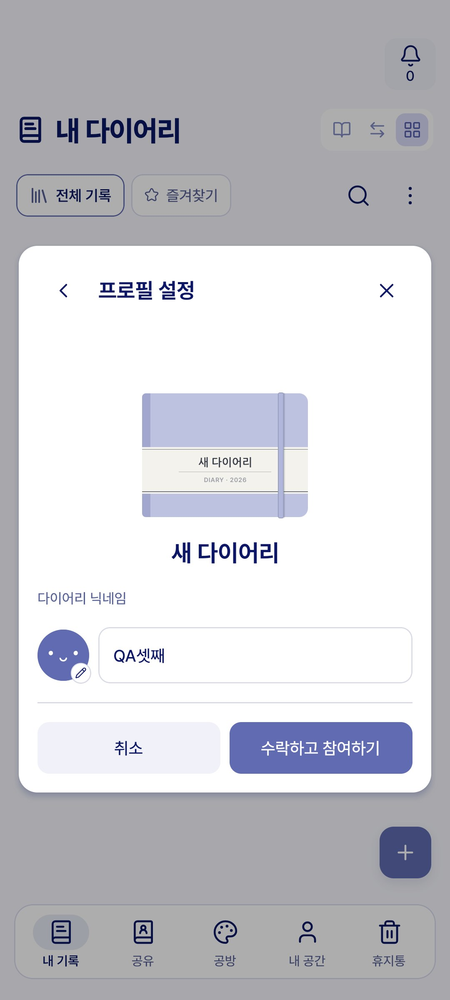
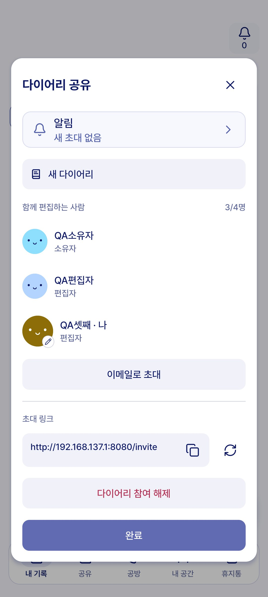
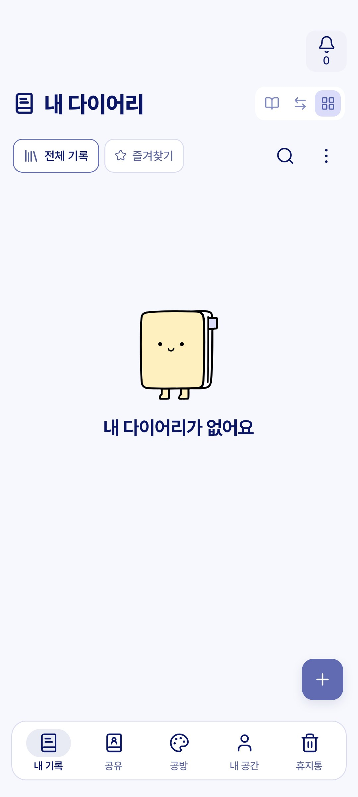

#### F-10 [P1] 로그인 뒤 하던 일로 돌아오지 않는다 [실기]

| 진입 | 게이트 시점 | 로그인 뒤 |
|---|---|---|
| 편집기 공유 | 누르면 바로 | 내 다이어리 (편집 중이던 다이어리는 안 보임) |
| 폰트 추가 | 누르면 바로 | 내 다이어리 |
| 스티커 추가 | **메뉴를 고른 뒤** | 미확인 |
| 테이프 · 표지 추가 | **게이트 없음** | - |
| 사진 패널 `최근 추가한 사진` | 비활성 + 설명문 | - |
| 종 | 누르면 바로, 문구 "받은 초대는 …" | 내 다이어리 |

- **해법:** 규칙 하나로 통일한다(서버가 필요한 기능을 누른 순간). 게이트 전에 "하려던 일"을 저장했다가 로그인 뒤 같은 화면으로 복귀한다. 계정이 필요한 **이유**를 한 줄로 말한다(Apple HIG). `회원가입하고 로그인한 사용자만 쓸 수 있어요`는 벽처럼 읽히니 `로그인하면 친구와 함께 꾸밀 수 있어요`처럼 얻는 것을 말한다.

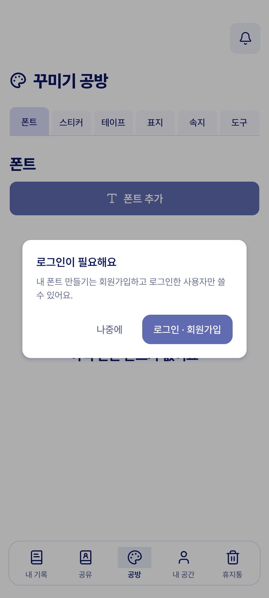
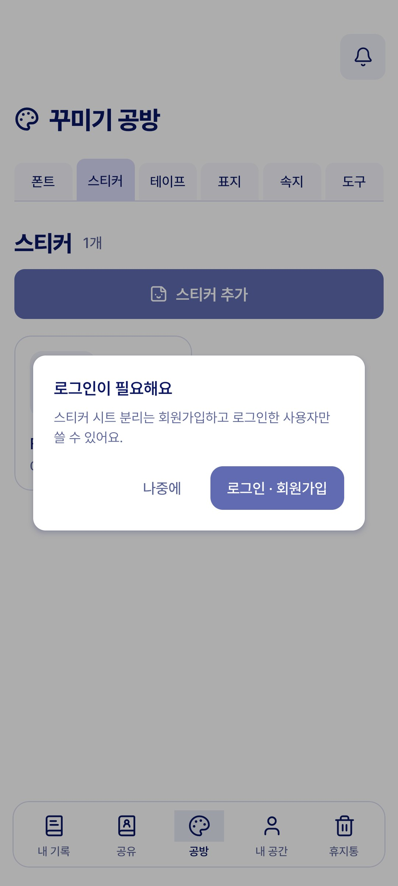
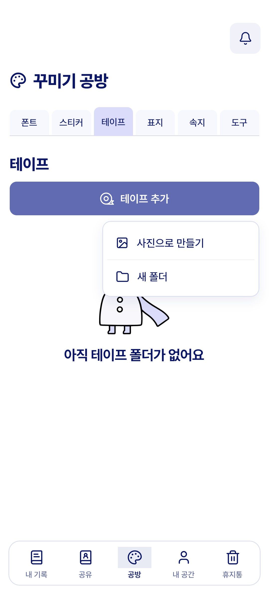
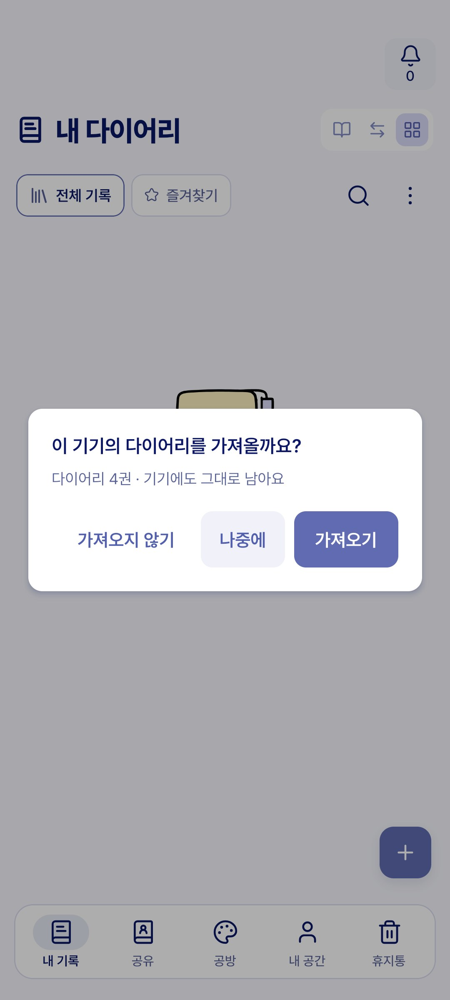

#### F-08 [P1] 가입하면 기능이 줄어든다 [실기]

- 게스트의 새 다이어리는 `기본 · 표지 · 속지 · 속지 색`, 회원은 `속지`가 없다. 표지 꾸밈 저장(F-07)까지 합쳐 **가입할수록 손해**인 구조다. 회원은 게스트의 상위 집합이어야 한다.

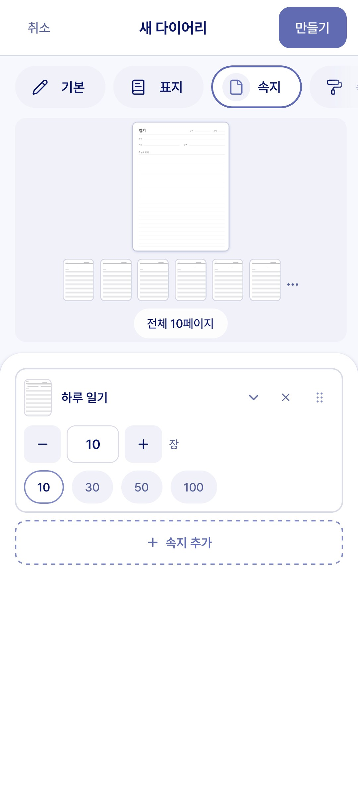
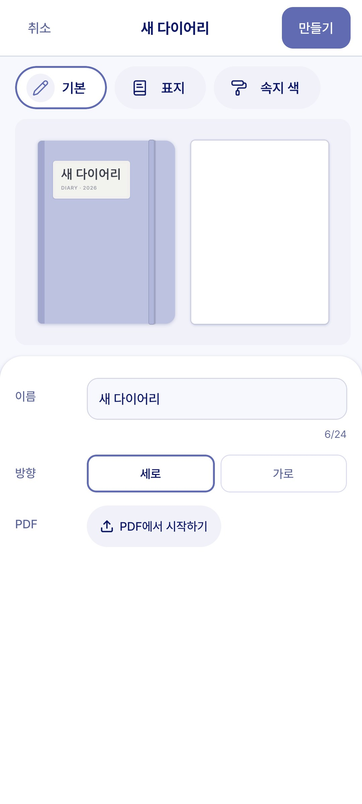

#### 가져오기 [실기, 태블릿]

- 실제로 2권이 잘 옮겨졌고 진행률도 정확하다(강점).
- **P2** 버튼이 `가져오지 않기 · 나중에 · 가져오기` 셋이다. `나중에`를 고르면 다시 가져올 입구를 앱에서 찾지 못했다(다음 로그인 때 다시 묻는다는 코드 근거만 있음). 두 개로 줄이고 설정에 입구를 둔다.
- **P2** 결과의 `옮기지 못한 항목`이 **끝난 뒤에야** 나온다. 묻는 단계에 미리 보여 준다.

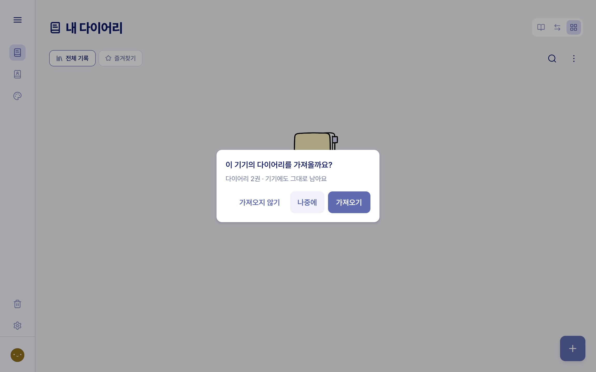
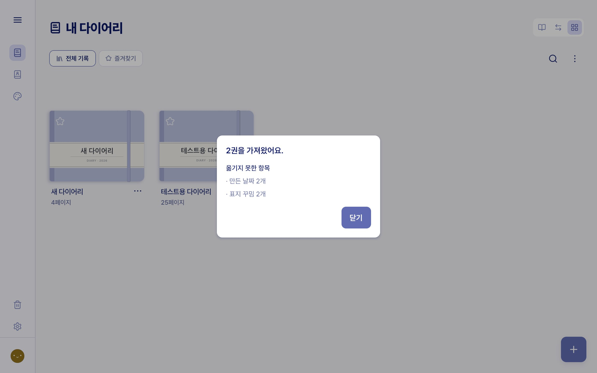

### 4.2 첫 경험 · 빈 상태

- **P2 빈 상태에 다음 행동이 없다** [실기]. `공유된 다이어리가 없어요`, `휴지통이 비어 있어요`, 회원의 `내 다이어리가 없어요`는 문구뿐이다. 특히 공유 탭은 **어떻게 공유를 시작하는지** 앱 어디에도 단서가 없다. NN/g 기준은 "상태 + 학습 단서 + 핵심 작업으로 가는 직접 경로"다. 안내 멘트 금지 규칙에 맞춰 설명 대신 **버튼**만 둔다(`내 다이어리 공유하기`). **도안 3**.
- **P2 첫 성공까지 길다.** 첫 실행은 빈 보관함 → `+` → 작업대 → 만들기 → 빈 페이지다. 서비스 소개의 "하루 한 장의 사진"으로 곧장 가는 길이 없다. 만들기 직후 빈 페이지에 `사진 넣기`를 눈에 띄게 두는 것을 검토한다. [첫 실행 데이터 삭제 재현은 다음 차수]
- **P2 공유로 가는 입구가 숨어 있다.** 혼자 쓰는 사용자에게 공유 유도가 없다. 편집기 사람+ 아이콘이 유일하다.

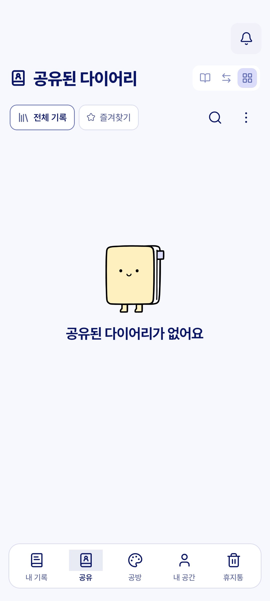

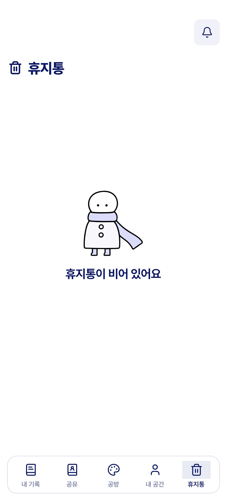
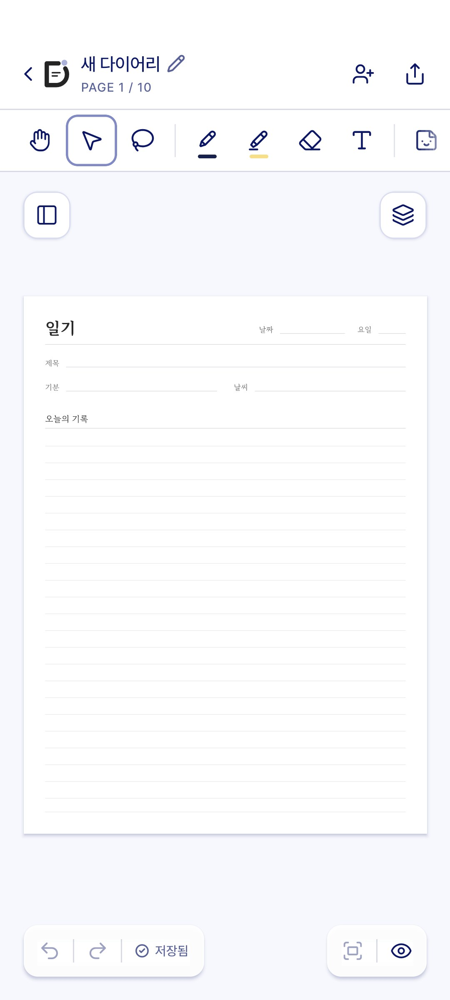

### 4.3 편집기 사용감

| # | 심각도 | 근거 | 내용 | 해법 |
|---|---|---|---|---|
| F-25 | P2 | 실기 | **뒤로가기 계층이 어긋남.** 더보기 메뉴에서 누르면 메뉴만이 아니라 선택까지 풀리고, 읽기 모드에서 누르면 편집기가 아니라 보관함까지 나감 | "메뉴 → 선택 → 나가기" 한 단계씩. 읽기 모드는 들어온 곳으로. 지난 보고서의 단일 뒤로 스택과 함께 |
| F-26 | P2 | 실기 | `옵션`과 `더보기`가 **같은 ⋯ 아이콘** | 옵션은 조절 아이콘(sliders)으로 |
| F-27 | P2 | 실기 | 폰 세로에서 **옵션만 떠 있는 패널**(나머지는 하단 시트). 고른 요소를 가림 | 폰 세로는 하단 시트로 통일 (폰 패널 결정과 일치) |
| F-28 | P2 | 실기 | **시트 높이가 도구마다 달라** 페이지가 들쭉날쭉 가려짐, 되돌리기 막대가 페이지 위에 뜸 | 높이 2단계 고정 + 막대를 시트에 붙임. **도안 5** |
| F-29 | P2 | 실기 | 폰 도구 줄 12개 가로 스크롤, 끝 아이콘 잘림 | 페이드 또는 7칸 + 더보기 — **구성 변경이라 결정 필요**(§9) |
| F-30 | P2 | 실기 | 기본 글자가 페이지에 비해 매우 작아 **손잡이가 글자보다 큼** | 기본 크기 상향은 코덱스 값 참고, 터치 영역은 hitSlop으로 유지 |
| F-31 | P2 | 실기 | 더보기 메뉴의 `삭제`가 잘린 채 스크롤 | 메뉴 높이를 내용에 맞춤 |
| F-32 | P3 | 실기 | 레이어 이름 `텍스트 / 텍스트`, 위젯 메모가 종류 `도형` | 이름은 글 앞부분, 종류는 `위젯` |
| F-33 | P2 | 실기 | 가로 폰: 레이어 패널이 페이지 왼쪽을 덮음, 패널 열면 되돌리기 막대가 위로 점프 | 패널 폭만큼 페이지 이동, 막대 위치 고정 |
| F-34 | P3 | 실기 | 회전하면 도구 줄 스크롤이 처음으로 돌아감 | 선택 도구가 보이게 복원 |
| F-15 | P1 | 실기 | **태블릿**: 페이지 목록 + 레이어가 기본으로 함께 열림. 세로는 페이지가 폭의 절반, 레이어가 비어 있어도 폭 30%. 가이드는 "한쪽만" | 처음엔 닫음, 빈 레이어 자동 열기 금지 |
| F-35 | P3 | 실기 | 태블릿 패널의 칩 줄이 끝에서 잘리는데 단서 없음(`사진 틀` 안 보임) | 페이드 부품 재사용 |

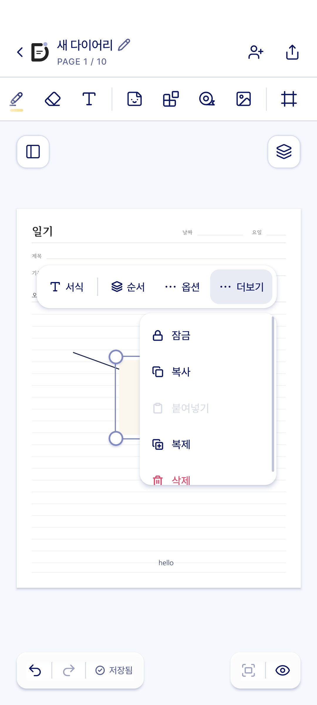
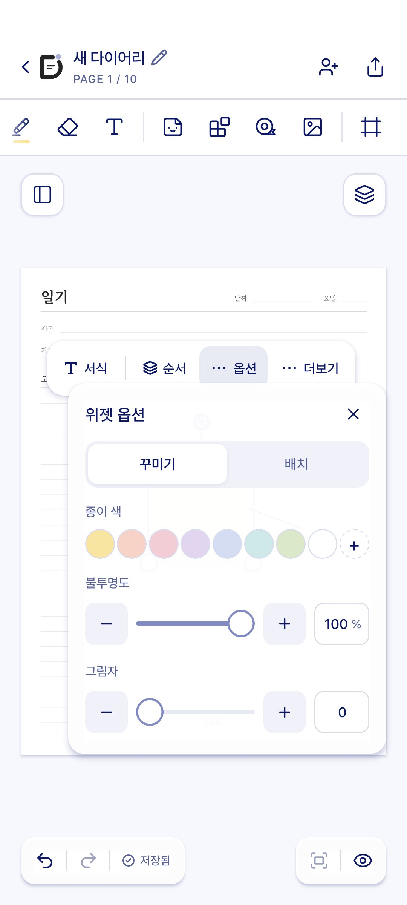
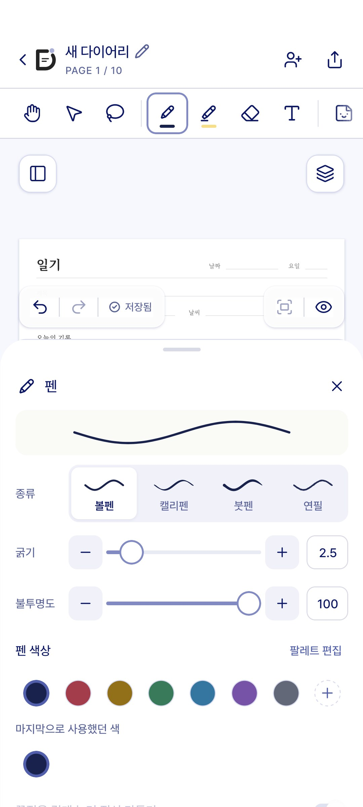
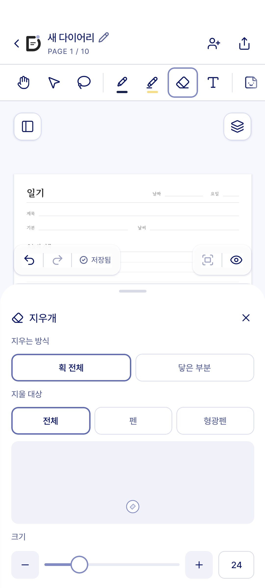
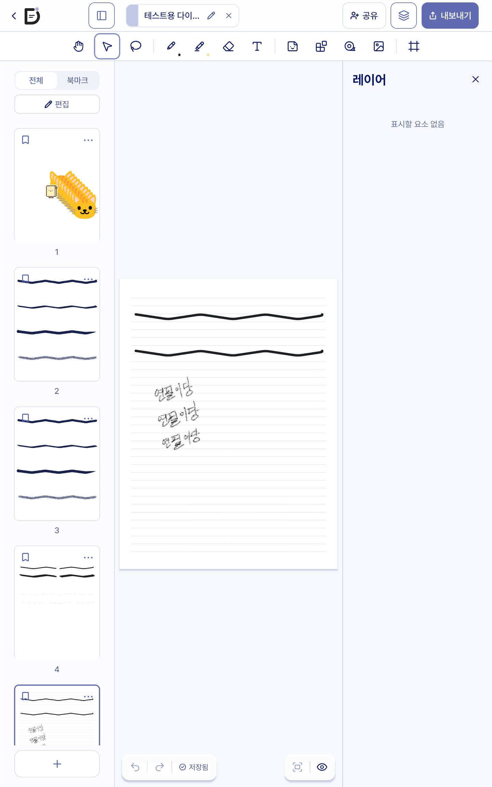
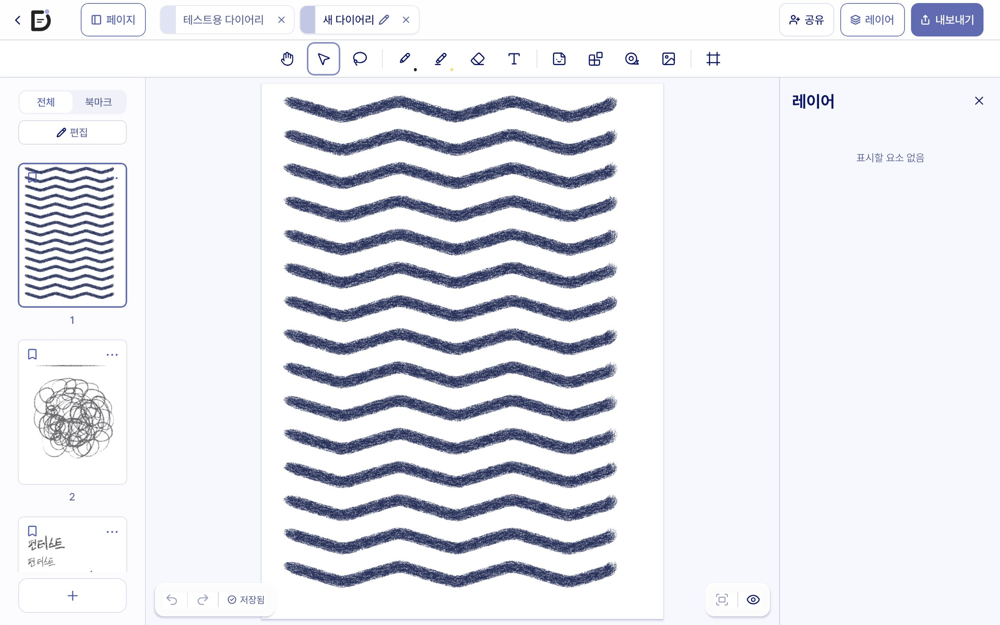
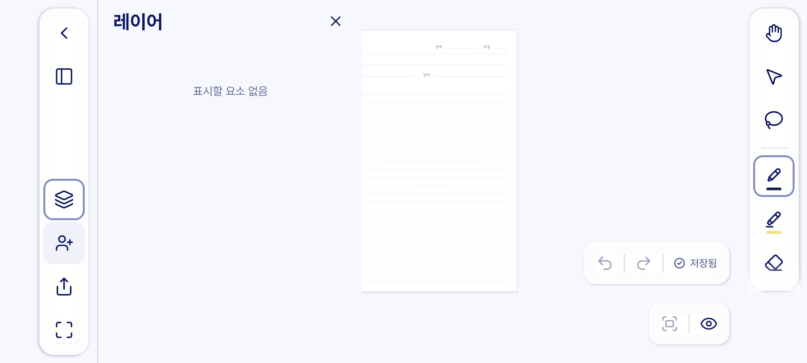

### 4.4 설정 · 내 공간

- **P2 알림 설정이 둘이다** [실기]. 설정의 토글 4개(즉시 반영, 코드상 서버 미연결)와 `알림 설정` 화면(서비스 · 마케팅, `저장` 버튼). 어느 쪽이 진짜인지 알 수 없다. 한 화면으로 합치고 토글은 즉시 저장한다.
- **P2 설정에 뒤로 버튼이 없다** [실기, 폰]. 스크롤하면 종 버튼 아래로 내용이 지나간다.
- **P2 휴지통이 폰 하단 탭 다섯 칸 중 하나다.** 자주 쓰지 않는 곳이 핵심 목적지와 같은 자리를 차지한다. 내 공간 · 보관함 메뉴로 옮기고 탭을 4개로 줄이는 것을 검토한다(판단, 공식 금지 규정은 아님).
- **P3** 탭 `내 공간` / 제목 `마이페이지` 이름이 다르다. 게스트 마이페이지는 카드 아래가 전부 비어 있다.
- **P3** 로그아웃에 확인창이 없다(즉시 게스트로).
- **P3** 비밀번호 재설정 뒤로 오면 로그인 입력값이 지워진다. `아이디 찾기`는 여전히 막다른 길이다.

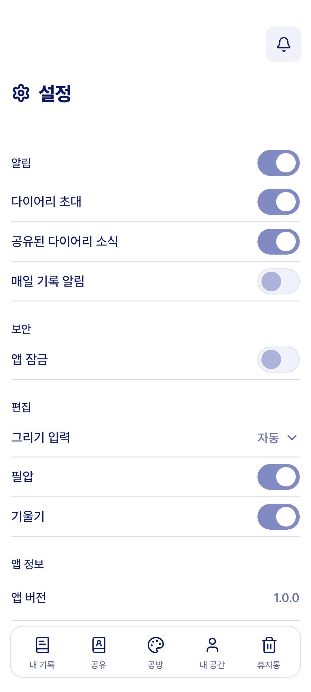
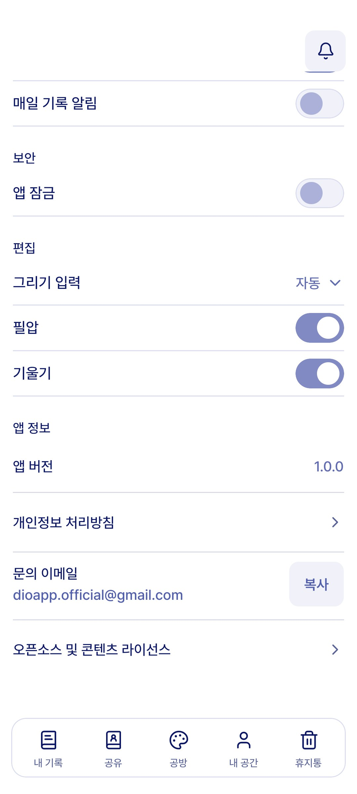
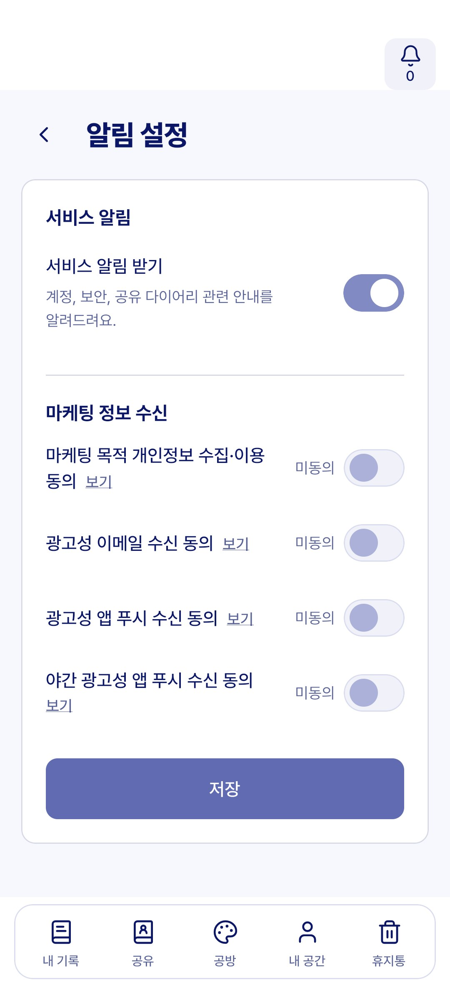
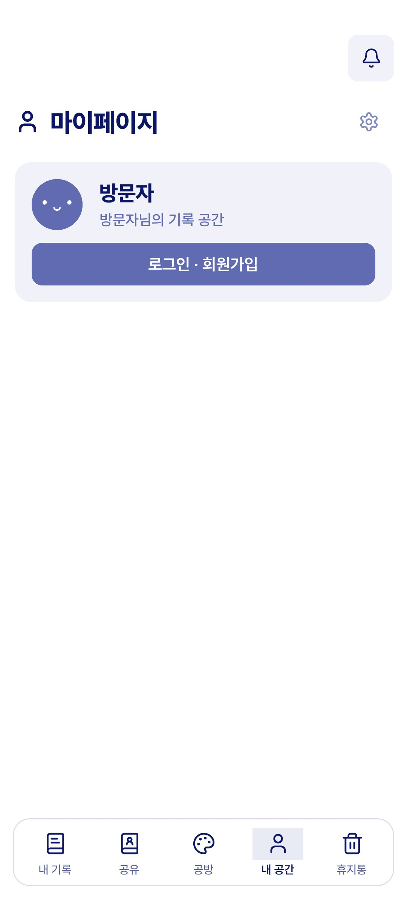
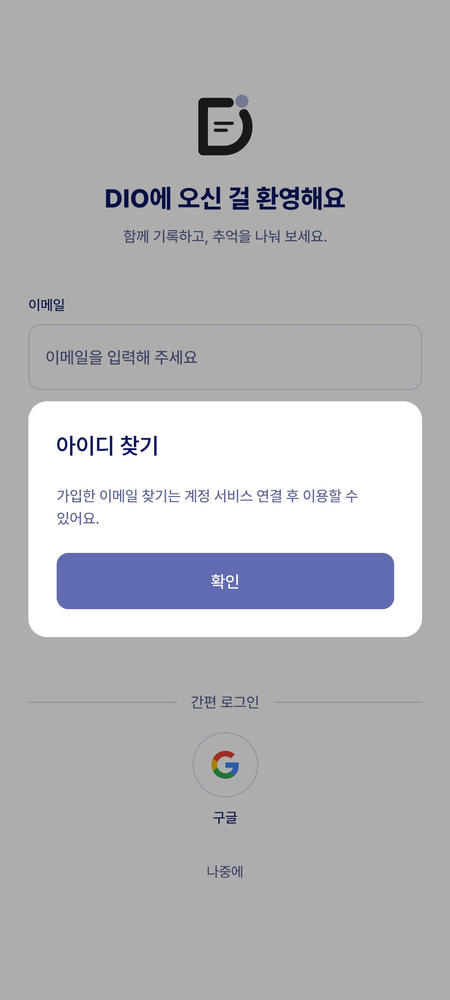

---

## 5. 미감

> 진단과 도안은 **코덱스**가 맡았다(미감 판단은 코덱스, 프로젝트 합의). 원문은 [리서치/코덱스 미감 진단](리서치/코덱스%20미감%20진단.md). 아래 채택 칸은 사용자 결정 · 가이드 · 기술 제약과 대조한 **클로드의 대조 결과**이고 미감 판단을 바꾼 것이 아니다.

**코덱스가 본 전체 인상**

- **지금:** 차분하고 정돈됐지만 큰 헤더 · 큰 버튼 · 빈 여백이 반복돼 **다꾸 앱보다 관리 화면처럼** 느껴진다.
- **갖고 싶게 만들 한 가지:** 모든 목록과 편집 진입에서 **내가 만든 표지와 오늘의 한 장**이 먼저 보이게 하고 조작 UI는 한 단계 뒤로 물린다.
- **지킬 강점:** 페리윙클~네이비의 차분한 톤, 흰 카드와 얇은 테두리, 모아 · 디오의 온도.

**Top 15 요약과 대조 결과**

| # | 위치 | 문제 | 코덱스 값 | 대조 |
|---|---|---|---|---|
| 1 | 보관함 위 | 종 줄이 크롬을 먼저 보이게 함, `0` 노출 | 헤더 72dp 안에 종, 0이면 배지 숨김 | **채택**. `0` 숨김은 바로 고칠 버그 |
| 2 | 스와이프 · 펼쳐서 | 옆 표지가 안 보임, 첫 면이 빈 페이지 | 카드 320dp + 다음 44dp, 첫 면은 표지 | **채택**. 폰 스와이프는 인벤토리상 "옆 카드 보임"이 의도인데 실기에서 안 보임 → 버그 여부 확인 |
| 3 | 카드 | 별 · 정보 결속 약함 | 별 표지 우상단 | **부분**. 별은 표지 위 유지, 위치는 가이드(왼쪽 위 12)를 따른다. 펼쳐서 보기의 별이 표지 밖인 것은 통일 |
| 4 | 빈 보관함 | 행동이 안 이어짐 | 문구 아래 48dp 보조 버튼 | **채택**. `+ 아이콘만` 결정은 FAB 한정이라 충돌 없음, 사용자 확인 |
| 5 | 공유 빈 상태 | 다음 행동 없음, 도구 과밀 | 필터 숨김 + 안내 문구 + 버튼 | **문구 기각**(안내 멘트 금지), 필터 숨김 · 버튼 채택 |
| 6 | 공방 | 탭명과 대제목 반복 | 대제목 제거 | **채택**. 개수 표시는 유지 필요 |
| 7 | 공방 | 본문이 75%에서 끊김 | 좌우 16 전폭, 탭 스크롤 | 전폭 **채택**, 탭 스크롤은 견출지 결정과 충돌 → 보류 |
| 8 | 공방 버튼 | 추가 버튼이 화면을 지배 | 52dp 행 또는 + | **검토**. 폰 전폭은 가이드 규칙이라 사용자 결정 필요 |
| 9 | 게스트 내 공간 | 아래가 비어 있음 | 미리보기 2행 | 이름 통일 **채택**, 미리보기는 새 기능이라 보류 |
| 10 | 설정 | 뒤로 없음, 토글 몰림 | 뒤로 44, 행 56, 세부 분리 | **채택** |
| 11 | 도구 줄 | 12개 + 잘림 | 7칸 + 더보기 | **결정 필요**(§9). 값은 `lavender100` 토큰으로 대체 |
| 12 | 시트 · 되돌리기 | 페이지가 흔들림 | 기본 344 · 확장 472, 막대 부착 | **채택 후 실측**. 슬라이드 예외(폰 시트) 안 |
| 13 | 선택 메뉴 | 옵션 · 더보기 같은 아이콘, 손잡이 큼 | 옵션 삭제, 손잡이 16, 글자 18 | 아이콘 구분 · 글자 **채택**. 옵션 기능은 유지, 손잡이는 터치 44 hitSlop 유지 |
| 14 | 편집기 가로 | 레일 페이드가 사각으로 튐 | 페이드 제거 | 튀는 모서리만 고침 — 페이드는 공통 부품 결정이라 **유지** |
| 15 | 공유 후 | 성공 경험 끊김 | 즉시 진입, 거절, 같은 자산 | **채택**(F-04 · F-07) |

**도안 6장** — 방향을 보는 그림이고 실제 값은 위 표를 따른다.

- **도안과 규칙이 다른 곳** — 도안 2의 별은 오른쪽 위(가이드는 왼쪽 위), 도안 5는 다시 실행 버튼이 빠짐(유지), 도안 4의 글자 팔레트 색은 임의, 도안 1의 상태 표시줄은 앱 정책과 다름. 그림의 사진 · 사람은 생성 이미지이고 예시일 뿐이다.

**현재 화면 (도안과 비교)**

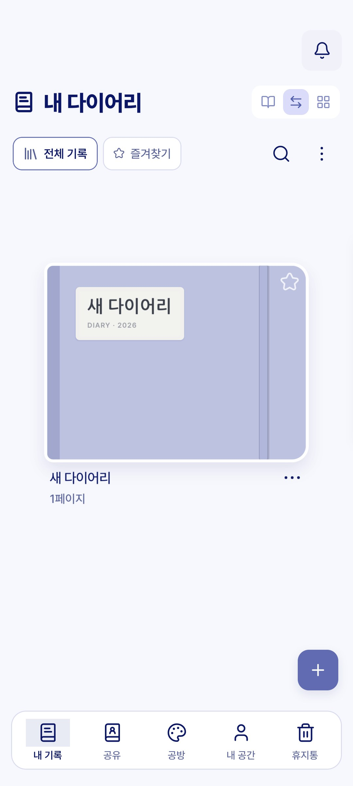
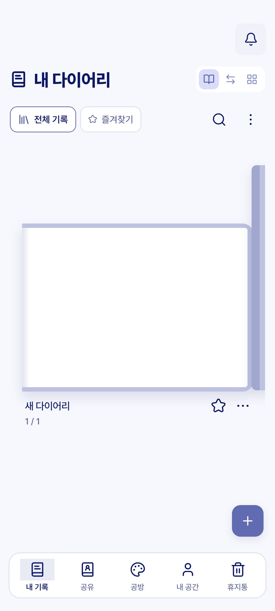
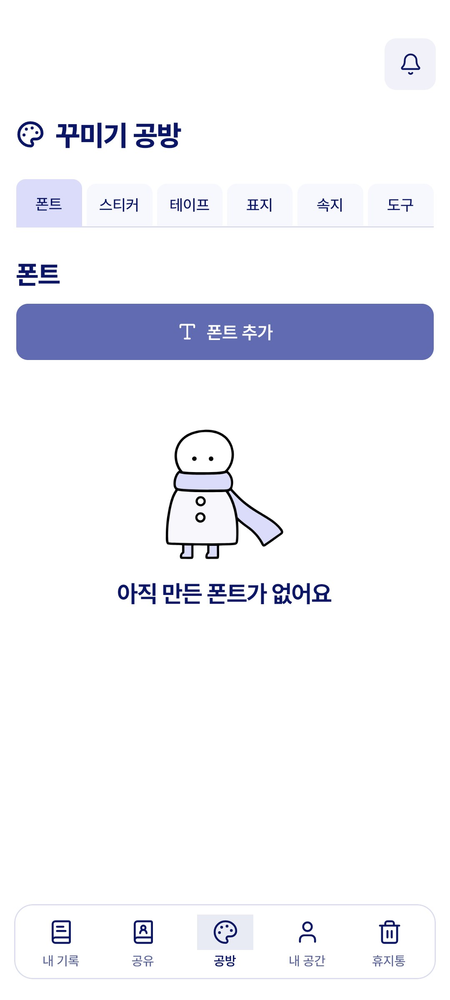
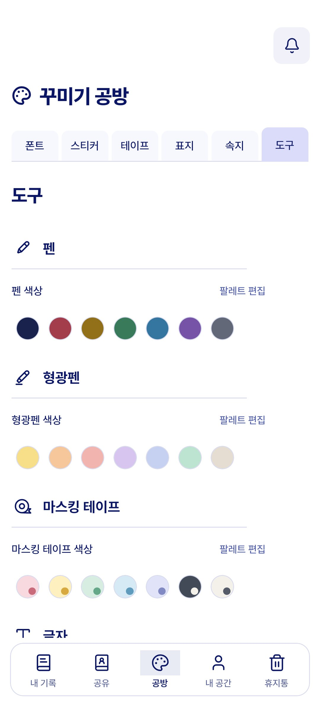
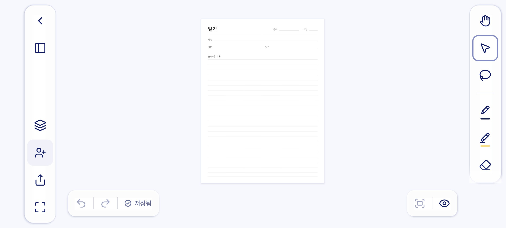
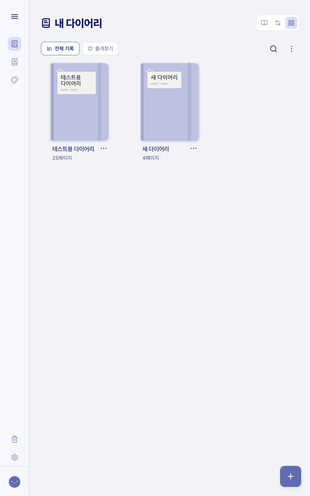

**클로드가 함께 본 작은 어긋남** (판단이 아니라 측정 · 대조)

- **P2** 회원 모든 화면의 종 아래 `0`(`sharing/SharingEntry.js`).
- **P2** 격자 첫 줄 표지가 필터 칩에 바짝 붙고, 별이 제목표에 반쯤 가린다(태블릿 가로 t020).
- **P3** 새 다이어리 미리보기의 페이지가 판 위쪽에 붙음, 태블릿 세로 작업대 아래 절반이 빔(t018).
- **P3** 태블릿 펼쳐서 세로에서 왼쪽 면이 좌측 바에 잘림(t011). 가로 펼쳐서는 아주 좋다(t021).

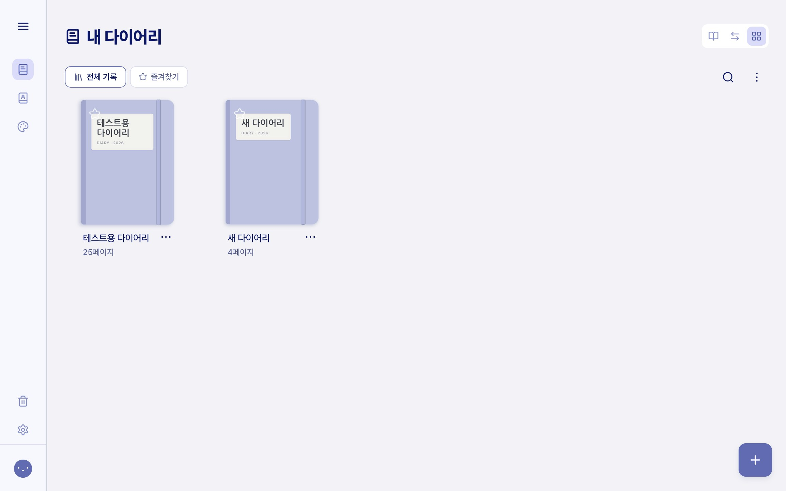
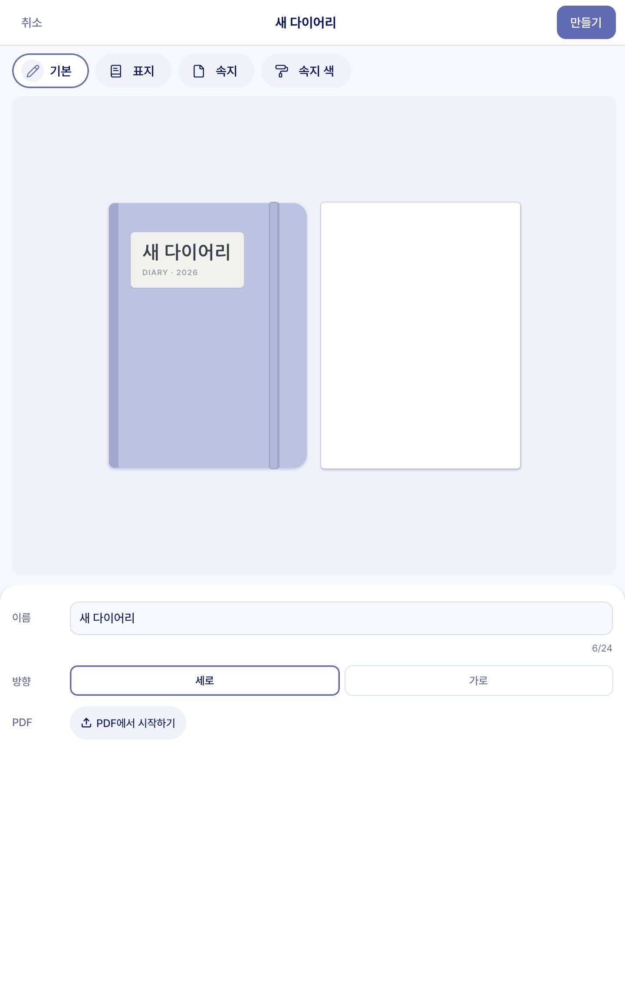

---

## 6. 통일성

| 대상 | 어긋남 | 맞출 기준 |
|---|---|---|
| 도구 패널 | 폰 세로에 시트 + 떠 있는 옵션 패널 공존 | 폰 세로 = 시트 |
| 저장 방식 | 토글 즉시 저장 / 알림 설정은 `저장` 버튼 | 토글은 즉시, 글자 입력만 저장 |
| 나갈 때 확인 | 새 다이어리 · 프로필은 있음, 스티커 분리 · 로그아웃은 없음 | 작업 손실이 있으면 확인 |
| 확인창 | 대부분 앱 창, 스티커 재분리만 시스템 창(`StickerSplitModal.js:169`) | `DialogHost` |
| 별 위치 | 표지 위 / 펼쳐서만 표지 밖 | 표지 위 |
| 전체 화면 머리 | 공방 · 설정: 제목만, 알림 설정 · 재설정: `<` + 선, 폰트: `<` + ⋯ | 하위 화면은 `<` 필수 |
| 로그인 묶음 | 로그인 · 가입은 카드, 재설정은 전체 화면 + 구석 버튼 | 같은 카드 |
| 말 | 내 공간/마이페이지, `받은 초대`/`알림`, `내보내기`(참여자)/`내보내기`(파일), 스티커 `1개`/폴더 `0개 스티커` | 용어표 한 장 |
| 안내 멘트 (§8) | `필기에 사용한 색이 여기에 저장돼요.`, `로그인한 서버 다이어리에서 올린 사진을…`, `개발 빌드에 모델 파일을 준비해 주세요.`(모델 없는 빌드에서 사용자 노출, 운영 노출 여부 확인) | 가이드 §8 |
| 가이드 ↔ 코드 | 공유 창 알림 행, `OO님이 초대했어요`, 수락 후 바로 열기, 태블릿 패널 한쪽만 등 | 코드 또는 가이드 수정 |

**특히 참여자 `내보내기`와 파일 `내보내기`는 같은 말이 전혀 다른 뜻이다.** 참여자 쪽을 `내보내기 → 참여 해제`로 바꾸는 것을 권한다.

---

## 7. iOS 팔로업 (실기기 없음)

**이 문서의 개선이 iOS에도 그대로 좋아지는 것** — F-01 · F-02(Keychain) · F-04 · F-05 · F-06 · F-07 · F-08 · F-10 · F-11 · F-12 · F-25 일부 · §4.2 빈 상태 · §5 미감 전부(공용 RN 코드).

| 주제 | iOS에서 따로 볼 것 | 근거 |
|---|---|---|
| 모달 닫기 | 스와이프 닫기를 막고 시도 시 확인 시트 (`isModalInPresentation`). 뒤로가기 키가 없어 F-06은 **`<` 버튼** 경로를 막아야 함 | 일반 지식, HIG 본문 미확인 |
| 세션 | SecureStore 값이 **앱 삭제 뒤에도 남음**(Android는 지워짐) → 재설치 첫 실행에서 초기화 | 조사 |
| 알림 권한 | 거부 후 재요청 불가, provisional 권한 활용 | Apple 문서 |
| 글자 크기 | Dynamic Type 확대 확인 (F-17) | 미확인 |
| 터치 | 44pt | 서드파티 수치 |
| 빌드 | 지난 보고서 P0(포인터 이벤트, requireFullScreen) 그대로. 현행 요건 Xcode 26 SDK, 연령 등급 재응답 | Apple 현행 페이지 |
| 폰트 | 폰트 생성은 Android 전용인데 게이트 후에야 알게 됨 | 코드 |

**iOS 담당자 확인 순서**: ① 로그인 유지 ② 초대 수락 후 도착 ③ 키보드 닫힌 뒤 위치(F-09) ④ `<`로 나갈 때 작업 소실 ⑤ Pencil 입력 ⑥ iPad 세로 패널(F-15).

---

## 8. PM 관점

경력 많은 PM이 이 앱을 볼 때 먼저 물을 질문들이다.

| 질문 | 지금 상태 | 권고 |
|---|---|---|
| **출시 후 무엇을 볼 것인가?** | 분석 · 크래시 수집 패키지 없음(F-13). 전역 오류는 기기에만 저장 | 최소 이벤트 6개(가입, 다이어리 생성, 초대 발송, 초대 수락, 첫 기여, 재방문) + 크래시 수집 |
| **북극성 지표는?** | 없음 | 제안: **주간 활성 공동 작성 다이어리 수**. 퍼널의 급소는 수락 → 첫 기여인데 지금 그 사이가 끊겨 있다(F-04) |
| **핵심 가치가 먼저 보이나?** | "하루 한 장 사진 + 함께"가 첫 화면에 없음. 사진은 도구 줄 11번째 | 서비스 문장과 첫 화면을 맞출지 결정 |
| **혼자 쓰는 사람을 어떻게 함께로 넘기나?** | 유도 없음, 게이트는 벽처럼 읽힘 | 다이어리를 만든 뒤 자연스러운 공유 지점 설계 |
| **재방문 이유는?** | `매일 기록 알림` 토글은 있으나 서버 미연결. 받는 쪽 소식 알림 범위 불명 | 알림 설계 확정, "친구가 꾸몄어요"가 핵심 재방문 동기 |
| **미성년 · 안전** | 만 14세 미만 가입 차단 있음. 신고 · 차단 없음(F-01). 14~19세 사용자 간 초대 안전 정책 불명 | 연령 정책 · 신고 처리 책임자 · 응답 시간 정의. Play Age Signals · Apple Declared Age Range 검토(공식 문서 재확인 필요) |
| **미완성이 사용자에게 보이나?** | 오리기 저장(F-12), 아이디 찾기, 알림 토글, 유료 안내(`유료 이용은 준비 중`) | 출시 범위 명단을 만들어 숨길 것 정리 |
| **코드엔 있는데 못 가는 것** | 영역 내보내기, 페이지 넓게 보기, 개인 사본, 카카오 로그인, 페이지 PDF 결과 화면 등 ([01 화면 목록 §0](01%20화면%20목록.md)) | 살릴지 지울지 결정. 특히 **개인 사본**은 F-05의 해법이 될 수 있음 |
| **고객 응대 경로** | 문의 이메일 복사만 있음 | 앱 안 문의 · 탈퇴 사유 · 신고 경로 |
| **요금제** | 정원 4명 + 유료 준비 중 문구 | 문구를 넣을 시점과 가격 실험 계획 |
| **데이터 책임** | 탈퇴 시 다른 사람과 함께 쓰던 다이어리 · 글 처리, 소유자 탈퇴 시 승계 규칙이 앱에 안 보임 | 정책 확정 후 탈퇴 창에 명시 |
| **QA 재현성** | 시드 파일이 저장소에 없어 매번 계정을 새로 만듦 | 로컬 시드 샘플(계정 · 공유 다이어리)을 저장소에 추가 |

참고: 소셜 앱 잔존율 기준은 출처마다 크게 다르다(a16z 우수 D1 70% · D7 50% vs MWM 2025 Q3 미국 D1 31.9% · D7 12.3%). 정의를 먼저 맞춘 뒤 비교한다.

---

## 9. 결정이 필요한 것

| # | 질문 | 권장 | 이유 |
|---|---|---|---|
| 1 | 폰 도구 줄을 7칸 + 더보기로 줄일까, 12칸 스크롤을 유지하고 페이드만 넣을까 | 사용 빈도 데이터가 없으니 **페이드 먼저** | 구성 변경은 기본 설계 변경 |
| 2 | 하단 탭에서 휴지통을 뺄까 | 뺀다 | 탭 4개면 라벨 여유 |
| 3 | 공방 만들기 버튼 전폭 유지? | 코덱스 제안대로 축소 시안을 먼저 본다 | 가이드 규칙 변경 |
| 4 | 회원 다이어리의 속지 · 표지를 서버 저장으로 | 필수 (백엔드 협의) | F-07 · F-08 |
| 5 | 오리기 · 유료 안내 · 알림 토글을 출시에서 뺄까 | 뺀다 | 미완성 노출 |
| 6 | 신고 · 차단 범위 | 정책 담당과 먼저 합의 | F-01 |
| 7 | 첫 실행에 소개 · 첫 사진 유도를 넣을까 | 안내 멘트 금지 규칙과 함께 결정 | §12.1 |
| 8 | 필기를 선택 도구로도 잡을지, 올가미 전용인지 | 사용자 기대는 탭 선택 | §12.4 |
| 9 | 오프라인일 때 회원 다이어리를 읽기로 보여 줄 범위 | 로컬 캐시 범위와 함께 | §12.2 |

---

## 10. 추천 순서

1. **이번 주, 작고 효과 큰 것:** `0` 숨김, F-06 나가기 확인, F-05 문구 · 잠금, F-09 위치 복원, F-04 수락 후 열기, F-14 빌드 3건, F-03 고지 재생성.
2. **다음:** F-02 세션 유지 + F-36 · F-37 오류 구분, F-10 게이트 통일 + 복귀, F-11 계정 범위, F-25 뒤로 계층, §4.4 설정 정리, F-15 태블릿 패널 기본값.
3. **백엔드 협의:** F-07 표지 저장, F-08 속지, F-01 신고 · 차단.
4. **그다음 미감:** §5 표의 채택 항목을 코덱스 값으로 → 렌더를 다시 코덱스 검수.
5. **출시 전:** F-13 분석 · 크래시, §0의 미확인 항목(오프라인 · 푸시 · 충돌 · TalkBack) 실기 점검, iOS 순서표.

---

## 11. 잘 되어 있는 점 (건드리지 말 것)

- **태블릿 가로 펼쳐서 보기 · 새 다이어리 3단 작업대**: 앱에서 가장 다이어리다운 화면.
- **공유 관리 확인창**: 양도 · 내보내기 문구가 결과를 정확히 말한다.
- **게스트 가져오기 진행률과 결과 보고**, 일부 실패 시에도 어디가 빠졌는지 알려 줌.
- **약관 화면**: 전체 동의 묶음과 선택 항목이 한 화면에 깔끔히 들어옴.
- **회전 시 선택 유지, 기기 간 획 동기화, 사진 자르기 · PDF 공유 흐름.**
- **Pretendard + 페리윙클 톤의 일관성, 모아 · 디오의 빈 상태 표정.**

## 12. 2차 점검 — 첫 실행 · 정원 · 동시 수정 · 서버 끊김 · 세션 만료 · 대량 · 글자 2배

### 12.1 첫 실행 [실기, 폰]
- **방법:** 개발 앱 데이터를 지우는 명령이 자동 권한 검사에 막혀, 같은 코드를 별도 패키지로 새로 설치해 봤다. 기존 앱 데이터는 그대로고 끝난 뒤 그 패키지만 지웠다.
- **좋음:** 권한을 먼저 묻지 않고 바로 쓸 수 있다. `+` → `만들기` **두 번이면 빈 페이지**다. 스티커도 게스트에게 바로 열린다.
- **P2** 소개 · 온보딩이 없다. "하루 한 장 사진, 함께 꾸미기"를 알 길이 없고 빈 보관함 문구뿐이다.
- **P2** 빈 페이지에서 다음 행동 단서가 없다. 사진은 도구 줄을 밀어야 보인다.
- **P3** 비어 있는데 필터 · 검색 · 정렬 · 보기 전환이 모두 보인다. 스티커 `최근` 칸은 비면 제목만 있고 공백이다.
- 개발 빌드의 흰 화면은 첫 번들 로딩 탓이라 운영 시작 속도와 무관하다. 운영 시작 속도는 [미확인]. 그림의 톱니는 개발 버튼.

### 12.2 F-36 · F-37 서버 끊김과 세션 만료 [실기, 폰]
- **방법:** 8080은 두고 토큰 수명을 줄인 임시 서버(8095)에 붙인 뒤 서버를 껐다 켰다. 비행기 모드와는 다를 수 있다.
- **서버 끊김:** 보관함 · 공유 탭이 `다시 로그인해 주세요.` + `다시 불러오기`만 보여 준다. 서버 문제를 사용자 계정 문제로 안내한다. 만들기도 작업대 아래 같은 문구로 끝난다(입력 내용은 유지됨).
- **서버 복구 후(토큰 만료):** `다시 불러오기`가 계속 실패한다. 내 공간은 로그인된 프로필을 보여 주고, 알림은 `로그인이 필요해요…`가 **두 줄 중복**이다. 로그인 버튼이 없어 **`로그아웃`을 누른 뒤 다시 로그인하는 것이 유일한 길**이다.
- **P2** `확인하지 못한 이전 생성 요청이 있어요. 같은 요청으로 결과를 확인해 주세요.` 내부 동작을 말하는 문구가 보관함 맨 위에 쌓인다.
- **P2** `나중에`로 넘긴 가져오기 창이 같은 세션에서 다시 떴다.
- **P3** 로그인 실패 `로그인 서버 설정을 확인해 주세요.`(503 서버 문구 그대로).
- **해법:** 네트워크 · 서버 · 세션 오류를 코드에서 나눈다. 세션 실패는 전역에서 받아 `다시 로그인` 화면(이메일 채움)으로 보내고, 네트워크는 상단 띠 + 자동 재시도, 기기에 있는 내용은 읽기로 보여 준다. 지금은 NetInfo가 없다(F-02와 함께).

### 12.3 정원 · 초대 [실기, 폰]
- **P2** 4/4인데 초대 카드와 상세는 `응답 대기`와 `수락`을 그대로 보여 준다. 프로필까지 입력하고 `수락하고 참여하기`를 눌러야 `최대 4명까지 참여할 수 있어요.`가 나온다. 입구에서 알린다(코드에 `정원 가득` 문구가 있으나 이 경로에서 안 나옴).
- **P3** 내보내진 사람의 알림에 옛 초대가 `이미 수락한 초대`로 남는다.
- **P2** 4명일 때 공유 창이 길어져 `완료` · `참여 해제`가 화면 밖으로 밀린다.
- 정원 초과 차단 자체는 정확하다(강점).

### 12.4 동시 수정 [실기, 폰]
- **좋음:** 다른 계정의 수정이 몇 초 안에 폰에 반영된다. 직후에 폰에서 옮겨도 `저장됨`으로 합쳐졌다. 충돌(409) 화면은 재현하지 못했다.
- **P2** 선택 도구로 필기 선을 눌러도 잡히지 않았다. 올가미로만 잡혔다. 의도인지 손으로 확인이 필요하다(자동 탭이라 좌표 오차 가능성이 남아 있다).
- **P3** 다른 계정이 옮긴 뒤 올가미 점선 상자가 선과 어긋나 보인다.

### 12.5 대량 데이터 · 긴 이름 [실기, 폰]
- **좋음:** 60권에서 스크롤이 부드럽다. 디버그 빌드 기준 149프레임 중 jank 2.7%, 99%가 20ms. 긴 이름 · 이모지도 표지와 목록에서 줄바꿈 · 말줄임이 된다. 페이지 · 획 대량은 [미확인].
- **P2** `다음 다이어리 불러오기`가 목록 끝이 아니라 **맨 위에 고정**이고 자동으로 이어지지 않는다. 20권 뒤는 위로 올라가 눌러야 한다. 스크롤 끝 자동 불러오기로.
- **P2** 선택 모드에서 안내 줄이 쌓여 첫 표지가 화면 중간에서 시작한다.
- **P3** `+` 버튼이 오른쪽 카드의 `⋯`를 가린다. 목록 끝 여백으로 해결.
- 참고: 스와이프 보기는 다음 카드가 가로 표지면 옆이 보이고 세로면 안 보인다(p007 · b01). §5의 2번과 같은 원인으로 보인다.

### 12.6 글자 2배 [실기, 폰]
- 앱 화면은 2배에서도 잘 버틴다(상한 처리 효과). 표지 제목만 줄이 바뀐다(F-17).
- **P1 추가 근거(F-16 · F-02):** 시스템 글자 크기를 바꾸면 앱이 재시작되어 **회원이 게스트로 풀린다.**

---

## 부록 A. 참고 자료

- 조사 원문(출처 URL · 확인 수준 포함): [리서치/업계 해법 조사](리서치/업계%20해법%20조사.md). **Material 3 수치, 초대 수락 · 권한 박탈 전용 공식 지침, 미감 트렌드는 근거가 약하다**고 원문에 표시했다.
- 코덱스 진단 원문: [리서치/코덱스 미감 진단](리서치/코덱스%20미감%20진단.md).
- 웹 관련: [05 웹 후속](05%20웹%20후속.md).

## 부록 B. 점검이 기기에 남긴 것

- **폰:** 개발 앱 재설치(데이터 유지), 사진첩에 PNG 1장(11-04 15:18 내보내기 결과), 설정은 되돌림(자동 회전 켬, 글자 1.0). 첫 실행용 별도 패키지와 테스트 사진은 삭제함.
- **태블릿:** `fonttest` 앱 데이터에 시드 계정 로그인 흔적, 설정은 되돌림(자동 회전 켬, 글자 1.1 그대로).
- **로컬 DB:** `qa1~5@dio-local.test`, QA용 다이어리, `qa5`의 대량 다이어리 60권. 언제든 지워도 된다.
- **캡처 제외:** `Test-A` 다이어리 표지에 예전 기기 페어링 화면이 찍힌 사진이 있어, 그 표지가 보이는 캡처는 문서에서 뺐다.
