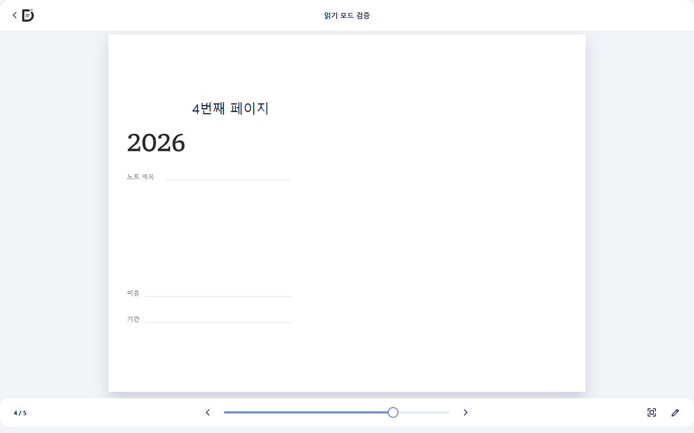

# 다이어리 읽기 모드

관련 태스크: [S15P31F106-372](https://ssafy.atlassian.net/browse/S15P31F106-372)

## 화면과 진입

편집 화면 오른쪽 아래의 화면 맞춤 옆 눈 아이콘으로 진입한다. 읽기 화면에서는 화면 맞춤·편집 전환을 하단 페이지 메뉴 안으로 통합한다. 별도 플로팅 버튼은 두지 않는다. 편집 권한이 없는 문서는 읽기 화면으로 시작하고 편집 전환은 표시하지 않는다.

- 상단: 홈, 중앙 다이어리 제목. 오른쪽은 비워 둔다.
- 하단: 현재/전체 페이지, 이전·슬라이더·다음, 화면 맞춤·편집 전환.
- 읽기 모드는 문서 탭, 편집 도구, 페이지·레이어 패널, 선택 표시, Undo/Redo, 저장 상태를 숨긴다.
- 모드 전환은 현재 페이지를 유지하고 화면에 맞춘다. 텍스트 초안은 기존 완료 경로로 확정하고 자르기 미리보기는 취소한다.
- 사용자 선택 모드와 권한용 readOnly를 분리한다. 모드 전환이 회원 텍스트 동기화의 권한 조건이나 진행 중인 정상 저장을 바꾸지 않는다.

## 입력과 페이지 이동

상·하단은 진입 시 표시한다. 중앙 탭으로 함께 숨기거나 표시하며 자동 숨김은 없다. 오버레이여서 숨김 전환은 페이지 배율과 위치를 바꾸지 않는다.

좌우 각 20%의 짧은 탭은 이전/다음 페이지, 중앙 60%는 메뉴 전환이다. 짧은 탭은 최대 이동 10dp·350ms 이하로 판정한다. 화면 맞춤 배율 이하의 한 손가락 수평 스와이프는 수평 거리 48dp 이상이면서 세로 거리의 1.5배 이상일 때 한 장만 넘긴다. 첫·마지막 페이지는 순환하지 않는다.

확대 상태에서만 빠른/느린 움직임을 추가 구분한다. 수평 48dp 이상·세로 거리의 1.5배 이상·250ms 이내·평균 수평 속도 0.5dp/ms 이상이면 스와이프로 한 장 넘긴다. 250ms를 넘긴 이동, 수평 48dp 이후의 느린 이동, 세로 24dp 이후 수평 우세가 아닌 이동은 드래그로 고정한다. 드래그 뒤 빠르게 마무리해도 손을 뗄 때까지 화면 이동만 한다. 화면 맞춤 이하의 기존 스와이프 판정은 유지한다.

하단 이전·다음 버튼은 짧게 누르면 한 장 이동한다. 350ms 누르고 있으면 90ms 간격으로 한 장씩 연속 이동하며, 첫/마지막 페이지에서 멈춘다. 손 떼기·터치 취소·메뉴 해제·앱 비활성화 시 타이머를 정리하고, 길게 누른 뒤 손을 뗄 때 추가로 한 장 넘기지 않는다.

스크린리더처럼 누르기 시작 이벤트 없이 들어오는 독립 활성화는 첫 회부터 한 장 이동한다. 비활성 버튼이 다시 활성화되거나 앱이 복귀한 뒤에도 이전 취소 상태를 새 활성화에 적용하지 않는다. 실제 터치·마우스·키보드 누름의 해제는 별도로 처리해 취소된 누름의 뒤늦은 클릭과 긴 누름의 중복 이동을 막는다.

두 손가락은 확대·축소와 이동이다. 두 손가락이 참여한 터치는 손가락 하나가 남아도 페이지를 넘기지 않는다. 읽기 모드는 기존 세로 끝 밀기 자동 페이지 전환을 사용하지 않는다. 확대 중에도 좌우 가장자리 탭과 하단 조작으로 페이지를 넘길 수 있다.

링크 탭은 링크가 먼저 처리한다. 링크 위에서 드래그하거나 두 손가락 조작을 시작하면 뷰어가 제스처를 받고 링크를 실행하지 않는다. 슬라이더는 이동할 쪽수를 미리 표시하고 손을 놓을 때 이동하며, 취소하면 현재 페이지를 유지한다. 한 페이지 문서는 양쪽 이동과 슬라이더를 비활성화한다.

## 페이지 넘김 효과

페이지가 바뀔 때 종이를 접어 넘기는 효과를 보여 준다. 탭·스와이프·하단 버튼·슬라이더가 모두 같은 효과를 쓴다. 화면 맞춤 배율 이하에서 수평 스와이프를 시작하면 손가락을 따라 넘어간다.

- 읽기 화면의 여백은 메뉴가 보이면 상단 헤더(56dp)와 하단 바(52dp) 사이에 맞추고, 메뉴를 숨기면 좌우·상하 여백 없이 화면 전체에 맞춘다.
- 앞장(지금 보이는 캔버스)은 넘기는 동안 다시 그리거나 움직이지 않는다. 접힘선 너머로 드러나는 새 페이지, 접혀 넘어온 종이 뒷면(앞장 속지 색), 그림자만 위에 얹어 움직이고 다 넘어간 뒤에 한 번만 페이지를 바꾼다.
- 접힘선은 잡은 모서리와 끌려 온 위치의 수직이등분선이다. 손가락을 처음 댄 높이가 화면 가운데(위에서 35~65%)면 곧은 세로선, 위·아래로 갈수록 대각선으로 기울고 위쪽이면 위 모서리부터, 아래쪽이면 아래 모서리부터 접힌다. 버튼·탭은 곧게 넘긴다. 이전 페이지는 좌우를 뒤집어 같은 계산을 쓴다.
- 손가락을 따라 넘길 때 페이지 폭의 90%를 끌면 끝까지 넘어간다. 놓을 때 30% 넘게 넘어갔거나 평균 0.4dp/ms 이상으로 빠르게 끌었다면 마저 넘기고, 아니면 접힌 만큼 되돌리고 원래 페이지를 유지한다. 끄는 도중 두 손가락이 닿으면 취소한다.
- 넘기는 중 연달아 요청(버튼 길게 누르기 등)이 오면 진행 중인 넘김을 바로 끝내고 이어서 넘긴다.
- 첫 페이지에서 이전, 마지막 페이지에서 다음으로 넘기려 하면 효과 없이 "첫 페이지예요"·"마지막 페이지예요"를 알린다.
- 네이티브(Android·iOS)는 기울어진 잘라내기 상자와 translate·rotate를 네이티브 드라이버로 한 프레임에 갱신하고, 웹은 `clip-path` 다각형과 CSS `linear-gradient`로 그린다. 그림자와 접힌 뒷면의 어두운 음영도 `linear-gradient`다.
- Galaxy Tab S9 FE(Android)에서 스와이프 중 앞장 왼쪽 영역이 프레임마다 픽셀 단위로 같음을 확인했다. 웹 구현은 아직 실기 확인 전이다.

## 열람 기록

기존 editorViewState를 사용해 마지막 페이지 ID만 보존한다. 개인 문서는 기기 저장, 임시 공유 문서는 기존 세션 범위를 따른다. 다시 열면 마지막 페이지를 화면 맞춤으로 표시하고, 기록이 없거나 페이지가 삭제됐으면 기존 첫 페이지 대체 규칙을 따른다.

열람·메뉴 토글·페이지 이동은 원본 내용과 수정 시각, Undo 이력을 변경하지 않는다. 읽기 모드 선택과 배율·이동량은 저장하지 않는다. 편집 가능한 문서는 재진입 시 편집 모드로 시작한다.

## 검증

- `node --test tests/reading-mode.test.js tests/viewport-input.test.js tests/text-keyboard.test.js tests/viewport.test.js tests/last-viewed-page.test.js tests/editor-page-management.test.js`
- Metro를 54841 포트로 실행한 뒤 `node tests/reading-mode-browser.cjs`로 실제 EditorScreen을 검증한다. 다른 주소·포트는 `EXPO_QA_HOST`·`EXPO_QA_PORT`로 지정한다. `--localhost` 서버가 IPv6에 바인딩되면 `EXPO_QA_HOST=localhost`를 사용한다. 전용 픽스처는 앱 진입점에서 참조하지 않는다.
- 웹 화면 기준 320×740, 375×812, 844×390, 1024×768, 1280×800에서 하나의 하단 메뉴·44dp 버튼, 메뉴 숨김 시 캔버스 좌표 보존, 연속 넘김의 양끝 정지, 페이지 탐색, 원본/Undo 보존, 마지막 페이지 복원, 권한 제한을 확인한다.
- iOS·Android 실기기 검증 여부는 실행 결과와 별도로 기록한다. 플랫폼 번들 성공은 실기기 터치 검증을 뜻하지 않는다.

### 기존 구현의 2026-10-29 실행 결과

- 읽기·입력·열람 기록·문서 관리 관련 자동 검사와 실제 EditorScreen 브라우저 검증을 통과했다. 위 다섯 화면 크기에서 버튼 좌표 일치와 메뉴 토글 시 캔버스 위치 보존을 확인했다.
- Chromium 실제 터치 이벤트로 핀치 확대·한 손가락 이동·확대 중 가장자리 탭을 확인했고 링크 탭 우선 처리와 텍스트 초안 보존을 확인했다.
- 로컬 실행 가능한 프런트엔드 자동 검사 1,195개가 통과했다. 전체 검사 시도 중 Spring 계약 응답 파일이 없는 4건을 확인했으며, 두 계약 파일과 휴지통·영구 삭제 HTTP 응답을 요구하는 두 검사를 제외한 결과다. 계약 파일을 임의로 생성하거나 백엔드 데이터를 변경하지 않았다.
- Expo 웹·Android·iOS 번들 내보내기를 통과했다. 연결 Android 기기가 없고 Windows에서 iOS 실기기를 실행하지 못해 네이티브 실기기 터치 검증은 미실행이다.

### MR 준비 검증

최신 develop의 로그인·공유 관리 변경을 통합한 뒤 로컬 실행 가능한 프런트엔드 자동 검사 1,213개가 통과했다. 위에서 설명한 Spring 응답 fixture 의존 계약 검사 4건은 같은 기준으로 제외했다.

### 2026-10-30 제스처·하단 메뉴 개선 검증

- 관련 자동 검사 72개 통과. 확대 상태의 속도·시간·방향 경계, 느린 드래그 후 빠른 마무리, 핀치·링크 우선순위, 반복 버튼의 짧은/긴 누름·취소·양끝 경계·앱 비활성화·unmount를 검사했다. DOM 이벤트 API가 없는 네이티브 window도 검증했다.
- headless Edge의 5개 화면 크기에서 실제 EditorScreen 검증 통과. 하단 메뉴 안에 맞춤·편집 전환이 있고 별도 버튼이 없는지, 길게 누른 뒤 손을 뗄 때 추가 이동이 없는지, 원본 문서와 Undo·열람 기록·읽기 권한이 유지되는지 확인했다.
- Chromium 터치 이벤트로 핀치 확대 후 느린 드래그는 현재 페이지를 유지하고, 별도의 빠른 가로 스와이프는 한 장 넘긴 뒤 화면에 맞추는 것을 확인했다.
- 전체 앱 웹 export 통과. 실제 Android·iOS 기기의 터치·길게 누르기는 이번에 검증하지 않았다.
- 로컬 근거: `frontend/.expo/reading-gestures-unit.log`, `reading-mode-browser.log`, `reading-gestures-export.log`, `reading-mode-qa/` 화면. 아래 화면은 이 검증용 문서이며 개인 다이어리를 사용하지 않았다.

### 2026-10-30 접근성 활성화 리뷰 수정

- 기존 코드에서 취소 후 단독 활성화·취소된 누름 이후 새 활성화·실제 버튼의 앱 복귀 후 활성화 검사 3개가 실패하는 것을 먼저 확인했다. 입력 출처와 누름·취소·반복 상태를 분리한 뒤 관련 자동 검사 76개가 통과했다.
- 5개 화면 크기의 실제 웹 검사에서 비활성 상태였던 이전 버튼을 다시 활성화한 후 첫 비포인터 click, blur 복귀 후 첫 비포인터 click, 기존 긴 누름·취소·양끝 경계·제스처가 정상 동작했다. Space·Enter 키 활성화도 확인했다.
- 전체 앱 웹 export 통과. 실제 TalkBack·VoiceOver 기기의 조작 검증은 수행하지 않았으며 웹의 비포인터 이벤트와 네이티브 이벤트 형태를 사용한 자동 검사 결과와 구분한다.
- 로컬 근거: `frontend/.expo/reading-accessibility-before.log`, `reading-accessibility-unit.log`, `reading-accessibility-browser.log`, `reading-accessibility-export.log`.

## 화면 자료

### 2026-10-30 병합 후 화면 맞춤 중복 코드 제거

- 사용자 제공 변경 이력에서 읽기 모드 커밋 `7c1795eb`가 기존 `fitted` 선언과 조건부 맞춤 버튼을 함께 제거하고 `ReadingModeControls`로 옮긴 것을 확인했다. 충돌 해결 커밋 `9564c6da`는 선언 없이 기존 버튼을 다시 포함해 편집 화면 렌더 오류가 발생했다.
- 임시로 추가했던 `fitted` 계산은 사용하지 않고 예전 조건부 버튼 블록을 제거했다. 편집 모드는 `ReadingModeControls`, 읽기 모드는 `ReadingNavigation` 안의 맞춤 기능을 유지한다. `fitToScreen` 동작은 변경하지 않는다.
- 회귀 검사는 참조 범위의 선언 여부와 편집/읽기 모드 화면 맞춤 버튼 개수를 확인한다.
- 리뷰 보완: fitted 참조가 0개여도 올바른 코드이므로 참조 개수의 하한을 제거하고 존재하는 참조의 바인딩만 검사한다. 화면 맞춤 브라우저 검사는 편집 모드 버튼의 44px 이상 크기·화면 내부 위치·중앙 히트 테스트·확대 후 실제 클릭으로 배율/위치 초기화까지 확인한다. undoOnRight와 floatingStacked는 실행 취소 바 배치에 사용하므로 유지한다.
- 보강한 실제 웹 검사 320×740·375×812·844×390·1024×768·1280×800 모두 통과. 각 크기에서 확대 후 맞춤 버튼 클릭 시 scale=1·x=null 복원, 버튼 1개·터치 영역 가림 없음 확인.
