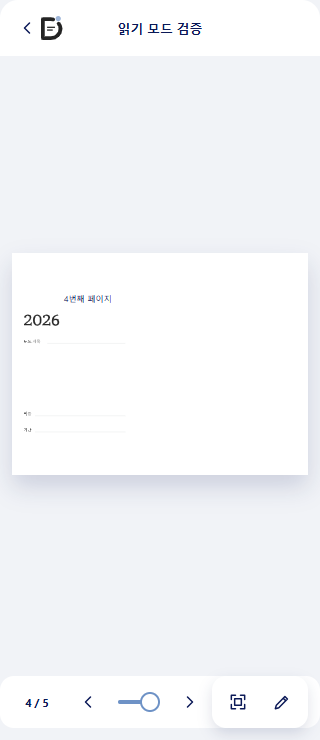

# 다이어리 읽기 모드

관련 태스크: [S15P31F106-372](https://ssafy.atlassian.net/browse/S15P31F106-372)

## 화면과 진입

편집 화면 오른쪽 아래의 화면 맞춤 옆 눈 아이콘으로 진입한다. 읽기 화면에서는 같은 자리를 화면 맞춤·편집 전환으로 사용한다. 편집 권한이 없는 문서는 읽기 화면으로 시작하고 편집 전환은 표시하지 않는다.

- 상단: 홈, 중앙 다이어리 제목. 오른쪽은 비워 둔다.
- 하단: 현재/전체 페이지, 이전·슬라이더·다음, 화면 맞춤·편집 전환.
- 읽기 모드는 문서 탭, 편집 도구, 페이지·레이어 패널, 선택 표시, Undo/Redo, 저장 상태를 숨긴다.
- 모드 전환은 현재 페이지를 유지하고 화면에 맞춘다. 텍스트 초안은 기존 완료 경로로 확정하고 자르기 미리보기는 취소한다.
- 사용자 선택 모드와 권한용 readOnly를 분리한다. 모드 전환이 회원 텍스트 동기화의 권한 조건이나 진행 중인 정상 저장을 바꾸지 않는다.

## 입력과 페이지 이동

상·하단은 진입 시 표시한다. 중앙 탭으로 함께 숨기거나 표시하며 자동 숨김은 없다. 오버레이여서 숨김 전환은 페이지 배율과 위치를 바꾸지 않는다.

좌우 각 20%의 짧은 탭은 이전/다음 페이지, 중앙 60%는 메뉴 전환이다. 짧은 탭은 최대 이동 10dp·350ms 이하로 판정한다. 화면 맞춤 배율 이하의 한 손가락 수평 스와이프는 수평 거리 48dp 이상이면서 세로 거리의 1.5배 이상일 때 한 장만 넘긴다. 첫·마지막 페이지는 순환하지 않는다.

두 손가락은 확대·축소와 이동이다. 확대 중 한 손가락 드래그는 페이지 내부 이동이며 좌우 가장자리 탭과 하단 조작으로는 페이지를 넘길 수 있다. 두 손가락이 참여한 터치는 손가락 하나가 남아도 페이지를 넘기지 않는다. 읽기 모드는 기존 세로 끝 밀기 자동 페이지 전환을 사용하지 않는다.

링크 탭은 링크가 먼저 처리한다. 링크 위에서 드래그하거나 두 손가락 조작을 시작하면 뷰어가 제스처를 받고 링크를 실행하지 않는다. 슬라이더는 이동할 쪽수를 미리 표시하고 손을 놓을 때 이동하며, 취소하면 현재 페이지를 유지한다. 한 페이지 문서는 양쪽 이동과 슬라이더를 비활성화한다.

## 열람 기록

기존 editorViewState를 사용해 마지막 페이지 ID만 보존한다. 개인 문서는 기기 저장, 임시 공유 문서는 기존 세션 범위를 따른다. 다시 열면 마지막 페이지를 화면 맞춤으로 표시하고, 기록이 없거나 페이지가 삭제됐으면 기존 첫 페이지 대체 규칙을 따른다.

열람·메뉴 토글·페이지 이동은 원본 내용과 수정 시각, Undo 이력을 변경하지 않는다. 읽기 모드 선택과 배율·이동량은 저장하지 않는다. 편집 가능한 문서는 재진입 시 편집 모드로 시작한다.

## 검증

- `node --test tests/reading-mode.test.js tests/viewport-input.test.js tests/viewport.test.js tests/last-viewed-page.test.js tests/editor-page-management.test.js`
- Metro를 54841 포트로 실행한 뒤 `node tests/reading-mode-browser.cjs`로 실제 EditorScreen을 검증한다. 전용 픽스처는 앱 진입점에서 참조하지 않는다.
- 웹 화면 기준 320×740, 375×812, 844×390, 1024×768, 1280×800에서 모드/맞춤 위치 일치, 메뉴 숨김 시 캔버스 좌표 보존, 페이지 탐색, 원본/Undo 보존, 마지막 페이지 복원, 권한 제한을 확인한다.
- iOS·Android 실기기 검증 여부는 실행 결과와 별도로 기록한다. 플랫폼 번들 성공은 실기기 터치 검증을 뜻하지 않는다.

### 2026-10-29 실행 결과

- 읽기·입력·열람 기록·문서 관리 관련 자동 검사와 실제 EditorScreen 브라우저 검증을 통과했다. 위 다섯 화면 크기에서 버튼 좌표 일치와 메뉴 토글 시 캔버스 위치 보존을 확인했다.
- Chromium 실제 터치 이벤트로 핀치 확대·한 손가락 이동·확대 중 가장자리 탭을 확인했고 링크 탭 우선 처리와 텍스트 초안 보존을 확인했다.
- 로컬 실행 가능한 프런트엔드 자동 검사 1,195개가 통과했다. 전체 검사 시도 중 Spring 계약 응답 파일이 없는 4건을 확인했으며, 두 계약 파일과 휴지통·영구 삭제 HTTP 응답을 요구하는 두 검사를 제외한 결과다. 계약 파일을 임의로 생성하거나 백엔드 데이터를 변경하지 않았다.
- Expo 웹·Android·iOS 번들 내보내기를 통과했다. 연결 Android 기기가 없고 Windows에서 iOS 실기기를 실행하지 못해 네이티브 실기기 터치 검증은 미실행이다.

### MR 준비 검증

최신 develop의 로그인·공유 관리 변경을 통합한 뒤 로컬 실행 가능한 프런트엔드 자동 검사 1,213개가 통과했다. 위에서 설명한 Spring 응답 fixture 의존 계약 검사 4건은 같은 기준으로 제외했다.

## 화면 자료

