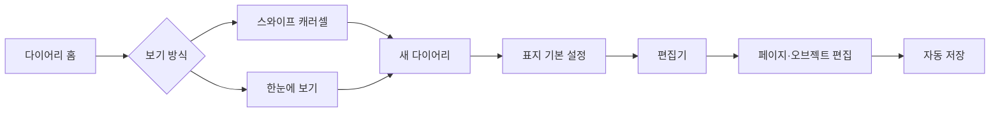

# DIO MVP1 UI/UX 명세

> 기준일: 2026-10-19 
> 기준 자료: [Figma DIO · 목업-MVP1](https://www.figma.com/design/plH5ItPuP8SAa9mGFnKTYg/DIO?node-id=0-1), 해당 보드의 열린 댓글, `dakku-mockup-palette.html`, 전달받은 팔레트 이미지

## 1. 목적과 적용 범위

DIO MVP1은 가로형 태블릿에서 다이어리를 만들고, 페이지 위에 텍스트·그림·사진·스티커·마스킹 테이프를 배치해 꾸미는 경험을 제공한다. 이 문서는 Figma의 `목업 - MVP1` 화면과 댓글을 구현 가능한 요구사항으로 정리한 것이다.

MVP1의 태블릿 기준 캔버스는 **1280 × 800 (16:10, 가로)** 이다. 창의 짧은 변이 600dp보다 작은 폰에서는 이 프레임 대신 폰 전용 배치(세로 홈 + 좁은 좌측 바, 세로·가로 편집기)를 쓴다. 기준과 화면 구성은 [폰 태블릿 배치.md](./폰%20태블릿%20배치.md)를 따른다.

### MVP1 사용자 흐름

## 2. 디자인 토큰

목업에 쓰인 진한 네이비 텍스트 계열은 유지하되, 전달받은 네 가지 색상을 MVP1의 UI 핵심 토큰으로 사용한다.

| 토큰 | 값 | 역할 | 적용 예 |
|---|---:|---|---|
| `color.surface.base` | `#FFFFFF` | 기본 표면 | 편집 캔버스, 카드, 드로어 내부, 모달 |
| `color.surface.soft` | `#CED9EE` | 옅은 보조 표면 | 앱 배경, 비활성 패널, 페이지 목록 배경 |
| `color.primary` | `#6E92C6` | 주요 동작·선택 | Primary 버튼, 활성 탭, 선택 테두리, 포커스 링 |
| `color.secondary` | `#9FB6D9` | 보조 강조 | 칩, 호버 배경, 보조 패널, 아바타 배경 |
| `color.text.strong` | `#0B1957` | 목업의 네이비 텍스트 | 제목, 아이콘, 본문 기본색 |
| `color.text.muted` | `rgba(11,25,87,.68)` | 보조 텍스트 | 메타 정보, 비활성 라벨 |
| `color.border` | `rgba(11,25,87,.16)` | 구분선·입력 테두리 | 카드, 패널, 입력 필드 |

규칙:

- 흰색 위의 본문·아이콘은 `color.text.strong`을 기본으로 사용한다.
- `color.primary`는 기능 선택 상태와 CTA에만 집중해서 사용하고, 넓은 배경을 모두 파랗게 채우지 않는다.
- 선택 상태는 색만 바꾸지 말고 테두리 또는 그림자도 함께 적용한다.
- 다크 모드는 MVP1 범위에서 제외한다. 이후 도입 시에는 댓글 의견대로 무채색 기반과 눈부심을 별도 검토한다.

## 3. 화면별 기능 명세

| Figma 화면 | MVP1 동작 | 확정/제외 사항 |
|---|---|---|
| `01-library-swipe` | 다이어리 표지를 좌우로 넘기는 캐러셀. 이전/다음 버튼과 키보드 좌우 이동을 제공한다. | `공유 다이어리`, `개인 다이어리`, `즐겨찾기`를 홈 분류명으로 사용한다. |
| `02-library-overview` | 카드 그리드로 전체 다이어리를 한눈에 본다. | 스와이프 보기와 동일한 데이터·정렬을 사용한다. |
| `03-new-diary` / `04-cover-editor` | 제목과 기본 표지색을 정해 다이어리를 생성·수정한다. | 표지 패턴, 제본 형식, 페이지 크기, 내지 분위기 선택은 MVP1에서 제외한다. 공유는 생성 화면이 아니라 다이어리 내부에서 수행한다. |
| `05-editor-page-1` | 페이지를 캔버스로 열고, 리본바·페이지 목록·레이어 패널을 통해 편집한다. | 가로 16:10만 제공한다. |
| `10-pen-settings` | 펜 종류·두께·색상을 설정하고 선을 그린다. | 펜 색상 팔레트와 격자 색상 팔레트를 동일한 색상 체계로 제공한다. |
| `11-highlighter-settings` | 형광펜 색·두께를 설정한다. | 획 끝/형태는 `라운드`, `스퀘어` 두 가지다. |
| `12-grid-settings` | 격자 가이드 ON/OFF, 색상 변경을 제공한다. | 색상 선택은 프리셋과 HEX 직접 입력을 지원한다. 간격 사용자 설정은 MVP1 확정 범위가 아니다. |
| `13-sticker-drawer` / `15-tape-drawer` | 스티커와 마스킹 테이프를 캔버스에 추가한다. | 테이프는 절취선형 또는 일자형을 제공한다. 스티커의 그림자·흰 테두리는 구현 전 시각 규칙을 확정한다. |
| `16-photo-drawer` / `사진 추가하기` | 사진·GIF 파일을 업로드·배치하고, 위치·크기·회전을 편집한다. | GIF **생성**은 MVP1에서 제외한다. |
| `17-layers` | 선택 오브젝트의 순서를 변경하고, 레이어 정보를 본다. | 레이어 그룹화 지원을 반영한다. 레이어 패널 하단의 추가 버튼은 제거한다. |
| `집중 편집 모드` / `양옆 창 닫힘` / `레이어 닫힘` | 패널을 접어 캔버스를 넓게 본다. | 읽기 모드에서는 리본바를 숨긴다. |
| `텍스트 입력` / `텍스트 편집` | 텍스트 입력, 폰트·크기·색상 변경을 제공한다. | 텍스트 전체뿐 아니라 선택한 일부 문자열의 색상만 변경할 수 있어야 한다. |
| `선택 및 이동` / `되돌리기` | 선택, 다중 선택, 이동, 크기 조절, 회전, Undo/Redo를 제공한다. | 선택한 변에 따라 양방향 리사이즈 커서를 표시하고, 회전 핸들을 노출한다. 회전 중에는 수평 기준 0–360° 값을 보여 준다. |

## 4. 편집기 동작 규칙

### 리본바와 탐색

- 리본바는 화면에서 한눈에 읽히도록 **아이콘 중심**으로 구성한다. 기능명 텍스트를 상시 표기하지 않는다.
- 사진·스티커·테이프 보관함은 리본바에서 열며, 고정 사이드바에는 에셋 목록을 노출하지 않는다.
- 좌상단 아이콘은 다이어리 홈으로 이동한다.
- 상단 탭은 다른 다이어리 사이를 이동한다.
- 왼쪽 페이지 목록은 같은 다이어리의 페이지/인덱스를 이동한다.
- 줌 조작 시 현재 배율을 잠깐 표시하고, `화면에 맞춤` 동작을 제공한다.
- 동시에 열 수 있는 탭의 상한 수는 댓글에 숫자가 정해지지 않았다. 제품 결정 전까지 임의로 제한값을 구현하지 않는다.

### 캔버스와 오브젝트

- 오브젝트는 선택·다중 선택·이동·크기 조절·회전·삭제·복제·레이어 순서 변경이 가능해야 한다.
- 사진 자르기는 MVP1에서 `폴라로이드`와 `도형` 두 방식만 우선 제공한다. 자유 오리기·끊어 이어 그리기는 후속(MVP2) 범위다.
- 하이퍼링크는 선택 요소에 내부 페이지/다이어리 또는 웹 주소를 연결할 수 있다. 링크가 설정되었다는 별도 아이콘을 요소에 상시 부착하지 않는 방향으로 해석했으며, UX 시안 확정 때 재검토한다.
- 공유 다이어리에서는 참여자의 상태를 아바타 불투명도 차이로 구분한다. 기본안은 현재 활성/편집 중인 참여자 `100%`, 비활성 참여자 `45%`다.
- 편집 내용은 자동 저장 상태를 사용자에게 알려 준다.

## 5. MVP1 범위 결정

### 포함

- 가로형 16:10 다이어리 홈, 새 다이어리 생성, 표지 이름·색상 수정
- 스와이프/그리드 홈 보기, 즐겨찾기·공유/개인 다이어리 분류
- 페이지 목록, 캔버스, 레이어, 선택·변형·Undo/Redo
- 펜, 형광펜, 지우개, 텍스트, 사진, 스티커, 마스킹 테이프, 격자 가이드
- 기본 공유 상태 표시와 내부 페이지/다이어리·웹 하이퍼링크

### 제외 또는 후속 검토

| 항목 | 상태 | 근거 |
|---|---|---|
| 다크 모드 | MVP1 제외 | Figma 댓글 #79 |
| GIF 만들기 | MVP1 제외 | Figma 댓글 #92 |
| 세로 레이아웃 | 태블릿은 지원하지 않음(Figma 댓글 #94). 폰은 세로 배치를 기본으로 한다 | [폰 태블릿 배치.md](./폰%20태블릿%20배치.md) |
| 표지 패턴·제본·페이지 크기·내지 분위기 설정 | MVP1 제외 | Figma 댓글 #82 |
| 페이지 구성 커스텀(구분지 포함/미포함 등) | 발전 방향 | Figma 댓글 #81 |
| 자유 사진 오리기 | 후속 | 사진 자르기 옵션 논의 필요 댓글 #72 |
| 손글씨 등록/보정, 템플릿 꾸미기, 인덱스 다중 창, 고급 하이퍼링크, 다크 모드 | MVP2 후보 | `목업 - MVP2`에 배치됨 |

## 6. 구현 전 확인이 필요한 결정

아래 항목은 댓글에는 언급됐지만 숫자·정책이 확정되지 않았다. 구현자가 임의로 결정하지 않고 PO/디자인 검토에서 확정한다.

| 주제 | 확인할 결정 | 관련 댓글 |
|---|---|---|
| 기기 대응 | 1280×800 논리 캔버스를 어떤 최소 화면폭까지 축소할지, 소형 기기에서 편집을 막을지 | #75, #74, #73, #67 |
| 속지 규격 | B5 여부와 페이지의 실제 비율/해상도 | #67, #74 |
| 그리드 간격 | 고정 간격 유지 또는 사용자 조절 제공 | #77 |
| 날짜형 속지 | 현재 날짜 자동 반영의 대상·갱신 시점 | #76 |
| 오브젝트 편집 | 사진 자르기 외의 편집 방법·컨텍스트 옵션의 세부 구성 | #69, #72 |
| 탭 상한 | 동시에 열 수 있는 다이어리/페이지 탭 수 | #85 |
| 링크 피드백 | 링크 아이콘을 완전히 숨길지, 선택 시에만 표시할지 | #91 |
| 모호한 논의 | “둘 다 구현 후 반응 보고 제외”의 대상 기능 | #80 |

## 7. 수용 기준

- 1280×800 가로 화면에서 홈·생성·편집 흐름이 끊기지 않는다.
- `#FFFFFF`, `#CED9EE`, `#6E92C6`, `#9FB6D9`가 표의 역할에 맞게 일관되게 적용된다.
- 읽기 모드에서는 리본바가 보이지 않고, 편집 모드에서는 필요한 도구와 패널을 다시 열 수 있다.
- 선택 요소의 각 변에서 적절한 양방향 리사이즈 커서가 표시되고, 회전 핸들·0–360° 표시가 동작한다.
- 텍스트의 일부만 선택해 색상을 바꿔도 나머지 문자열의 스타일이 보존된다.
- GIF 생성·다크 모드·태블릿 세로 전용 레이아웃·표지 고급 옵션은 MVP1 UI/API에 노출되지 않는다.
- 창의 짧은 변이 600dp보다 작으면 폰 배치, 크면 태블릿 배치로 바뀐다([폰 태블릿 배치.md](./폰%20태블릿%20배치.md)).
- 포토 자르기 옵션은 폴라로이드와 도형 두 종류만 제공하며, 자유 오리기는 노출하지 않는다.

## 8. 변경 이력

| 일자 | 내용 |
|---|---|
| 2026-10-19 | Figma `목업 - MVP1` 댓글, 전달된 팔레트, HTML 목업을 바탕으로 초안 작성 |
